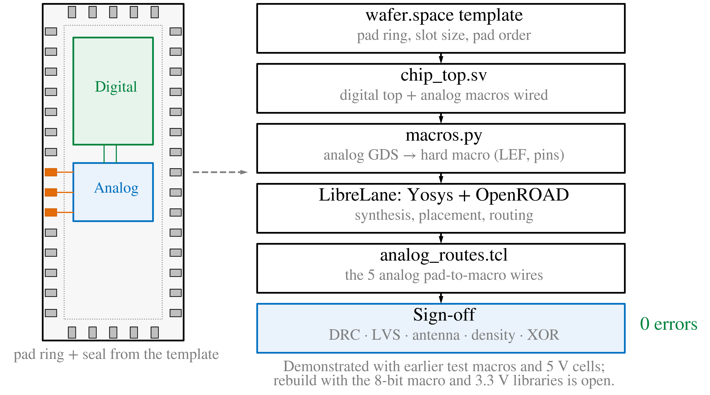

# chip_integration — digital-on-top chip assembly

This folder builds the full chip as one flow: the wafer.space GF180MCU
**1x0p5** pad ring (die 3.932 x 2.531 mm), with the hardened **digital
top** and the **analog top** placed inside as hard macros. It follows the
digital-on-top flow of the CPAD talk figure
([`flow/fig11_digital_on_top.svg`](flow/fig11_digital_on_top.svg)):



The step-by-step results are in **[REPORT.md](REPORT.md)**: every picture
the flow draws, which script made it, and the sign-off numbers.

## Quick start

From the repository root, on the host with Docker. Every EDA tool runs in
the pinned IIC-OSIC-TOOLS container; nothing is installed on the host.

```sh
make pdk                                  # once: the 3.3 V libraries (as_sc, ocd_io)
chip_integration/scripts/run.sh           # everything: macros, chip, renders (~35 min)
```

`run.sh` prints one PASS / FAIL line per criterion and exits non-zero on
any FAIL. It writes its result lines to `final/results-<stage>.txt` and
refreshes `renders/` and `final/`. To run one stage at a time:

```sh
chip_integration/scripts/run.sh macros    # step 3: analog GDS -> hard macro, macro DRC (~3 min)
chip_integration/scripts/run.sh chip      # steps 4-6: LibreLane Chip flow + sign-off (~30 min)
chip_integration/scripts/run.sh renders   # redraw every step picture from the last run (~3 min)
chip_integration/scripts/run.sh collect   # re-read the last run's figures
```

The folder needs only `scripts/eda-common.sh` from the rest of the
repository (the container image, the Docker CLI, the library path).
Optionally, to get a `runs/<target>/<stamp>/metrics.json` record from
`scripts/sim.sh`, add a make target that calls `chip_integration/scripts/run.sh $(STAGE)`.

To refresh the input copies, for example after a new digital layout or a
real analog GDS:

```sh
chip_integration/scripts/fetch_inputs.sh                       # re-copy all three inputs
ANALOG_GDS=x.gds ANALOG_PINS=x.pins.csv chip_integration/scripts/fetch_inputs.sh
```

## What is where

```text
chip_integration/
├── flow/          the flow figure (copied from mixed_signal/cpad_talk/fig_updt)
├── inputs/        the three inputs, copied, with MANIFEST.sha256 (inputs/README.md)
│   ├── digital/     asic_digital_top: GDS, LEF, gate netlist, SDC
│   ├── analog/      wsa_analog_top: GDS + pin contract (PLACEHOLDER layout, no transistors)
│   └── template/    wafer.space template @ 0de7e394: slot, config, PDN, ID cells (ip/)
├── src/           chip_top.sv (pad ring), chip_core.sv (pad map + glue), black box of the digital top
├── librelane/     the LibreLane Chip-flow configuration and its Tcl hooks
├── scripts/       every script of the flow (table below)
├── renders/       one SVG + PNG per step (REPORT.md shows them)
├── final/         the last run's metrics.csv / metrics.json and result lines
└── work/, librelane/runs/   build output, git-ignored
```

| Script | Runs where | Role |
| --- | --- | --- |
| `scripts/fetch_inputs.sh` | host | copies the digital views, the analog GDS and the template files into `inputs/` and writes the manifest |
| `scripts/run.sh` | host | entry point: checks the manifest, runs `build.sh` in the container, judges the result |
| `scripts/container.sh` | host | starts the pinned container with this folder as the working directory |
| `scripts/build.sh` | container | the stages: `macros`, `chip`, `collect`, `renders` |
| `scripts/macros.py` | container (KLayout Python, OpenSTA) | **step 3**: analog GDS → LEF / liberty / Verilog / SPICE black box; digital liberty models; LEF pictures |
| `scripts/digital_timing_model.tcl` | container (OpenSTA) | liberty timing model of the digital top per corner |
| `scripts/macro_check.py` | container (KLayout, Magic) | KLayout `gf180mcu.drc` on the analog GDS; the Magic bbox LibreLane needs |
| `librelane/config.yaml`, `slot_1x0p5.yaml`, `macros.yaml` | container (LibreLane) | **steps 1, 4**: the Chip flow: pad ring, macros, PDN, placement, CTS, routing, fill, sign-off |
| `librelane/pad_cfg.tcl` | inside OpenROAD.PadRing | **step 1**: places the pad ring, adds the AVDD rail-break cells |
| `librelane/pdn_cfg.tcl` | inside OpenROAD.GeneratePDN | **step 4**: power grid, and the hook for the two drawn-wire scripts |
| `librelane/analog_routes.tcl` | inside OpenROAD.GeneratePDN, before pdngen | **step 5**: draws the four analog pad → macro wires |
| `librelane/power_routes.tcl` | inside OpenROAD.GeneratePDN, after pdngen | **step 5**: draws the AVDD / AVSS / DVDD / DVSS straps of the analog macro |
| `scripts/drc_summary.py`, `lvs_summary.py`, `flow-errors.awk`, `step-errors.awk` | container / host | **step 6**: turn DRC, XOR, LVS reports and failures into short lines |
| `scripts/check-chip.awk` | host | acceptance: one PASS / FAIL line per criterion |
| `scripts/render_steps.py` | container (`openroad -python`) | the step pictures, from each step's own OpenROAD database |
| `scripts/render_gds.py` | container (KLayout Python) | GDS pictures of the inputs and of the final chip |
| `scripts/lef_probe.py` | anywhere | size / pins / obstructions of a LEF macro, without reading the LEF |

## Relation to `mixed_signal/top_placement`

`mixed_signal/top_placement` builds the same chip inside the analog tree
and draws its own analog macro. This folder is the stand-alone version.
It reads copied inputs only. It derives the analog macro's LEF from the
analog **GDS**, which is the figure's `macros.py` box, rather than from
the generator: the LEF made from the GDS is byte-identical to the
generator's LEF (REPORT.md). It also draws a picture of every step. The
LibreLane configuration and the Tcl hooks started as copies of
`top_placement`'s, with paths moved to `inputs/`.

## Known limits

Each is repeated in REPORT.md with its consequence:

- the analog macro is a placeholder;
- its pin contract is the v5 interface: twelve S0/S1/S2 pins, driven
  from pads gated by `acquire`. `Analog_top` v7 replaced those pins with
  one `acq` pin and an internal `sample_seq` (ADR 0027), so the contract
  and `chip_core.sv` must change when the real macro arrives;
- no CDM secondary protection;
- the brk5 rail-break cells have not been seen by the provider precheck.

## Verified baseline

The recorded run (2026-11-02, 18/18 PASS, REPORT.md) used:

| Item | Version |
| --- | --- |
| PDK | `gf180mcuD` at Ciel `f6eeac7d` |
| Template | `0de7e394` |
| Container | IIC-OSIC-TOOLS `2026.07` |
| Digital views | `inputs/digital`, copied from the 8-bit digital top of 2026-10-23 |

Since then `main` has moved the PDK to `792ef670` and the template pin to
release `d99f6e1b` (PR #23). It also changed the digital top's
Analog_top interface: synchronous q capture, and the sampling sequence
generated on chip (ADR 0010). This flow has **not** been re-run on those
yet.

The copies in `inputs/` keep the verified state reproducible. To move to
the new baseline:

1. Run `scripts/fetch_inputs.sh`; it reads the template pin from
   `config/wafer_space_run3.mk`.
2. Port `src/chip_core.sv` and the pad map to the new digital interface.
3. Re-run the flow and record the new result.
