# Digital-on-top chip integration: step-by-step report

**Result:** the 1x0p5 chip (die 3932 x 2531 um) passed every gate. It holds
the wafer.space pad ring, the hardened digital top, the analog top GDS and
the five provider ID cells. The gates: KLayout `gf180mcu.drc` 0, routing
DRC 0, Magic/KLayout XOR 0, antenna 0, density after fill 0. Recorded but
not gated: Netgen LVS 0 and setup/hold 0 violations at 9 corners.

**What the result does not cover.** The analog GDS is a **placeholder**:
outline, pins, rings and MIMs, but no transistors. LVS treats both macros
as black boxes. These numbers prove the integration, not the analog
circuit (see [Limits](#limits)).

| | |
| --- | --- |
| Reproduce | `chip_integration/scripts/run.sh` (from the repository root; `make pdk` once before). The record below was taken through a local make target with `./scripts/sim.sh chip-integration`, which wraps the same script |
| Record | `runs/chip-integration/20261102T210337Z/metrics.json` (all stages, 18/18 PASS); earlier chip-stage run `20261102T204028Z` gave identical figures |
| Acceptance | `chip_integration/scripts/check-chip.awk` |
| Tools | IIC-OSIC-TOOLS 2026.07 (pinned in `scripts/eda-common.sh`): LibreLane 3.1.0.dev2, OpenROAD 26Q3-850, Yosys, KLayout, Magic, Netgen, OpenSTA |
| PDK / libraries | `gf180mcuD` at Ciel `f6eeac7d`; `gf180mcu_as_sc_mcu7t3v3`, `gf180mcu_ocd_io` (`make pdk`) |

The flow follows the CPAD talk figure. Each box below is one section of
this report:

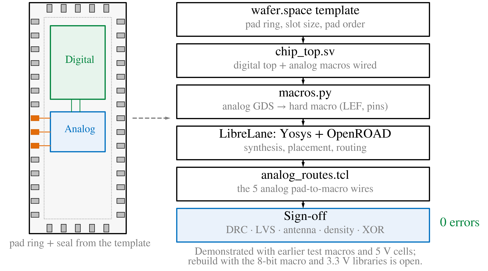

| Figure box | This folder | Tools | Pictures |
| --- | --- | --- | --- |
| *(inputs)* | `scripts/fetch_inputs.sh`, `inputs/` | git, sha256sum | 00a-00c |
| wafer.space template | `inputs/template/`, `librelane/slot_1x0p5.yaml`, `librelane/pad_cfg.tcl` | OpenROAD (PadRing) | 01 |
| chip_top.sv | `src/chip_top.sv`, `src/chip_core.sv` | Verilator (lint), Yosys (synthesis) | 02 |
| macros.py | `scripts/macros.py`, `scripts/macro_check.py`, `scripts/digital_timing_model.tcl` | KLayout Python, KLayout DRC, Magic, OpenSTA | 03a, 03b |
| LibreLane: Yosys + OpenROAD | `librelane/config.yaml`, `macros.yaml`, `pdn_cfg.tcl`, `chip_top.sdc` | LibreLane: Yosys, OpenROAD | 04a-04d |
| analog_routes.tcl | `librelane/analog_routes.tcl` (+ `power_routes.tcl`) | OpenROAD odb Tcl, inside GeneratePDN | 05a, 05b |
| Sign-off | LibreLane's sign-off steps + `scripts/drc_summary.py`, `lvs_summary.py`, `check-chip.awk` | KLayout, Magic, Netgen, OpenROAD STA | 06a-06d |

Every picture is in `renders/` as **SVG and PNG**. The 01-05 pictures
are drawn by `scripts/render_steps.py` from the OpenROAD database each
step left behind (`librelane/runs/chip_top/<NN-step>/chip_top.odb`), so
they show what the tool held at that point, not a re-drawing. The 00 and
06 pictures are KLayout renders of real GDS with the template's layer
colours (`scripts/render_gds.py`). The 03 pictures are drawn from the
LEF files by `scripts/macros.py`.

---

## Step 0: inputs, copied in one place

**Script:** `scripts/fetch_inputs.sh` (host). **Role:** the only script
that knows where the inputs come from. It copies them into `inputs/` and
writes `inputs/MANIFEST.sha256` (40 files). Every run first checks the
folder against the manifest (`inputs_manifest_ok = 1`), so a run is always
built from exactly the files listed. Provenance: [inputs/README.md](inputs/README.md).

| Input | Size | Source |
| --- | --- | --- |
| `inputs/digital/asic_digital_top.gds` (+ `.lef`, `.nl.v`, `.sdc`) | 1.87 MB | `digital/asic_digital_top/physical/final_views` (`make digital-physical`, DRC/LVS/STA clean, `runs/digital-physical/20261023T095022Z`) |
| `inputs/analog/wsa_analog_top.gds` (+ `.pins.csv`) | 0.58 MB | `mixed_signal/top_placement/analog_macro.py` (placeholder) |
| `inputs/template/` | 0.45 MB | `wafer-space/gf180mcu-project-template` @ `0de7e394` (Apache-2.0) |

**00a: the analog GDS** (`render_gds.py inputs`, PDK layer colours).
Outline, the AVDD/AVSS rings, the bus channel, the four 54.5 fF cell MIMs
and the larger MIMs of the bias / ramp / reference blocks. No devices.
The block names are text on a layer the DRC deck does not read.

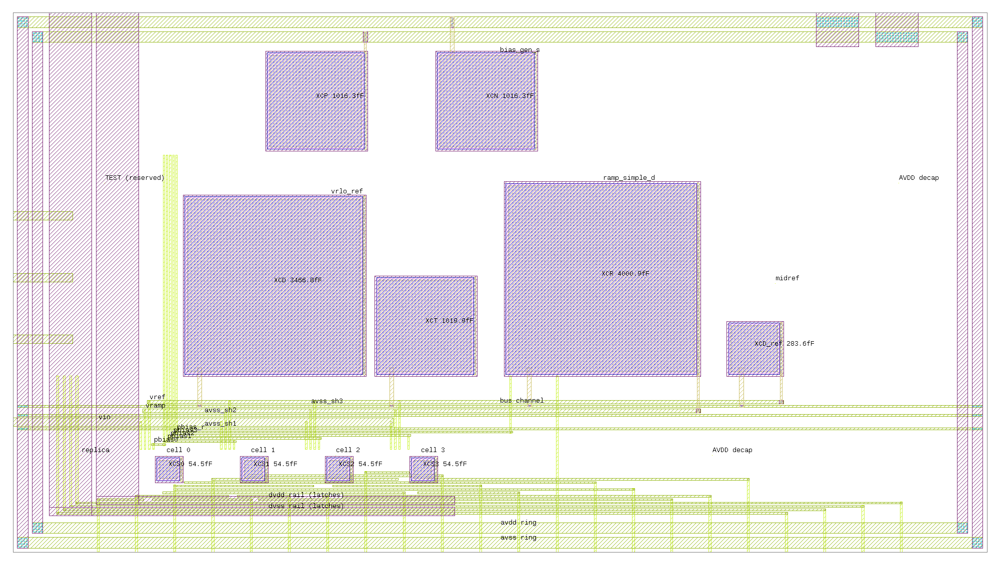

**00b: the digital GDS**, the 8-bit parallel controller and serializer
as hardened by the digital flow (292.35 x 310.27 um).

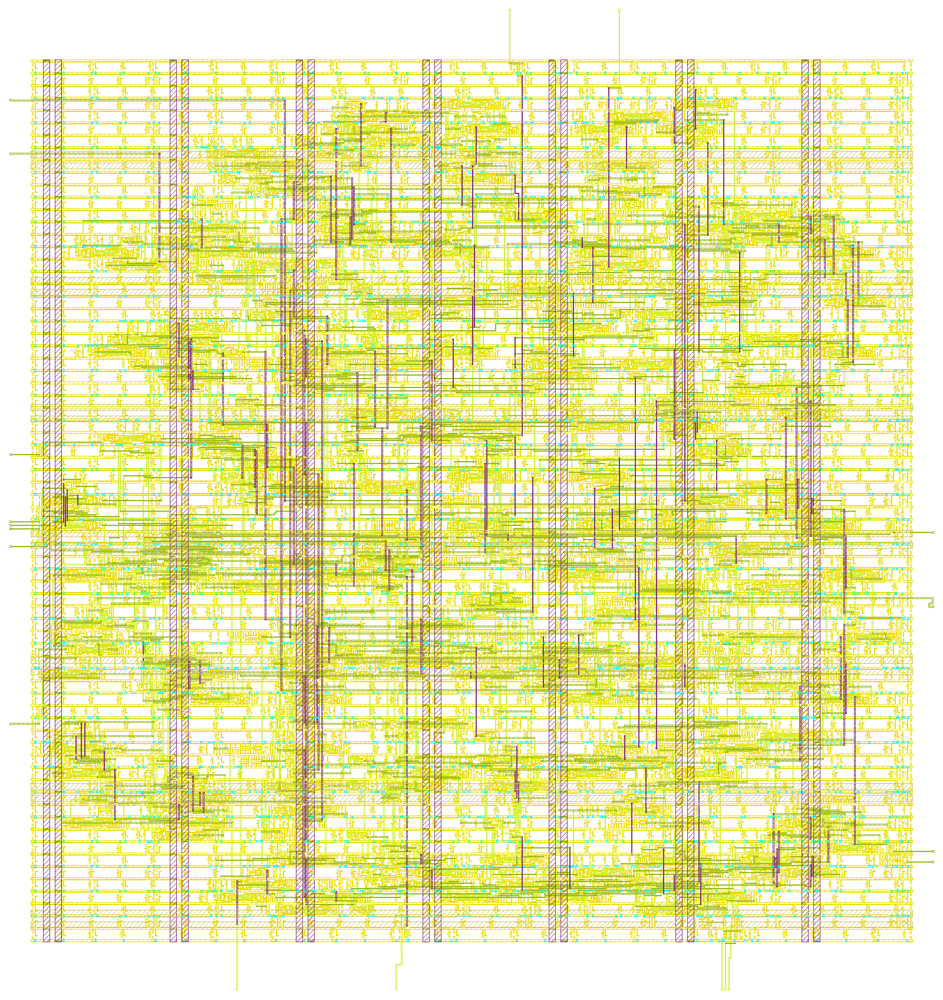

**00c: the provider ID cells** the template requires: QR code, shuttle
ID, project ID, marker, logo.


---

## Step 1: wafer.space template, the pad ring

**Files:**

- `librelane/slot_1x0p5.yaml`: die 3932 x 2531 um, core 442.4-3489.9 x
  443.0-2085.4 um, and the pad order of every side. This is the
  template's file with three instances renamed: `bidir[45]` → `avdd_pad`,
  `bidir[44]` → `avss_pad`, `analog[3]` → `analog3_pad`.
- `librelane/pad_cfg.tcl`: LibreLane's own pad-ring script, plus one
  project change.
- `src/chip_top.sv`: the pad cell of each position.

**Tool:** OpenROAD, step `OpenROAD.PadRing`. It places the pad cells,
corners and fillers and joins the ring rails.

**The project change in `pad_cfg.tcl`: AVDD rail breaks.** Every
`gf180mcu_ocd_io` cell carries the VDD rail from edge to edge. A pad
re-typed as AVDD would short to its neighbours' VDD (OpenROAD error
`PAD-0002`). `pad_cfg.tcl` therefore puts a `brk5` rail-break cell on
each side of `avdd_pad` (`ws_avdd_rail_breaks = 2`).

**01: the ring after PadRing.** Analog pads are orange, AVDD dark red,
core supply red/blue, I/O supply light. The core is still empty.

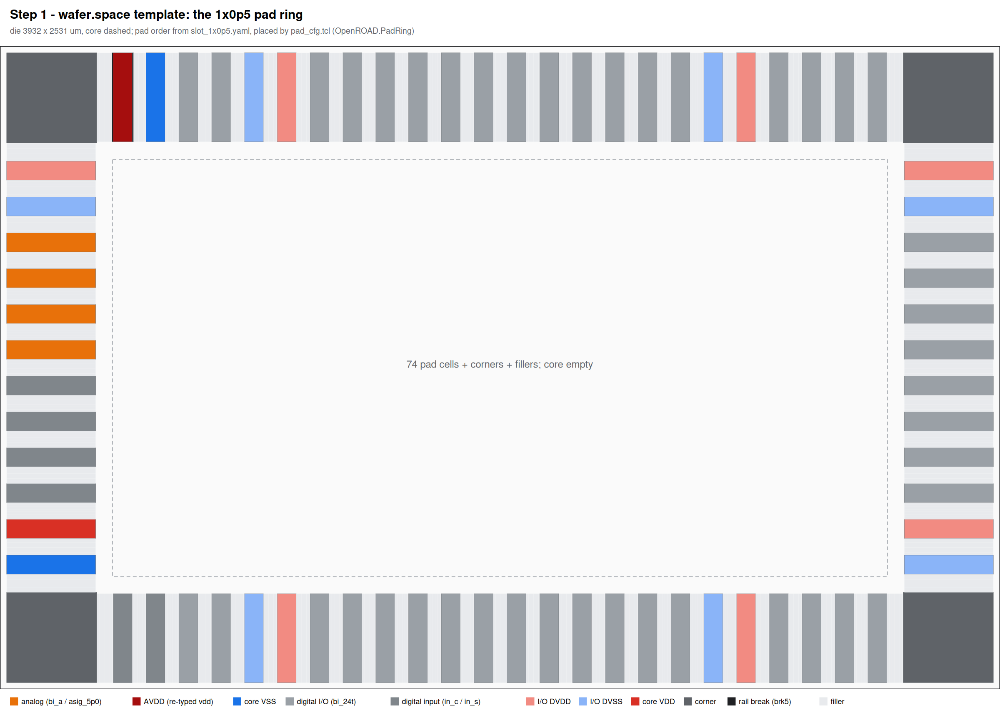 · [SVG](renders/01_template_padring.svg)

---

## Step 2: chip_top.sv, the pads wired to the two macros

**Files:**

- `src/chip_top.sv`: the ring itself (74 pad cells, `ocd_io` only; bi_a
  for the three analog test pads, asig_5p0 for VIN).
- `src/chip_core.sv`: the pad map and the glue. Each pad drives or reads
  a digital or analog macro pin; test mode switches the capture input to
  `ext_compare`; the S0/S2 pads are gated by `acquire`; unused bidir pads
  are tied off.
- `src/asic_digital_top_bb.v`: the black box of the digital macro.

**Tools:** Verilator (lint) and Yosys (synthesis), as LibreLane steps
1-9. Synthesis maps only the glue logic and the pad tie-offs; both
macros stay black boxes.

**02: what each pad reaches.** The labels are **read back from the
synthesised netlist**, not typed in. `render_steps.py` walks from each
pad in signal direction, through glue cells, to the macro pin it ends
on. The straight lines are the connections the router (green / blue) or
the drawn wires (orange) still have to make. The three bi_a pads reach
nothing yet: their `ANA` pin is missing from the pad's liberty, so
synthesis cannot see it. `analog_routes.tcl` connects them in step 5.
The labels agree with the pad map in `src/chip_core.sv`:

- `start`, `shift_en`, `clk` / `cnt_clk`, `rst_n`;
- `serial_data`, `data_ready`, `conversion_*`;
- `acquire`, `ramp_connect`, `ramp_reset`;
- `s0_*`, `s2_*`, `q0..q3`;
- `compare_high[*]` from `test_mode` / `ext_compare`;
- `ramp_sel`, `amon_sel*`, `cmp_sa_en`.

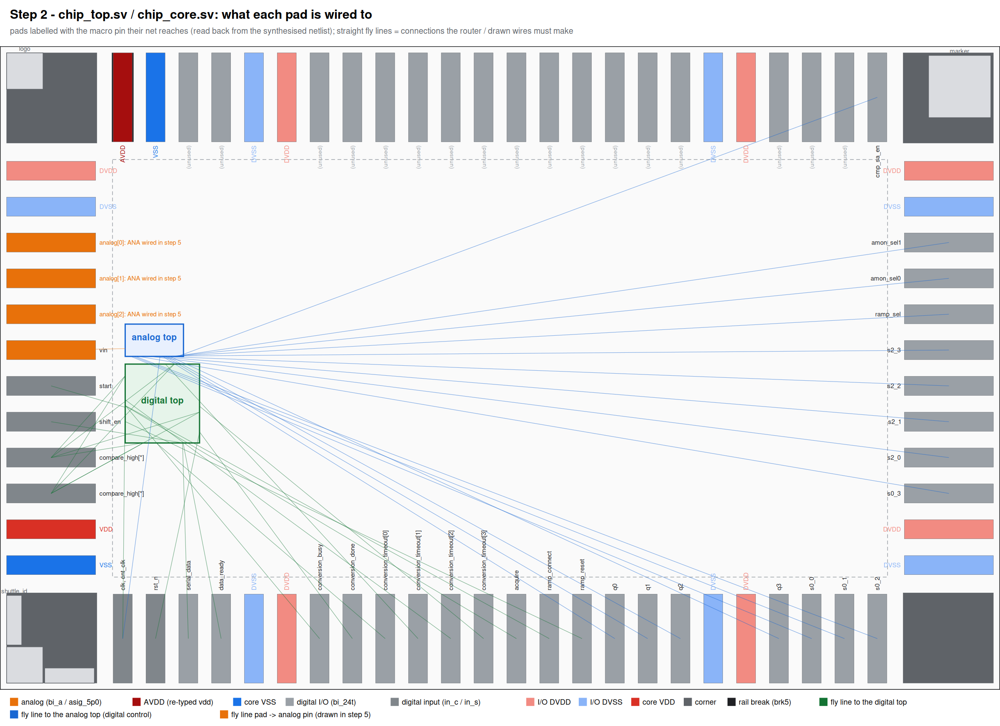 · [SVG](renders/02_chip_top_wiring.svg)

---

## Step 3: macros.py, analog GDS → hard macro

**Scripts** (all run by `scripts/build.sh macros` in the container):

| Script | Tool | What it does |
| --- | --- | --- |
| `scripts/macros.py analog` | KLayout Python | Reads `inputs/analog/wsa_analog_top.gds`. The outline is the PR boundary on 0/0. The pins are the labels on `<metal>/10`, each with the pin shape under it. Writes `work/macros/wsa_analog_top/`: LEF (SIZE, 30 PINs, OBS = Metal1-5 over the outline less the pins, so no router enters the analog block), liberty (directions, no arcs), Verilog black box, SPICE black box (for chip LVS), `pins.json`. Directions, uses and port order come from `inputs/analog/wsa_analog_top.pins.csv`; a pin missing on either side stops the script |
| `scripts/macro_check.py` | KLayout `gf180mcu.drc`, Magic | The PDK's DRC deck on the analog GDS, density apart (density is a die-level rule; the chip fill resolves it). Then LibreLane's own `get_bbox.tcl` in Magic: the four PR-boundary numbers `Magic.StreamOut` needs |
| `scripts/macros.py digital` + `scripts/digital_timing_model.tcl` | OpenSTA | The digital top is used **as is** (its GDS, LEF, netlist). Its final views have no liberty, and without one chip STA would black-box it. `write_timing_model` makes one per corner (tt / ff / ss) from its gate netlist: cell delays only, no wire delay |
| `scripts/macros.py svg` | Python, cairosvg | The two LEF pictures below |

**Evidence** (`runs/chip-integration/20261102T210337Z/metrics.json`):

| Criterion | Result |
| --- | --- |
| contract pins found in the GDS | 30 / 30 (22 Metal2 south, 4 Metal3 west, 4 Metal4 north) |
| KLayout `gf180mcu.drc` on the analog GDS, density apart | **0** |
| density rules on the macro alone (reported, die-level) | 7 rules (DCF.1b, M1.4, M2.4, M3.4, M5.4, MT.3, PL.8); the chip fill clears them |
| Magic bbox fields | 4 of 4 (0, 0, 229.2, 127.1 um) |
| digital liberty models | 3 of 3 |

**Cross-check (one-off, this session).** The LEF and liberty made from the
GDS are **byte-identical** to the ones the generator writes directly. The
Verilog and SPICE black boxes are identical apart from their comment
lines. So the GDS carries the whole interface, and a real analog GDS with
the same labelling will drop in. Command:
`cmp chip_integration/work/macros/wsa_analog_top/lef/wsa_analog_top.lef mixed_signal/top_placement/work/macros/wsa_analog_top/lef/wsa_analog_top.lef`.

**03a: the analog macro as the router sees it.** Grey is the
obstruction; the coloured squares are the pins: four Metal3 analog pins
west, 22 Metal2 controls south, four Metal4 supplies north.

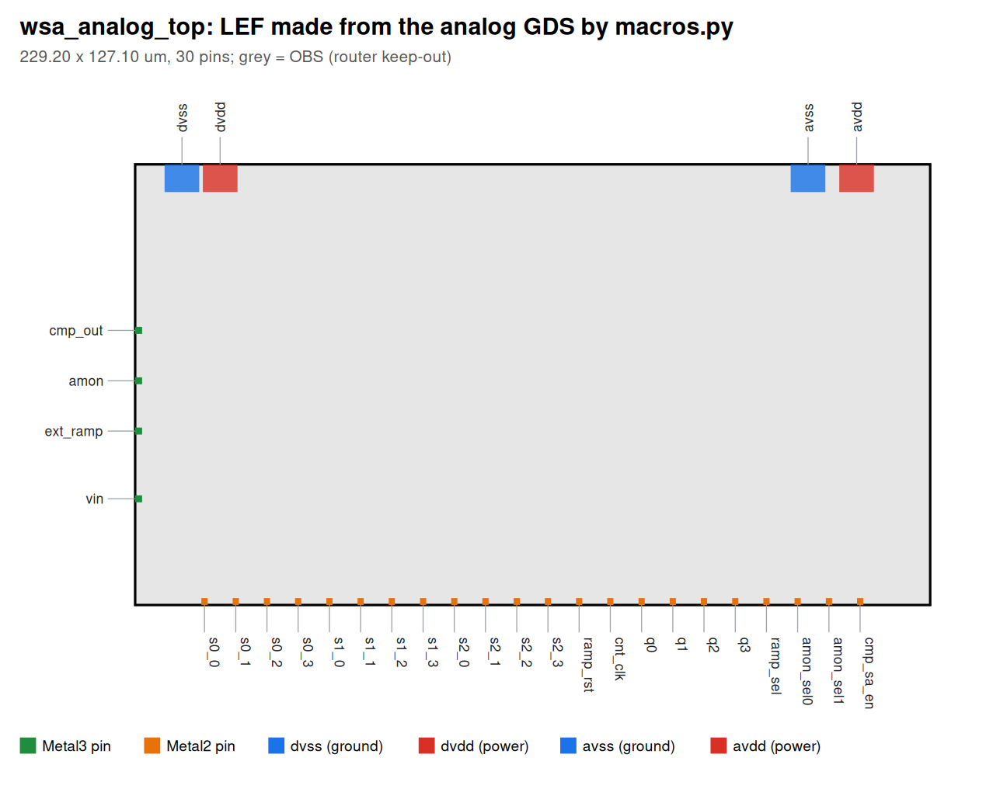 · [SVG](renders/03a_analog_macro_lef.svg)

**03b: the digital macro as the router sees it.** 21 signal pins, and
the VDD (red) / VSS (blue) straps on Metal4 / Metal5 that the chip grid
connects to.

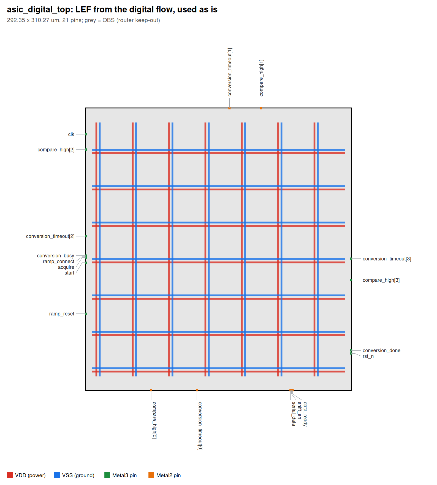 · [SVG](renders/03b_digital_macro_lef.svg)

---

## Step 4: LibreLane, Yosys + OpenROAD

**Command (inside `scripts/build.sh chip`):**

```sh
librelane --manual-pdk --pdk-root /foss/pdk_libs -p gf180mcuD \
    -s gf180mcu_as_sc_mcu7t3v3 --pad gf180mcu_ocd_io \
    slot_1x0p5.yaml macros.yaml config.yaml
```

That is LibreLane's **Chip** flow, 76 steps, 21.6 min of step time on
this host. The three YAML files layer on top of each other:

| File | Role |
| --- | --- |
| `librelane/config.yaml` | the template's Chip-flow config, adapted. It names the 3.3 V library set, `PAD_CFG` and `PDN_CFG`, the bi_a pad terminal and the 20 MHz clock. It sets two kinds of keep-out for the drawn wires: `FP_OBSTRUCTIONS` (no cell rows in the analog wire channel or under the AVDD strap) and `PDN_OBSTRUCTIONS` (no core straps in the drawn Metal4 columns). Signoff is KLayout's, so Magic DRC is switched off |
| `librelane/slot_1x0p5.yaml` | die, core, pad order (step 1) |
| `librelane/macros.yaml` | where each hard macro goes and which files it comes from. Digital at (492.24, 970.48), analog directly above at (492.24, 1310.96), both snapped to the 0.56 um routing pitch from `mixed_signal/chip_floorplan`. The five ID cells sit at the template's positions. Power hook-up: the digital macro joins the core grid; `avdd_pad` sits on AVDD |
| `librelane/chip_top.sdc` | 20 MHz conversion clock, asynchronous comparator-event clocks |

**04a: floorplan, after `OpenROAD.TapEndcapInsertion`.** Both macros and
the ID cells are placed. The yellow bands are the standard-cell rows;
there are no rows in the strip west of the macros, where the analog wires
will run.

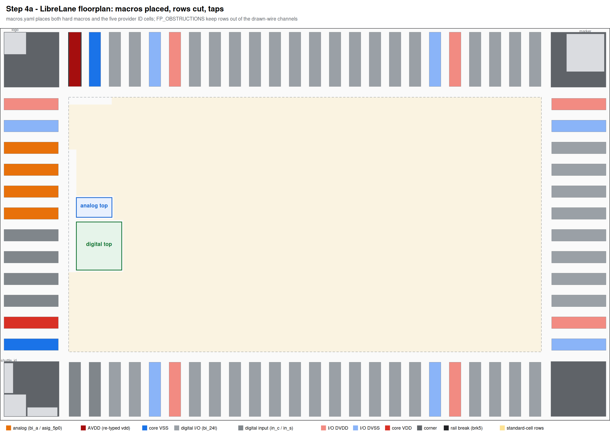 · [SVG](renders/04a_floorplan_macros.svg)

**04b: power grid, after `OpenROAD.GeneratePDN` with
`librelane/pdn_cfg.tcl`.** That file is the template's PDN script with
the SRAM grids removed. It builds a 25 um core ring and 5 um Metal4 /
Metal5 straps at a 75 um pitch, and a macro grid on the digital top only
(Via4 where the core straps cross its Metal4 straps). The analog macro
is in no grid: its OBS covers Metal1-5, and any grid over it stops
pdngen (`PDN-0006`). Its supplies are drawn instead (step 5).
`pdn_cfg.tcl` also hooks the two drawing scripts into this same step,
`analog_routes.tcl` before pdngen and `power_routes.tcl` after it. Their
wires (orange, dark red) are therefore already in this database.

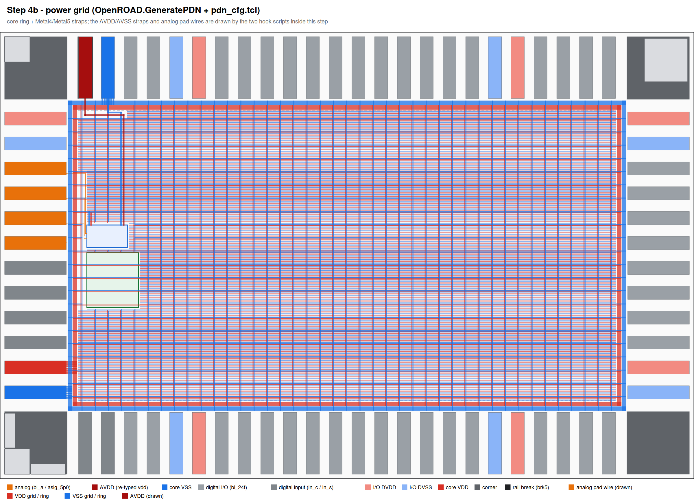 · [SVG](renders/04b_power_grid.svg)

**04c: placement and clock tree, after `OpenROAD.CTS`.** Global and
detailed placement, then CTS (clock buffers in red). The cells are the
`chip_core` glue: pad control ties, test-mode muxes, the acquire gates
and buffers, placed where their pads and macro pins pull them.

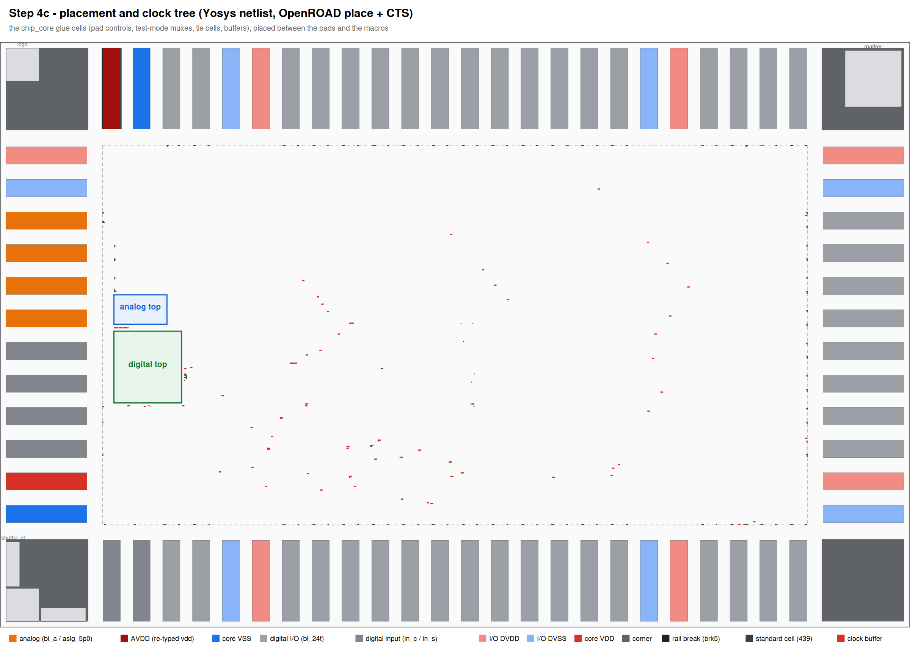 · [SVG](renders/04c_placement_cts.svg)

**04d: routing, after `OpenROAD.DetailedRouting`.** Every chip-level
signal wire, coloured by metal (Metal2 vertical, Metal3 horizontal). The
drawn analog wires and the AVDD strap are shown too; the router treats
them as obstacles, since special nets are never re-routed.

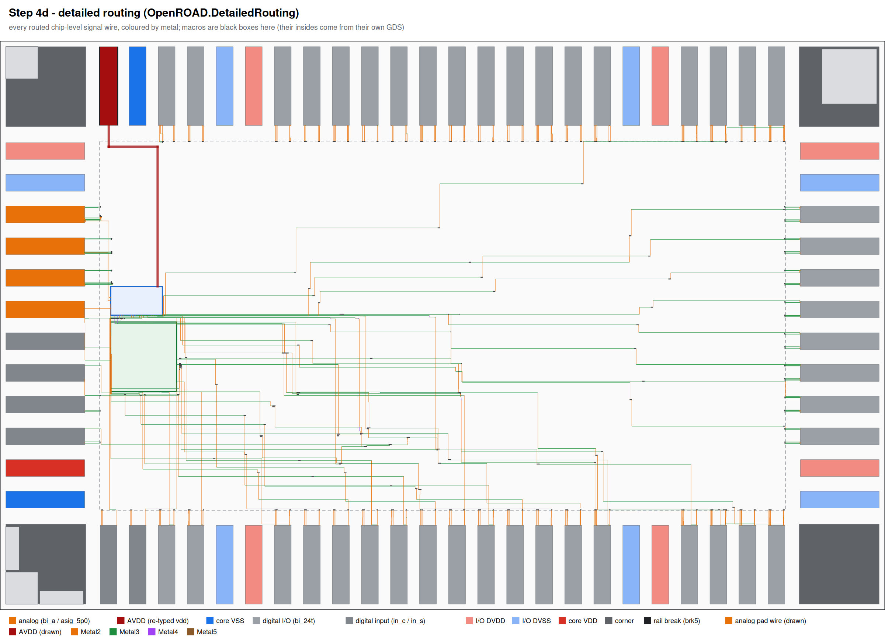 · [SVG](renders/04d_routing.svg)

After routing, LibreLane inserts fill cells, extracts parasitics
(`OpenROAD.RCX`), runs post-route STA at nine corners, and streams out
with both Magic and KLayout. It then adds the seal ring
(`KLayout.SealRing`) and metal fill (`KLayout.Filler`) before sign-off
(step 6).

---

## Step 5: analog_routes.tcl, the drawn analog wires

**Why drawn, not routed (ADR 0009).** The routers skip the special nets
that PadRing makes of analog pad terminals. When those nets were
un-specialised, they crashed detailed routing in the earlier 0p5x1 chip.
An analog net wants a drawn wire anyway: short, 1.2 um wide, no buffers,
no router-inserted antenna diodes.

**`librelane/analog_routes.tcl`** runs inside `OpenROAD.GeneratePDN`,
before pdngen, through OpenROAD's odb Tcl API. It writes the wires as
fixed special wiring, which every later step leaves alone. For each of
the four west analog pads it:

1. connects bi_a's `ANA` to the macro pin's net, because synthesis could
   not see `ANA`;
2. marks the net special;
3. draws Metal2 over the pad finger, Via2, Metal3 east to the net's own
   jog column (x 476 / 480 / 484 um), a Metal2 jog to the pin's height,
   and Metal3 onto the macro's west pin.

The higher the pad, the further east its jog, so no two wires cross. VIN
lines up with its pin and needs no jog. If an assumption fails (pad not
on the west edge, pin missing, no room), the script stops the step rather
than draw anything.

| Pad | Cell | Macro pin | Drawn (from the PDN log) |
| --- | --- | --- | --- |
| `analog3_pad` | asig_5p0 | `vin` | straight at y 1341.60 |
| `analog[2]` | bi_a | `ext_ramp` | pad y 1448.22 → jog x 476.0 → pin y 1361.12 |
| `analog[1]` | bi_a | `amon` | pad y 1589.22 → jog x 480.0 → pin y 1375.65 |
| `analog[0]` | bi_a | `cmp_out` | pad y 1730.22 → jog x 484.0 → pin y 1390.18 |

**`librelane/power_routes.tcl`** runs right after pdngen, reading the
grid that pdngen just built. It draws the analog macro's four supplies:

| Strap | Path |
| --- | --- |
| AVDD | `avdd_pad` → Metal2 under the core ring → Metal5 east at y 2055.4 → Metal4 down x 695.24-705.24 onto the pin (36 via blocks) |
| AVSS | `avss_pad` → Metal3 at y 2070.4 → Metal4 down x 681.24-691.24 (18 via blocks) |
| DVSS | Metal4 x 500.74-510.74 up to the first VSS Metal5 strap (3 Via4 blocks) |
| DVDD | Metal4 x 511.74-521.74 up to the first VDD Metal5 strap (3 Via4 blocks) |

Gates: `ws_analog_routes = 4`, `ws_supply_straps = 4`.

The figure's box reads "the 5 analog pad-to-macro wires". This chip
draws four signal wires (VIN, EXT_RAMP, AMON, CMP_OUT) plus the AVDD and
AVSS supply straps; the figure predates the current pad map.

**05a: the four drawn analog wires, zoomed** (database after
GeneratePDN; Metal2 orange, Metal3 green).

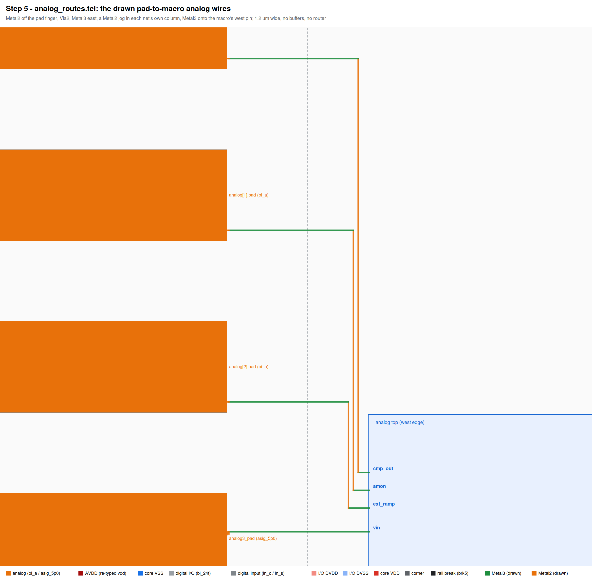 · [SVG](renders/05a_analog_routes_zoom.svg)

**05b: the drawn supply straps.** `avdd_pad` sits between its two
`brk5` cells (black). The AVDD strap (dark red) crosses the core ring and
grid with no via down to the analog macro. AVSS joins from the
neighbouring VSS pad, and DVDD / DVSS come up from the core grid.

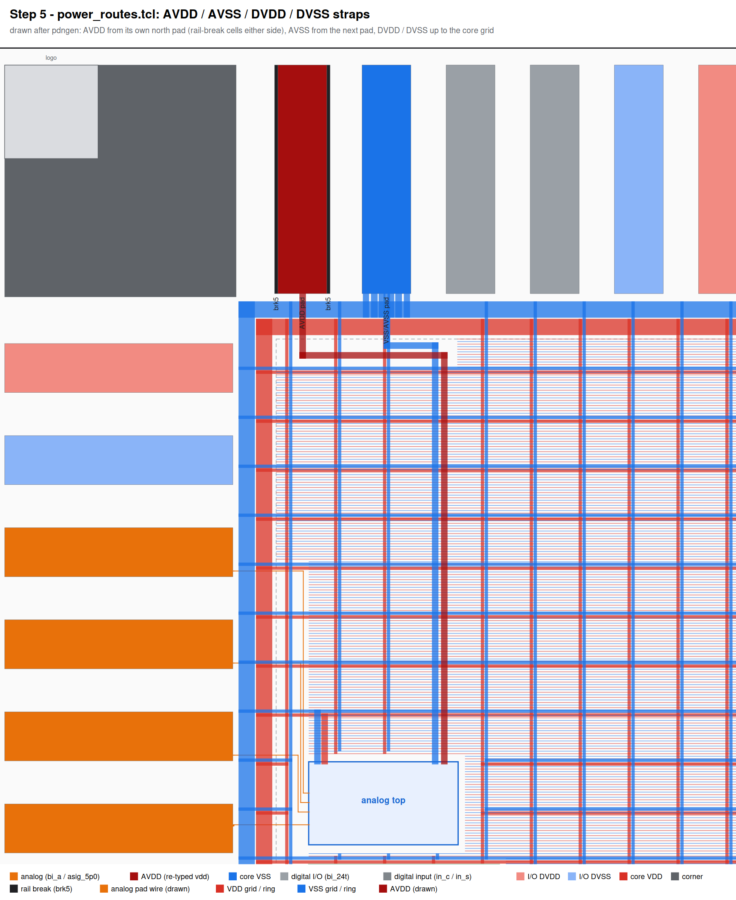 · [SVG](renders/05b_supply_straps_zoom.svg)

The same wires in the final GDS (KLayout, real layers):
[06c](renders/06c_chip_analog_wires_zoom.png),
[06d](renders/06d_chip_supply_straps_zoom.png).

---

## Step 6: sign-off

LibreLane's sign-off steps run on the sealed and filled GDS. The project
scripts only turn their reports into short lines (`drc_summary.py`,
`lvs_summary.py`, `flow-errors.awk`, `step-errors.awk`), and
`check-chip.awk` judges them.

| Check | Tool / step | Gate | Result |
| --- | --- | --- | --- |
| LibreLane Chip flow | all 76 steps | exit 0, no deferred errors | **PASS** |
| detailed-routing DRC | OpenROAD `DetailedRouting` | 0 | **0** |
| disconnected critical pins | `Odb.ReportDisconnectedPins` | 0 | **0** |
| full-chip DRC | KLayout `gf180mcu.drc` (PDK deck; antenna, density apart) | 0 | **0** |
| stream-out XOR | Magic GDS vs KLayout GDS | 0 | **0** |
| antenna | KLayout antenna deck | 0 | **0** |
| density after fill | KLayout density deck | 0 | **0** |
| LVS (both macros black boxes) | Magic extraction + Netgen | reported | **0 errors, 0 unmatched nets / devices** |
| setup / hold, 9 corners | OpenROAD STA after RCX | reported | **0 / 0**; worst slack +19.26 / +0.549 ns (tt: +23.67 / +1.18) |
| max slew / cap / fanout | OpenROAD STA | reported | 15 / 106 / 1 (see [Limits](#limits)) |
| chip GDS | `final/gds/chip_top.gds` | written | 148 MB |

Cells: 33 134 standard-cell instances, almost all well taps; the glue
is 105 logic and buffer cells plus 334 tie cells after routing. There
are 760 pad-ring cells and 7 macros. Routed: 114.6 mm of wire, 1 220
vias. The sign-off counts, both slacks and the slew / cap / fanout counts
equal the `mixed_signal/top_placement` record of the same chip
(`runs/top-placement/20261023T093027Z`, which repeats the
`top-placement-v2` record line for line).

**06a: the finished chip** (KLayout, final GDS with seal ring and fill).

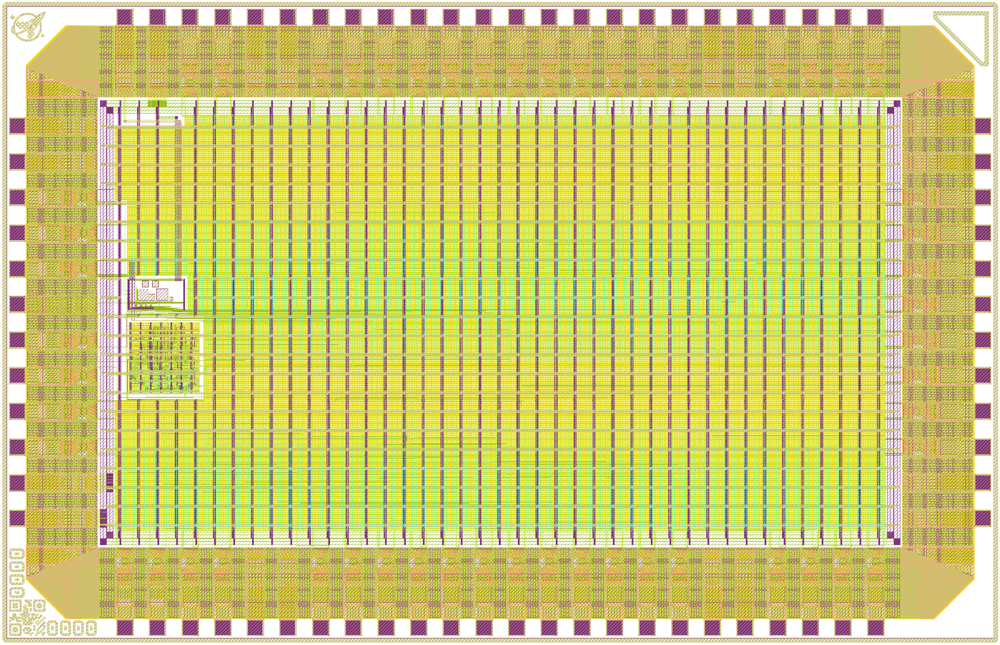

**06b: the two macros in the final GDS.** The analog macro (top) shows
its MIMs and rings; the digital macro (bottom) shows its routed
standard cells. The core grid stops at the analog macro.

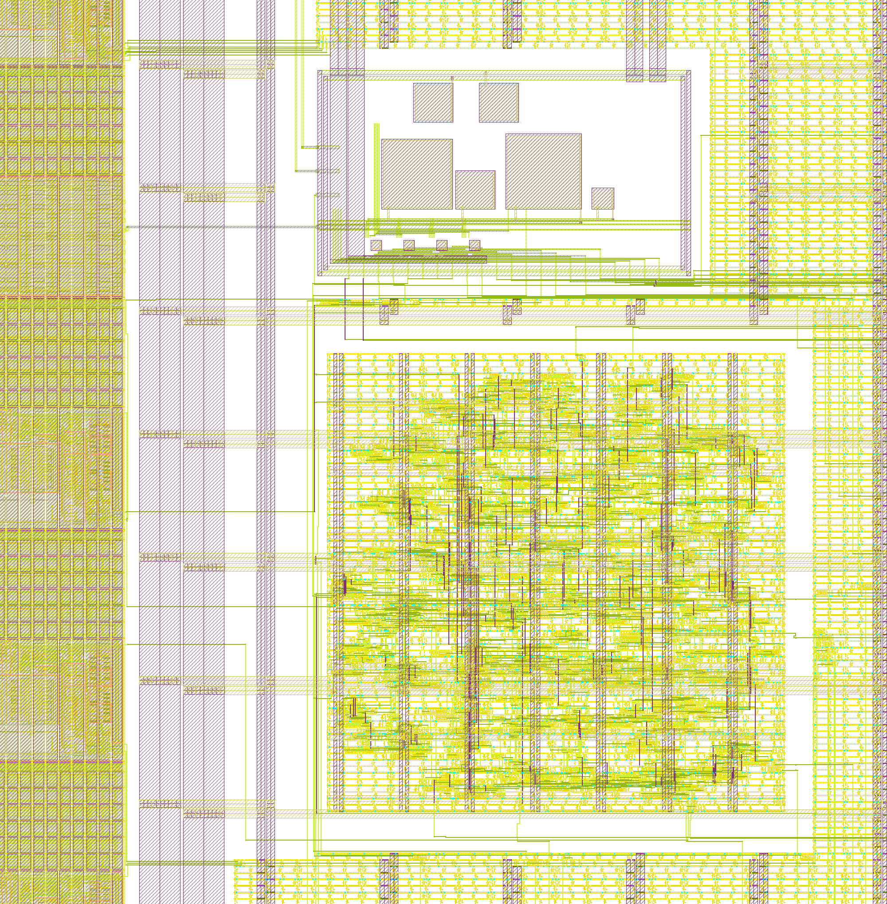

---

## How to recreate it

1. **Once, on a new machine.** Install the frozen libraries with
   `make pdk`. `scripts/eda-common.sh` holds the path (`PDK_LIBS_ROOT`)
   and mounts it read-only as `/foss/pdk_libs`. The container image is pulled on first use. Check
   the setup with `./scripts/sim.sh check`.
2. **Inputs.** They are committed in `inputs/`, so nothing needs
   fetching. To refresh them from the repository and the template, run
   `chip_integration/scripts/fetch_inputs.sh` (it needs the network once
   for the template clone).
3. **Run.** `chip_integration/scripts/run.sh` runs every stage (about
   35 min). It prints one PASS / FAIL line per criterion above, exits
   non-zero on any FAIL, and keeps its lines in
   `final/results-all.txt`. Through `scripts/sim.sh` (with a make
   target that calls `run.sh`) the same lines land in
   `runs/<target>/<stamp>/metrics.json`.
4. **Look.** `chip_integration/renders/` holds every picture of this
   report. The chip GDS is at
   `chip_integration/librelane/runs/chip_top/final/gds/chip_top.gds`
   (148 MB, not committed). Open it with KLayout, using the layer file
   `inputs/template/librelane/gf180mcu_render.lyp`.
5. **Change something.**
   - A new analog layout: `ANALOG_GDS=... ANALOG_PINS=... scripts/fetch_inputs.sh`, then `run.sh macros`, then the full run.
   - A moved macro: `librelane/macros.yaml`. Keep `FP_OBSTRUCTIONS` / `PDN_OBSTRUCTIONS` in `config.yaml` and the jog columns in `analog_routes.tcl` consistent with it.
   - A changed pad map: `src/chip_core.sv`, and `slot_1x0p5.yaml` if a pad cell type changes.

   Then `run.sh renders` redraws the pictures from the new run.

| Stage | Command | Time | Writes |
| --- | --- | --- | --- |
| macros | `chip_integration/scripts/run.sh macros` | ~3 min | `work/macros/`, `renders/03*` |
| chip | `chip_integration/scripts/run.sh chip` | ~25-30 min | `librelane/runs/chip_top/`, `final/metrics.*` |
| renders | `chip_integration/scripts/run.sh renders` | ~3 min | `renders/*` |
| collect | `chip_integration/scripts/run.sh collect` | seconds | re-reads the last chip run |

---

## Limits

These are what the 0-error result does **not** say:

- **The analog macro is a placeholder** (no transistors or resistors).
  Its DRC 0 and the chip LVS 0 prove the integration, not the analog
  design. LVS sees both macros as black boxes. The digital macro was
  LVS-clean in its own flow; the analog one has no circuit to compare.
- **The macro's pin contract is the v5 interface**: twelve S0/S1/S2
  controls from pads gated by `acquire`. `Analog_top` v7 moved the
  sampling sequencer inside the macro, with one `acq` pin (ADR 0027).
  When its layout exists, the contract CSV, `chip_core.sv` and the south
  pad map change with it.
- **Digital macro timing is approximate**: the liberty is cell delays
  from the gate netlist, without the macro's own wire parasitics.
- **max cap / max slew (106 / 15)** are reported, not gated, and were not
  investigated here. They equal every earlier record of this chip.
- **The brk5 rail-break cells** around AVDD have not been through the
  provider precheck yet.
- **No CDM secondary protection** is drawn at VIN (asig_5p0).
