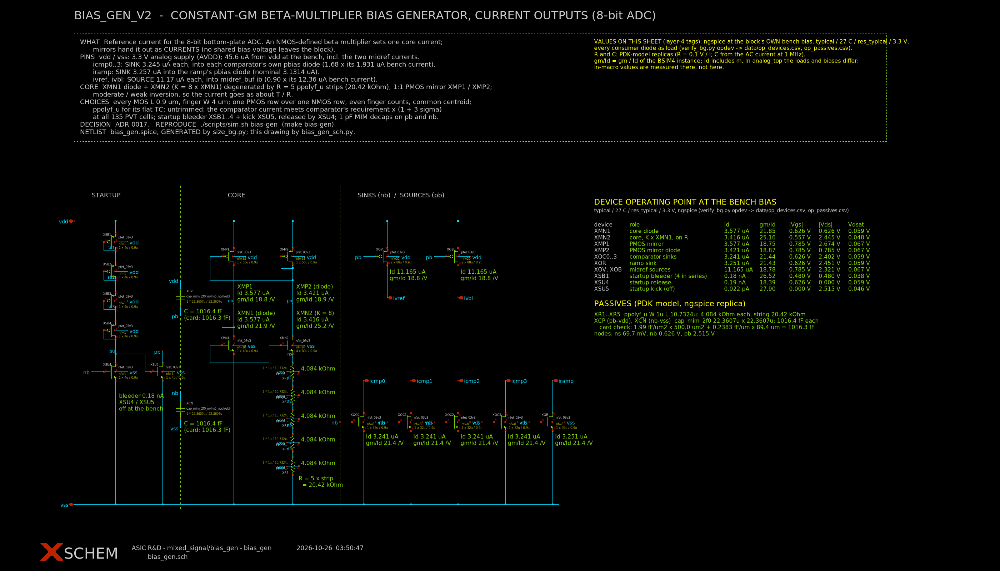
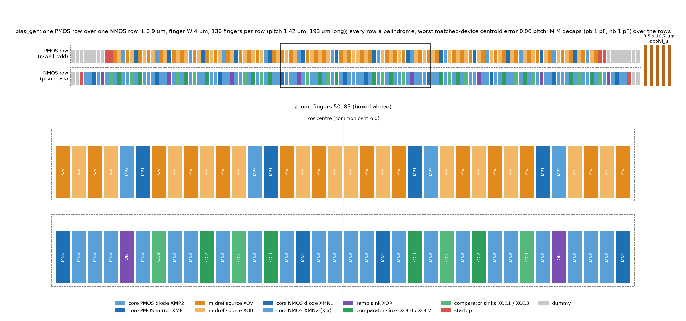

# bias_gen — short-L constant-gm bias generator with current outputs

The bias reference of the 8-bit bottom-plate ADC, re-sized on 2026-10-08:

- **Rules [U]:** gm/Id + matching, every L below 1 µm, W split into
  fingers, every device in one PMOS row above one NMOS row.
- **Consumers:**
  - four `comparator` comparators (`../comparator`);
  - the two `midref_v2` buffers, VREF and VBL (`../midrail_ref_bkp/midrail_ref_v2`);
  - the ramp (`../ramp_gen`).

`../bias_gen_bkp/bias_gen` (the old configuration S) is unchanged. Decisions:
[ADR 0017](../../docs/decisions/0017-bias-gen-v2-current-outputs.md).




```spice
.include /foss/designs/mixed_signal/bias_gen/bias_gen.spice      ; needs the res_* and mimcap_* model sections
XBG vdd vss icmp0 icmp1 icmp2 icmp3 iramp ivref ivbl bias_gen
```

| Port | Direction | Into | Typical |
| --- | --- | --- | --- |
| `icmp0..3` | sink | each comparator's own pbias diode, `pfet_03v3 L=0.28u W=1u nf=1` in its cell (= v3's bench `XREFP`) | 3.245 µA = 1.681 × 1.931 µA |
| `iramp` | sink | the ramp's diode `pfet_03v3 L=1u W=20u nf=10` (its `pbias`) | 3.257 µA (+4.0 % of 3.1314) |
| `ivref`, `ivbl` | source | `midref_buf` port `ib` (its NMOS diode XMBN) | 11.17 µA = 0.903 × 12.36 µA |

## Run it

```sh
./scripts/sim.sh bias-gen                                            # lut verify floorplan schematic (~25 min)
./scripts/sim.sh bias-gen PHASES='lut size verify floorplan schematic'  # also re-run the search, which must reproduce bias_gen.spice
```

The record is `runs/bias-gen-v2/<stamp>/metrics.json`.
The verify flow's `opdev` phase (2026-10-10) records an operating point at the
bench bias. It writes Id, gm/Id and Vdsat per MOS to `data/op_devices.csv`, and
R and C from PDK-model copies to `data/op_passives.csv`. `bias_gen_sch.py`
prints these values on the sheet.
`./container.sh '<cmd>'` runs one command in the pinned container.
`../comparator`, `../midrail_ref_bkp/midrail_ref_v2`, `../ramp_gen` and
`../bias_gen_bkp/bias_gen` are read by path and never written.

## Topology

```text
 vdd ─┬──────────┬────────────┬──────────────┬─────────────┐
   bleeder     XMP1 ─── pb ── XMP2 (diode)  XOV, XOB (pb)   MIM pb→vdd
  4 PMOS diodes  │             │              → ivref, ivbl
      su        nb            pb
   XSU4 (g=nb)  XMN1 (diode)  XMN2 (K×XMN1, source on R)     XOC0..3, XOR (nb)
   XSU5 (g=su,                 │                              → icmp0..3, iramp
   kicks pb)                  R = 5 ppolyf_u strips           MIM nb→vss
 vss ─┴──────────┴─────────────┴──────────────────────────────┘
```

- **Core.** An NMOS-defined beta multiplier in moderate/weak inversion
  (XMN1 gm/Id 20), so the current goes as about T/R:
  - it rises with temperature, as comparator's requirement does
    (1.05×, 1.10× and 1.20× at ss/0, 27 and 85 °C);
  - it depends on R only to the first power (dlnI/dlnR = −1.13), not the
    second as in strong inversion.
- **Resistor.** ppolyf_u, the flattest temperature coefficient of the PDK
  resistors: −0.7 % over 0–85 °C, ±20 % process (`data/res_char.csv`).
- **Outputs.** Mirrors of `nb` (sinks) and `pb` (sources) at the core's
  finger current, so no extra legs.
- **No cascodes.** Line regulation is 14 %/V. A cascoded core would gain
  about 4 % of comparator current at 3.0 V; the extra leg costs about the
  same power.

## Sizing (size_bg.py)

Stage A works from tables (`lut/build.sh`: gm/Id at L 0.4–0.9 µm and
finger W 1/2/4 µm from ngspice). It enumerates:

- one L and one finger width for both rows;
- K, the core, mirror and ramp finger counts (all even [U], so every
  matched device splits about the row centre).

For each candidate it computes:

- gm/Id per role;
- R, from the table loop equation;
- **Pelgrom mismatch** with the PDK pair coefficients:
  - core: ΔVt(XMN1, XMN2) and the PMOS mirror error, through the loop
    sensitivity;
  - per output: gm/Id × σΔVt ⊕ σβ;
- the row lengths, with both rows padded to the same finger count;
- a 1/f proxy of the ramp line.

Stage B (ngspice) runs on 60 front points. Each one:

- tunes the resistor so the ramp current sits within ±5 % of 3.1314 µA;
- measures the comparator output at all 135 cells against
  `comparator/data/bias_req.csv` (drawn geometry) and takes
  s_pvt = max(required / delivered);
- sets the comparator fingers to the smallest even count with
  s ≥ s_pvt × (1 + 3σ × 1.06), where 1.06 is the MC/Pelgrom ratio of the
  first selection [M];
- measures the ramp-line noise. The candidate is kept only if the ramp-bias
  noise share is ≤ 0.099 LSB: the 0.110 allocation (NOISE_BUDGET row 4)
  less 10 % for the VACASK/analysis ratio.

The selection is the kneedle point of the (area, comparator system power)
front:

| | |
| --- | --- |
| L / finger W | 0.9 µm / 4 µm, every MOS |
| K | 8 |
| core | XMN1 10 fingers, XMN2 80, XMP1 = XMP2 14; 3.58 µA per branch |
| sinks | 8 fingers per comparator, 8 for the ramp |
| sources | 44 fingers per midref buffer |
| startup | 4 PMOS diode fingers, XSU4 / XSU5 1 finger each |
| R | 5 × 10.73 µm ppolyf_u, W 1 µm (≈ 20 kΩ) |
| decaps | 1 pF MIM pb→vdd, 1 pF nb→vss, over the rows |
| rows | 136 fingers each, pitch 1.42 µm, 193 µm long; ≈ 2870 µm² with R |

The front is flat past the knee. Doubling the area to about 5200 µm² saves
3 % of comparator power (`data/stage_b.csv`).

## Floorplan (floorplan.py)

- Each row is a palindrome. Every matched device's fingers are split
  evenly into the two halves and interleaved, so every centroid sits on
  the row centre (worst error 0.00 pitch).
- The startup devices sit outside the matched block.
- Dummies sit at both ends, and the shorter (PMOS) row is padded to the
  NMOS row's 136 fingers.
- The finger order is `data/rows.txt`.
- The pitch (L + 0.52 µm contacted S/D) and the row overhead are [A].
  There is no GDS yet.

## Results

`runs/bias-gen-v2/20261008T102101Z/metrics.json`:

| Gate | Result |
| --- | --- |
| Operating point, 135 cells | every matched device ≥ 382 mV in saturation; startup node ≤ 15 mV; bleeder ≤ 127 nA |
| Comparator current vs requirement (mismatch-free) | worst 1.144 at ss/0 °C/res_ss/3.0 V |
| … with 3σ mismatch (MC σ 4.74 %) | 1.144 ≥ 1.142 PASS |
| Startup: 100 ns / 10 µs / 1 ms ramps and a forced dead state, 135 cells each | 180/180 back to the operating point within 1 %; the kick-less control stays dead |
| Monte Carlo, 200 draws, reproducible | comparator output 4.74 % (core 3.42 %, per output 2.32 %), Pelgrom 4.76 % |
| Ramp-bias noise share at code 255 | 0.095 LSB (line noise 1.18 × the old bias_gen) ≤ 0.099 |
| comparator on this generator, 135 cells | delay from the static trip ≤ 11.64 ns (12.5 limit); typical 8.59 ns, 111 µW |
| Four comparators, three aggressors 1 LSB early | victim moves ≤ 0.0006 LSB (old shared pbias: −0.165) |
| midref_v2 on this generator, 135 cells | follower headroom ≥ +41 mV, VDD/2 error ≤ 9.5 mV; S2 kick back within 8 ns at the extreme-current cells |
| Schematic | `bias_gen.sch` netlists back: 24 instances, ports, nodes and every parameter |

Reported, not gated:

- **Spans over 135 cells:** comparator 0.71–1.55× typical, ramp
  0.74–1.62× nominal, midref 0.66–1.38× nominal.
- **Line regulation:** 14 %/V.
- **Comparator dout fall:** up to 11.6 ns (waived over PVT, ADR 0015).

## Open

- **Comparator power.** About 1.7× is the price of an untrimmed
  resistor. A 2-bit trim on the R strips would bring it to about 1.15×.
- **Ramp range.** The ramp current runs 0.74–1.62× over PVT. Below about
  0.93× the ramp does not reach 2.0 V in 276 counts, so its trim or
  calibration is needed for range, not just gain.
- **Ramp noise in the ramp's own kernel.** The noise gate scales the old
  share by the line-noise ratio. The ramp's noise bench was not re-run on
  this generator.
- **Remaining layout work:** PEX, GDS, and repointing `unit_cell_bps`.
- **Local resistor mismatch.** ppolyf_u carries only global variation in
  the PDK model, so it is not in the MC.
