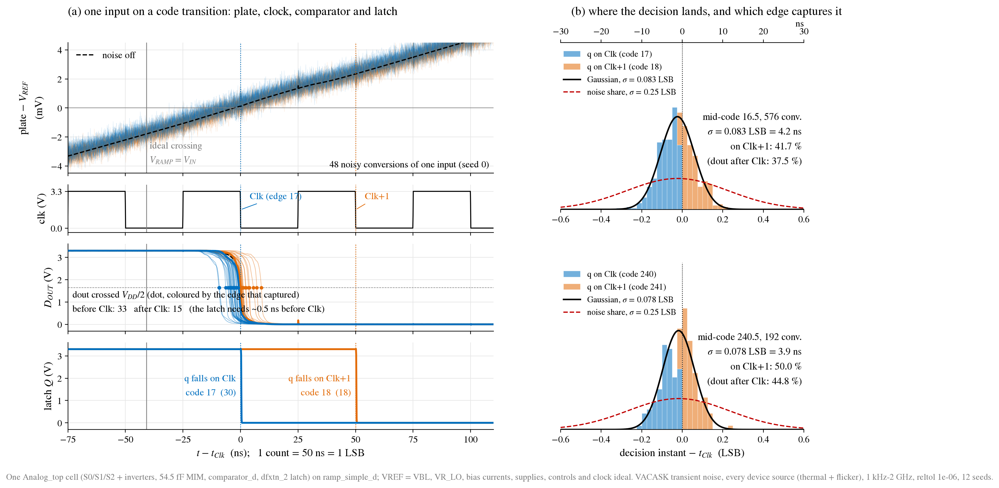
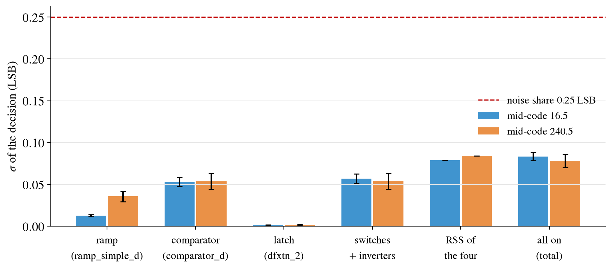

# cell_trannoise: transient noise of one cell, as the macro builds it

Date: 2026-10-14. `../cell_trannoise_bkp/cell_trannoise` is unchanged.

The user asked for a fresh VACASK transient-noise run of one conversion cell
in its actual set-up:

- the basic ramp `ramp_simple` (real);
- the most recent comparator, the one with delay < LSB/4 (`comparator`);
- the standard-cell latch now in the macro (`dfxtn_2`);
- supplies and bias currents ideal, as before.

They also asked for the `fig08` plot again, with `dout` and `q` visibly
corresponding: `q` must fall either on a clock edge **Clk** or on the next one
**Clk+1**, and noise alone must decide which.

**Result** (`runs/cell-trannoise-v2/20261015T032007Z`, 28/28 checks PASS,
typical): the decision moves by **σ = 0.083 ± 0.005 LSB (4.2 ns) at mid-code
16.5 and 0.078 ± 0.008 LSB (3.9 ns) at 240.5**, a third of the 0.25 LSB noise
share. The switches (0.057 / 0.054 LSB) and the comparator (0.053 / 0.054)
carry almost all of it; the ramp adds 0.013 / 0.036 and the latch 0.002. In
every conversion q fell exactly once, on Clk or Clk+1 and on no other edge,
and the edge agreed with where dout crossed in every conversion more than
1 ns from the edge. Sections 4-8.


## 1. What is simulated

```text
                 ideal 3.1314 uA                         ideal 1.93077 uA
                      |                                         |
  ramp_simple_d: XRD diode -> XPS (L 8 um) -> vramp      comparator_d: XREFP diode -> tail
                 XRST to VR_LO (0.5 V ideal)  |                          |
                 XCR 4 pF MIM                 |  S1                      |
                                              +--o/o--+                  |
  VIN (ideal) -------------------------o/o-----------+-- top            |
                                       S0            |                   |
                                                  C_S 54.52 fF MIM       |
                                                     |                   |
  VREF = 1.65 V (ideal) ---o/o--------------------- bot ---- inn (-)     |
                           S2                         inp (+) -- VREF    |
                                                      dout -------------> dfxtn_2 D
                                       count clock (ideal 20 MHz) ------> CLK (falling edge)
                                                                          Q -- q (40 fF)
```

One cell of the current macro, `../Analog_top`. Every block is read
**by path** from `../Analog_top/analog_top.spice`, which `schematic.sh`
generates from the drawings. Nothing is re-typed.

| Part | Subcircuit (from `Analog_top/analog_top.spice`) | In this bench |
| --- | --- | --- |
| Ramp | `ramp_simple_d`: PMOS source L 8 um, 4 pF MIM, reset NMOS, its L 1 um bias diode | ideal 3.1314 uA sunk from the diode (bias_gen's nominal ramp sink) |
| Cell | `atop_cell`: S0, S1 (TG 0.5/1.0 um), S2 (NMOS 0.36 um), their three control inverters, 54.52 fF MIM | ideal single-ended controls s0/s1/s2, as the macro |
| Comparator | `comparator_d`: `comparator` drawn flat with its pbias diode and the PDK S/D junction geometry | ideal 1.93077 uA sunk from its diode (its design current) |
| Latch | `latch` = `gf180mcu_as_sc_mcu7t3v3__dfxtn_2` (26 MOS), the library's negative-edge flop | count clock on CLK, 40 fF on q |
| References | ideal | VREF = the comparator's inp (one node, as v5), VR_LO = 0.5 V |

The noise of the bias generator, the VDD/2 buffer and vrlo_ref is **not** in
this bench. Their own records are `../bias_gen`, `../midrail_ref` and
`../vrlo_ref`.

### Against `../cell_trannoise_bkp/cell_trannoise` (v1)

| | v1 (`runs/cell-trannoise/20261009T103632Z`) | v2 (this block) |
| --- | --- | --- |
| Comparator | `comparator` deck, no S/D geometry | `comparator_d`, drawn S/D geometry (as the macro) |
| Latch | `tspc_dff` (TSPC + keeper) | `dfxtn_2` standard cell (ADR 0019) |
| Control inverters | absent (complementary ideal controls) | the cell's own three inverters |
| VREF and VBL | two ideal sources | one node (ADR 0021) |
| Sample to ramp start | 100 ns | 300 ns (the macro's TS3 -> TR, ADR 0018) |
| Clock | phase walks 6.25 ns per record (S-curve) | synchronous: every record sees the clock at the macro's phase, TR on a rising edge |
| Input | mid-code 16.5 / 240.5 | moved by +0.18 / +0.21 LSB so that the noiseless decision sits on a falling clock edge |
| Per-block shares | not measured | ramp, comparator, latch, switches each alone |
| Source | xschem testbench, translated | the macro's generated netlist, translated; ngspice runs the same bench as reference |

## 2. Why the bench is built this way

**Why the input sits on a clock edge.** The latch samples `dout` only on
falling clock edges, 50 ns apart. A decision that moves by about 4 ns rms
almost never changes the code, unless the decision lies near an edge.

The `align` step moves the held level by a fraction of an LSB, so that the
noiseless decision falls exactly on edge *k*:

- If `dout` crosses VDD/2 before the latch samples it, `q` falls on **Clk**
  and the code is *k*.
- If it crosses after, `q` falls on **Clk+1** and the code is *k*+1.

Each conversion is then one Bernoulli trial decided by noise. Moving the
input by Δ LSB is the same as moving the clock phase by Δ × 50 ns, which is
what v1 did by walking the clock.

**Why a clock-synchronous record.** The macro runs everything from one 20 MHz
clock, so the ramp starts on a rising clock edge. Every record here does the
same, so the latch's view of `dout` is the macro's.

**Why the time of `dout` and not the code.** The code is quantised to whole
counts. The decision instant `td` is continuous, so its spread over a few
hundred conversions gives σ directly. The code statistics are kept as a
cross-check: the share of conversions on Clk+1 must equal the share of `td`
after Clk.

**Why one block at a time.** Independent noise sources add in power. Running
each block alone gives its share, and the root-sum-square of the four must
reproduce the all-on total.

## 3. How it is run

```sh
./scripts/sim.sh cell-trannoise                 # everything (~2-3 h on 16 jobs)
./scripts/sim.sh cell-trannoise STEPS=reduce    # re-judge the cached runs
```

Steps, all in `ct.sh` inside the container (`container.sh` mounts the
standard-cell library at `/foss/pdk_libs`; `make pdk-libs` once):

1. **models.** `ct_models.py` converts the GF180 3.3 V BSIM4 models for
   VACASK, using `../Analog_top_bkp/Analog_top_v4/trannoise/gf180_vacask.py` by path, and adds
   noiseless copies (`_q`).
   - `ct_netlist.py` translates the five subcircuits and `dfxtn_2` into
     VACASK, once per noise set: as drawn, all noisy, and each block alone.
   - Noisy multi-finger MOS are finger-expanded (NF1), because VACASK's
     flicker grows with nf and ngspice's does not.
2. **align.** A noiseless VACASK run at the nominal mid-code gives the decision
   `td`. `ct_align.py` moves POS so that `td` lands on the nearest falling
   clock edge (`work/align.txt`).
3. **ngspice.** ngspice runs the same bench without noise: the reference the
   translation must reproduce.
4. **sim.** VACASK runs, per level, at the aligned input:
   - `q`: noiseless, drawn nf.
   - `q1`: noiseless, finger-expanded.
   - `n`: every noise source on, 12 seeds × 48 (c16) or 16 (c240) records.
   - `g_<block>`: one block alone noisy, 4 seeds each.
   - At one level only: `b6`, the 6 GHz band, and `tt`, reltol 2e-7.
5. **reduce.** `ct_reduce.py` writes the metrics, `data/ct_summary.json`,
   `data/ct_noise.npz` and the figures. `check-ct.awk` judges them.

**Noise settings.** Every BSIM4 thermal and flicker source, 1 kHz – 2 GHz,
SDE mode, oversample 3. 150 us of idle tracking before the first record,
because VACASK's flicker generators start from zero; the clock starts 1 us
before the first record. reltol 1e-6, because at the default 1e-3 the noise
leaks charge onto the floating plate (`../cell_trannoise_bkp/cell_trannoise`, finding 1). The
ramp-alone, latch-alone and switch-alone runs use 1e-5 (section 7, finding 1).

**Cost.** One VACASK run takes 25-77 min on one core (table in section 7):
about 70 runs, ~50 CPU-hours, ~3-4 h on 16 jobs. A cached re-run must leave
out the `models` step, which rewrites the netlists and so invalidates every
cached result:

```sh
./scripts/sim.sh cell-trannoise STEPS='align ngspice sim reduce'
```

**Record timeline** (`tb_params.inc`, every edge 100 ps). Times from the
record start t0, which is a rising clock edge:

| Time | Event |
| --- | --- |
| t0 | S2 opens: the sample, the comparator's plate `bot` frozen at VREF |
| t0 + 5 ns | S0 opens |
| t0 + 10 ns | S1 closes: `top` goes to the ramp at VR_LO, and `bot` drops by α (VIN − VR_LO) |
| TR = t0 + 300 ns | ramp_rst falls on a rising clock edge: ramp and count start |
| TR + 25 ns + k × 50 ns | falling clock edges: the latch samples `dout`; code = k |
| TE = TR + (floor(POS) + 8) × 50 ns | S1 opens, then the ramp resets and S0/S2 close: track 470 ns |

**Extracted per conversion** (`ct_extract.py`; times from TR):

| Column | Meaning |
| --- | --- |
| `td` | `dout`'s first fall through VDD/2: the decision |
| `tq` | `q`'s fall |
| `kq` | the falling clock edge that captured = the code |
| `cq` | clock-to-q |
| `tm` | the frozen plate, `bot` − VREF averaged over the 40 ns before TR |
| `at` | α at the trip, d bot / d vramp over the 200 ns before the decision |
| `vr`, `slope` | the ramp's own error and slope at the ideal crossing |

A conversion counts only if `dout` and `q` were high at TR and `q` fell
exactly once.

**Referring time to the input.** The ramp moves 1 LSB per count, so a
decision moved by dt is dt / 50 ns LSB at the ADC input. 1 LSB = 1.5 V / 256 =
5.859 mV.

## 4. Result

Record `runs/cell-trannoise-v2/20261015T032007Z/metrics.json`: `pass: true`,
28 checks (`check-ct.awk`). Typical process, 27 C, 3.3 V. The values are
identical to the first record of the same runs, `20261015T020953Z`.

| | mid-code 16.5 | mid-code 240.5 | criterion |
| --- | --- | --- | --- |
| Aligned input (POS) | 16.683 (+0.183 LSB), edge 17 | 240.709 (+0.209 LSB), edge 240 | noiseless decision within 1 ns of a falling edge |
| Noiseless decision − Clk | +0.096 ns | −0.000 ns | ≤ 1 ns |
| Conversions (seeds × records) | 576 (12 × 48) | 192 (12 × 16) | none lost |
| **σ of the decision** | **0.0834 ± 0.0048 LSB = 4.17 ns** | **0.0782 ± 0.0078 LSB = 3.91 ns** | ≤ 0.25 LSB (noise share, ADR 0013) |
| Conversion-to-conversion σ (within a record) | 0.0796 LSB | 0.0722 LSB | reported |
| q on Clk / Clk+1 / other edge | 336 / 240 / 0 | 96 / 96 / 0 | no other edge |
| Share on Clk+1: from q / from dout / from the Gaussian | 0.417 / 0.375 / 0.389 | 0.500 / 0.448 / 0.408 | q vs dout within 3 se |
| dout and q disagree, more than 1 ns from Clk | 0 | 0 | 0 |
| dout and q disagree, within 1 ns of Clk | 24 of 109 | 10 of 45 | reported (latch set-up) |
| Boundary that best separates them | dout −0.485 ns before Clk (3 left) | −0.415 ns (2 left) | reported |
| Clock-to-q, mean / σ | 0.371 ns / 0.70 ps | 0.371 ns / 5.0 ps | reported |
| Numerical floor (noiseless, NF1 vs drawn) | 3e-5 LSB | 7e-4 LSB | ≤ 0.1 σ |
| VACASK − ngspice, noiseless decision | +0.040 LSB | +0.033 LSB | ≤ 0.1 LSB |
| VACASK − ngspice, frozen sample | −0.111 mV | −0.078 mV | ≤ 0.3 mV |

The code columns of the translation check differ in all 4 records at both
levels. That is expected here: the input was placed on a clock edge on
purpose, so the 2 ns between the two simulators decides the edge. Every
difference has a clock edge between the two decisions (gate).



### Reading the figure

**(a) One input, 40 conversions (seed 0, mid-code 16.5).** Time runs from the
capturing clock edge Clk (edge 17). One count is 50 ns = 1 LSB. Blue is a
conversion the latch took on Clk (code 17), orange one it took on Clk+1
(code 18). The colour is the same in all four rows, so a conversion can be
followed from top to bottom.

1. **plate − VREF.** The comparator's input `bot` against its threshold,
   while the ramp lifts it through α ≈ 0.38 of the ramp step. The dashed line
   is the noiseless run. The spread around it is the sum of every noise
   source in the cell referred to this node. The grey line is the ideal
   crossing V_RAMP = V_IN; the decision comes about 41 ns later at this code
   (the comparator's 10.6 ns delay plus the cell's pedestal).
2. **clk.** The ideal 20 MHz count clock. The latch samples on the falling
   edges, Clk at 0 ns and Clk+1 at 50 ns.
3. **dout.** The comparator output. Each dot is where that conversion crossed
   VDD/2, coloured by the edge that captured it. The dots spread over about
   ±10 ns: σ = 4.2 ns. The two bold traces are the conversions closest to Clk
   on either side. 27 of the 40 crossed before Clk but only 24 were taken on
   Clk: the 3 orange dots just left of the Clk line crossed in the last
   ~0.5 ns, inside the latch's set-up window, and went to Clk+1 (finding 3).
4. **latch Q.** Each conversion falls exactly once: blue on Clk, 0.37 ns
   after the edge, orange one count later on Clk+1. Nothing falls anywhere
   else. That is the requested correspondence: q's edge is decided by when
   dout fell.

**(b) Where the decision lands, all seeds.** One histogram per level of the
dout crossing minus Clk, in LSB (bottom) and ns (top). The bars are stacked
by the capturing edge.

- The black curve is a Gaussian with the measured σ.
- The red dashed curve is the 0.25 LSB noise share. The measured
  distribution is three times narrower.
- Left of about −0.5 ns everything is blue, right of 0 everything is orange.
  Between them sits the latch's set-up window, where the two colours mix
  (section 7, finding 3).
- The share on Clk+1 is not exactly 50 %: the noisy decisions sit 1.2 ns
  (c16) and 0.9 ns (c240) earlier than the noiseless one used to align
  (finding 2).

## 5. Where the noise comes from

Each block alone noisy, the rest quiet, 4 seeds each:



| Block alone | σ at 16.5 (LSB) | power share | σ at 240.5 (LSB) | power share | mean shift vs noiseless (LSB, 16.5 / 240.5) |
| --- | --- | --- | --- | --- | --- |
| ramp `ramp_simple_d` (3 MOS) | 0.0128 ± 0.0007 | 2.4 % | 0.0358 ± 0.0032 | 20.9 % | −0.019 / −0.005 |
| comparator `comparator_d` (11 MOS) | 0.0531 ± 0.0027 | 40.5 % | 0.0536 ± 0.0048 | 47.0 % | −0.013 / +0.028 |
| latch `dfxtn_2` (26 MOS) | 0.0017 ± 0.0001 | 0.04 % | 0.0018 ± 0.0002 | 0.05 % | −0.020 / −0.003 |
| switches S0/S1/S2 + their inverters (11 MOS) | 0.0570 ± 0.0029 | 46.7 % | 0.0539 ± 0.0048 | 47.5 % | −0.012 / +0.010 |
| RSS of the four | 0.0789 | | 0.0840 | | |
| all on | 0.0834 | | 0.0782 | | |
| RSS / all on | ×0.946 (tol 0.131) | | ×1.074 (tol 0.240) | | gate: within 3 se |

- **Switches.** The sampled kT/C: S2 opening freezes `bot` with the thermal
  noise of its channel on the 54.5 fF MIM and the plate parasitics.
  √(kT/C_S) for 54.5 fF is 0.275 mV = 0.047 LSB at the input. It does not
  depend on the code.
- **Comparator.** Its input-referred noise during the slow crossing,
  integrated by the decision. It does not depend on the code either.
- **Ramp.** Current noise of the L 8 um PMOS integrated on 4 pF. It grows
  with the ramp time: 0.6 µs to code 17, 12 µs to code 240. Flicker
  dominates the growth.
- **Latch.** Negligible. Its noise reaches the decision only through its
  load on dout.

The per-block sum reproduces the total at both levels, so the four groups
account for all the noise in the bench.

## 6. What the numbers mean, from basic to advanced

**Basic.** With noise, the same input does not give the same decision time
twice. The spread is 4 ns rms, out of the 50 ns of one count. Most of the
time that changes nothing, because the code only counts whole clock periods.

**Codes.** Only a decision that happens to lie near a clock edge can move to
the next code. For inputs spread evenly over a count, the share of
conversions whose code differs from the noiseless one is about
σ·√(2/π) ≈ 0.8 σ = **6.6 %**, always by ±1. This bench puts every input on an
edge, the worst case, where the split is close to 50/50.

**Against the budget.** ADR 0013 gives noise a 0.25 LSB share of the ENOB-7
error budget. This cell, with ideal bias and references, uses 0.083 LSB, a
third. Added to quantisation noise (1/√12 = 0.289 LSB) it costs
log2(√(0.289² + 0.083²) / 0.289) = **0.06 bit** of ENOB.

**Against v1.** `../cell_trannoise_bkp/cell_trannoise` measured 0.0844 ± 0.0049 and
0.0881 ± 0.0088 LSB on the deck comparator and the TSPC latch. This bench,
with the drawn comparator, the standard-cell latch, the control inverters and
one VREF node, gives 0.0834 ± 0.0048 and 0.0782 ± 0.0078: the same within
the error bars.

**Advanced.**

- **Which half depends on the code.** The switch and comparator shares are
  flat over the range. Only the ramp's grows with the code, from 2 % to 21 %
  of the power. A longer ramp or a lower clock moves the top-code noise
  toward the ramp.
- **Reading σ from q alone.** The share on Clk+1 measured by q agrees with
  the share by dout within 3 se. On silicon, where only codes can be read, an
  S-curve of the code over the input gives σ, offset by the latch's 0.4-0.5 ns
  set-up window: 0.01 LSB, below the error bars here.
- **Noise vs the 6 GHz band.** At noisefmax 6 GHz σ is ×0.964 (tol 0.177),
  and the frozen sample ×1.020. The 2 GHz band already holds all the kT/C
  noise.
- **Noise vs reltol 2e-7.** The mean decision moves +0.011 LSB (tol 0.035)
  and σ ×1.06 (tol 0.31). 1e-6 is tight enough.
- **A diagnostic, not used for judging.** The rms of `bot` averaged over the
  40 ns before TR is 206 / 259 µV. Divided by α it reads 0.093 / 0.117 LSB,
  more than the decision σ, because that 40 ns average still contains noise
  that is not held. The same was seen in v1.

## 7. Findings

1. **Blocks alone with few noisy devices lose the run at reltol 1e-6.**
   - VACASK stops with "Timestep too small. Transient analysis aborted" on
     both attempts (the second with a new seed) for every latch-alone run at
     code 16 and every switch-alone run at code 240. Each switch run spent
     2-2.6 h before losing.
   - The ramp alone loses it even at 1e-5 for one seed at code 240; the retry
     passes.
   - All three blocks alone now run at 1e-5 (`LOOSE_G`, `RELTOL_G`). The
     all-noise runs at 1e-6 never lose a run.
   - At 1e-5 no block's mean decision moves more than 0.028 LSB from the
     noiseless run. The floating-plate leak at the default 1e-3 was 1 LSB
     (`../cell_trannoise_bkp/cell_trannoise`).
2. **The noisy runs decide about 1 ns earlier than the noiseless run used to
   align** (−0.025 LSB at 16.5, −0.018 at 240.5).
   - The latch-alone run, whose own noise is 0.002 LSB, shows the same
     −0.020 LSB at 16.5, so this is a numerical difference, not noise: the
     tight reltol against the default with a 0.2 ns maxstep.
   - It is under the 0.1 LSB translation gate and does not change σ. It only
     moves the Clk/Clk+1 split away from 50/50 at 16.5.
3. **The latch takes dout on Clk only when dout crossed VDD/2 at least
   0.4-0.5 ns before the edge.**
   - The best boundary is −0.485 ns (16.5) and −0.415 ns (240.5). Within that
     window the outcome depends on the slope of dout and the latch's own
     threshold, so 24 + 10 conversions within 1 ns of Clk disagree with the
     plain "before/after Clk" rule.
   - No conversion further than 1 ns from the edge disagrees.
   - q never fell twice or late (no metastable output): clock-to-q is 0.371 ns
     at both levels with a 0.7 / 5.0 ps spread.
4. **dout crossed VDD/2 twice in 1 of 576 conversions** at 16.5 (noise
   chatter at the slow crossing). The latch took the first crossing; the
   code was not affected.
5. **Cost.** One run takes 26 s (noiseless, c16) to 76 min (6 GHz band), on
   one core each:

   | Runs | Time per run |
   | --- | --- |
   | All-noise, c16 / c240 | 28 / 41 min |
   | Comparator alone, c16 / c240 | 27 / 45 min |
   | Latch alone, c16 / c240 | 27 / 36 min |
   | Ramp alone, c16 / c240 | 20 / 29 min |
   | Switches alone, c16 / c240 | 52 / 62 min |
   | reltol 2e-7 | 42 min |
   | 6 GHz band | 76 min |

   These are means from the record. Per-block runs that are lost first take
   up to 2.6 h, both attempts together.

## 8. What this does not cover

- **Noise of the real bias and reference blocks** (`bias_gen_s`, the one
  VDD/2 buffer `midref`, `vrlo_ref`) and of AVDD. Here they are ideal. In
  the v4 macro run the bias generator through the ramp current was the
  largest single share (0.086 LSB at code 240).
- **Flicker below 1 kHz** (noisefmin), i.e. slow drifts between records.
  These are a pedestal/calibration matter.
- **PVT corners, mismatch, layout parasitics (PEX)**, and the other three
  cells and their crosstalk.
- **The S0/S1 sampling of VIN** as such. VIN is ideal and S0 is opened before
  the comparator plate is used.
