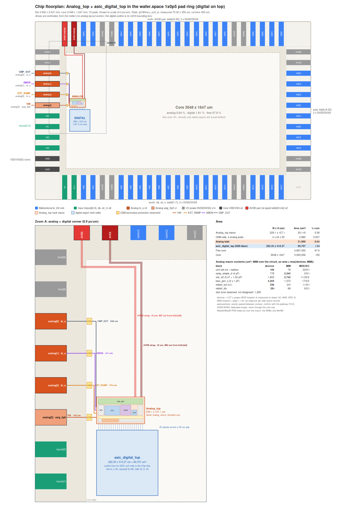
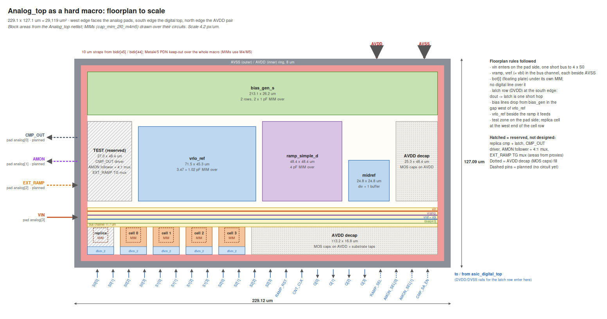

# Chip floorplan v2: Analog_top + digital top in the 1x0p5 pad ring

A to-scale area and placement plan, digital on top, for the chip that holds
`mixed_signal/Analog_top` as one hard macro and `digital/asic_digital_top`
as soft logic. **No analog layout exists. The analog areas are estimates from
the netlist.** The digital outline is measured from its GDS.

`../chip_floorplan_bkp/chip_floorplan` (the same plan for `Analog_top_v4`,
`runs/chip-floorplan/20261011T230819Z`) is unchanged. The talk slides
`cpad_talk/fig11a_analog_top` and `fig11b_pinout` both read
`data/floorplan.json` from here, so they cannot disagree.

```sh
./scripts/sim.sh chip-floorplan    # probe, plan, render, check -> runs/chip-floorplan-v2/latest/metrics.json
```




## What changed from v4

| | v4 (`../chip_floorplan_bkp/chip_floorplan`) | v2 (this, `Analog_top`) |
| --- | --- | --- |
| VDD/2 reference | `midref_v2`: divider + two buffers (VREF, VBL) | `midref`: divider + **one** buffer, VREF = VBL (ADR 0021) |
| Bias generator | `bias_gen_v2r` (with XOB for VBL), row + 6 XOL fingers | `bias_gen_s` (no XOB). The recorded row is unchanged: the NMOS row (132 + 4 dummies of 136) sets its length, and the PMOS row has room for XOL after XOB's 44 fingers go |
| Bus channel | vfe, vramp, vref, vbl + 5 bias lines | vin, vramp, vref + 5 bias lines |
| Macro | 237.6 x 130.1 um, fill 48.5 % | **229.1 x 127.1 um**, fill 49.6 % |
| Pin names | VFE, COMP_TEST_OUT | VIN (the v5 port), CMP_OUT (the talk's name) |
| Pin status | not recorded | every pin `core` (a port of the v5 netlist) or `planned` |

## 1. Pins

The v5 netlist's ports are `vin`, `ramp_rst`, `cnt_clk`, `s0/s1/s2_[3:0]`,
`q[3:0]`, `avdd`, `avss`, `dvdd`, `dvss`. Everything else is **planned** test
access from specification §7.3 (`Analog_top/PIN_LIST.md` §4). It has area
reserved here and no circuit yet, and is drawn dashed.

| Pin | Pad / side | Status | Function |
| --- | --- | --- | --- |
| VIN | `analog[3]` (asig_5p0), west | core | sampling input to the four S0 switches |
| AVDD / AVSS | `bidir[45]` / `bidir[44]`, north | core | analog supply on its own 10 um straps |
| S2[3:0] (talk: S0′), S0[3:0], S1[3:0] | south, from Digital | core | bottom-plate sample, input and ramp switches per cell |
| RAMP_RST | south, from Digital | core | holds the ramp at VR_LO; its fall starts the conversion |
| CNT_CLK | south, from Digital | core | 20 MHz count clock; the latches sample on its falling edge |
| Q[3:0] | south, to Digital | core | latch outputs; each falls once, at the code |
| EXT_RAMP + RAMP_SEL | `analog[2]` (bi_a), west | planned | external ramp switched in place of the internal one |
| AMON + AMON_SEL[1:0] | `analog[1]` (bi_a), west | planned | analog monitor: one buffer behind a 4:1 mux (vramp, vref, vrlo, replica plate) |
| CMP_OUT + CMP_SA_EN | `analog[0]` (bi_a), west | planned | a fifth, replica comparator + latch in standalone mode; not a signal cell's output |

Pad order is unchanged from v4. The two precision inputs, VIN and EXT_RAMP,
are nearest the macro, with wires of 142 and 274 um. Each wire drops in its
own column, so none crosses another; the checker verifies this segment by
segment.

## 2. Area model and floorplan choices

These are as in `../chip_floorplan_bkp/chip_floorplan` README §2-3:
- layout factor k 3.27 from the drawn `UC_MIM`;
- MIMs over their circuits;
- 8 um ring, 4 um block spacing;
- 30 um analog-digital gap and 50 um CDM strip.

Two things differ:
- the bias generator row, as in the table above;
- the bus channel is 11.7 um (15.7 with the spacing to the blocks) instead of
  14.6 um.

The test zone and the replica cell are **reserved, not designed**. Their
1306 um² come from proxy blocks: one unit cell, one `midref_buf` follower,
a 4:1 mux, the EXT_RAMP switch and a pad driver.

## 3. Result (`runs/chip-floorplan-v2/20261015T095506Z`)

`pass: true`:
- 72-pad 1x0p5 ring as drawn;
- macro, digital region and CDM cells inside the core with no overlap;
- 0 route crossings;
- fill 49.6 % (gate ≥ 45 %).

| | W x H (um) | um² | % core |
| --- | --- | ---: | ---: |
| Analog_top macro | 229.1 x 127.1 | 29 119 | 0.58 |
| CDM cells | 4 x 24 x 30 | 2 880 | 0.06 |
| Digital | 292.35 x 310.27 | 90 707 | 1.81 |
| Free core | | | 97.6 |

## 4. Open items (unchanged from v4)

- **This is not the frozen slot.** The specification and the platform
  precheck use `0p5x1`. Using 1x0p5 is a §13 revision.
- The MIMs use Metal4/Metal5, so the chip PDN needs an M4/M5 keep-out over
  the macro.
- AVDD must not touch the template core ring.
- The digital region is soft. Keeping it beside the macro needs a placement
  region, or the digital top hardened as a macro.
- The test zone needs circuits. Until then, EXT_RAMP, AMON and CMP_OUT are
  pads with nothing behind them.
