# comparator: the short-channel comparator of the 8-bit bottom-plate cell, final report

Date: 2026-10-07. The design argument in full is
[`DESIGN_RECIPE.md`](DESIGN_RECIPE.md). The decisions are in
[ADR 0015](../../docs/decisions/0015-cmp-updt-v3-acceptance.md). The
interactive version of the plots is `assets/comparator_pareto.html`.

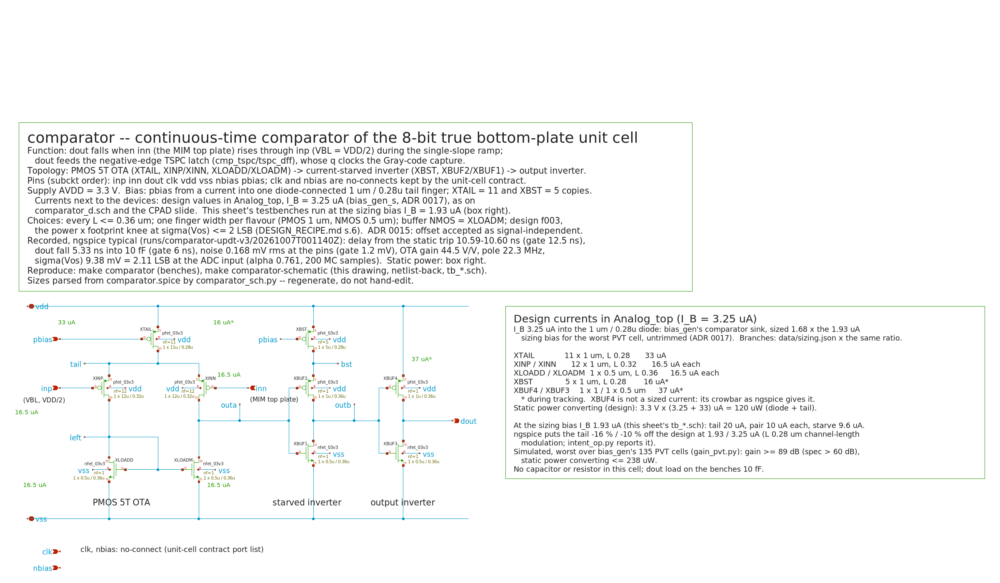

## 1. Verdict

Typical corner, 27 C, 3.3 V, ideal bias. Every number is an ngspice or
VACASK measurement unless marked.

| Requirement | Gate | Result | Verdict |
| --- | --- | --- | --- |
| delay from the static trip, 4.5-250.5 LSB | <= 1/4 count = 12.5 ns (user) | 10.59-10.60 ns | **PASS** |
| level spread of the delay | <= 0.1 count = 5 ns | 0.01 ns | PASS |
| dout fall into 10 fF | <= 6 ns (the latch's verified edge) | 5.33 ns typical; up to 10.4 ns over PVT | PASS typical; **WAIVED** over PVT (ADR 0015) |
| noise at the pins, thermal + 1/f from 1 kHz, own band | < 1.2 mV (user) | 0.168 mV ngspice; VACASK transient decision noise 160 uV (0.036 LSB) | **PASS**; PVT max 0.189 mV, transient 0.038 LSB |
| every L <= 0.36 um | user | 0.28-0.36 um | PASS |
| power | minimise (user) | 96.9 uW worst state (model); ngspice static: 112 uW at the trip point, 62-63 uW converting (I_B 1.93 uA), 283 / 108-110 uW at the Analog_top bias (`intent_op.py`); 58-89 uW mean over a conversion | the power x area knee at sigma <= 2 LSB |
| area | minimise (user) | 39.4 um2 footprint, 13.6 um2 gate (v2: 245.6 / 149) | 6.2x smaller than v2 |
| sigma(Vos) at the ADC input | <= 4/3 LSB (contract, "assumed") | 1.8-2.2 LSB at 7 corners, both simulators; 3.8-4.2 LSB in the cell | **ACCEPTED**, being signal-independent (ADR 0015) |
| offset signal-independence | <= 0.1 LSB per cell between levels | <= 0.0017 LSB, 90 mismatched cells at 3 corners | **PASS** |
| delay over PVT with the ideal bias | 12.5 ns | 42/45 cells (36/45 with the drawn S/D geometry); ss / 85 C up to 12.75 (13.56) ns | **OPEN**, to be met by the bias generator: >= 1.20x nominal at ss / 85 C |
| xschem schematic, symbol, testbenches | netlist back; each testbench reproduces its bench | all pass | PASS |

## 2. Requirements and assumptions

| Item | Value | Source |
| --- | --- | --- |
| LSB, count, slope | 1.5 V / 256 = 5.859 mV; 50 ns (20 MHz); 117.2 mV/us | contract |
| Delay | from the comparator's own DC trip to dout at 50 % | user, AskUserQuestion 2026-10-06 |
| Noise | rms at the pins, 1 kHz to the OTA's own pole, thermal + 1/f | user, AskUserQuestion 2026-10-06 (equals SPEC item 6's 0.25 LSB at the ADC input) |
| dout load | 10 fF total | user |
| Bias | ideal current into one diode-connected tail finger; J_D a variable | user |
| Conventions kept from v2 | one finger width per flavour; buffer NMOS = XLOADM; identical buffers; buffer PMOS = 2 x W(XLOADM) | user, 2026-10-05 |
| Wire on outa / outb | 5 fF / 2 fF | assumed (PEX replaces) |
| Area metric | footprint with contacted S/D strips: 0.52 um shared, 0.44 um end | PDK DRC CO.1 / CO.4 / CO.7 |
| Headroom, pedestal, dead zone | as v2's contract | contract |

## 3. Sizing: gm/Id tables first, simulator second

**Device data built for this design (`lut/`).**

- **Short-L gm/Id tables.** The repo's table had only 0.28-0.30 um below
  0.4 um. These tables cover L = 0.28, 0.30, 0.32, 0.34 and 0.36 um.
- **Device noise.** The pygmid tables carry none, so ngspice `.noise` was
  run on single devices at the same L. The model uses 1/f per unit area
  and the thermal gamma.

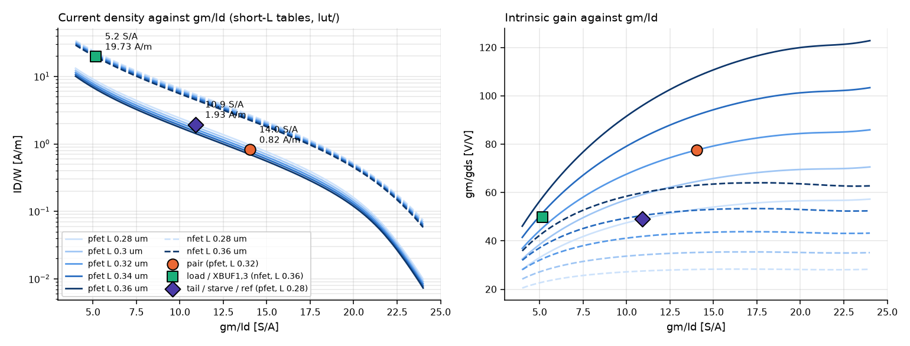

**Operating points of the selected design** (the markers in the plot
above):

| Device | gm/Id | L | Density |
| --- | ---: | ---: | ---: |
| pair | 14.0 S/A | 0.32 um | 0.82 A/m |
| load and buffer NMOS | 5.2 S/A (strong inversion) | 0.36 um | 19.7 A/m |
| tail, starve and reference | 10.9 S/A | 0.28 um | 1.93 A/m |

The pair sits where the L = 0.32 um gain curve still rises (gm/gds 77). The
load is short and narrow, as the buffer convention forces (s.9).

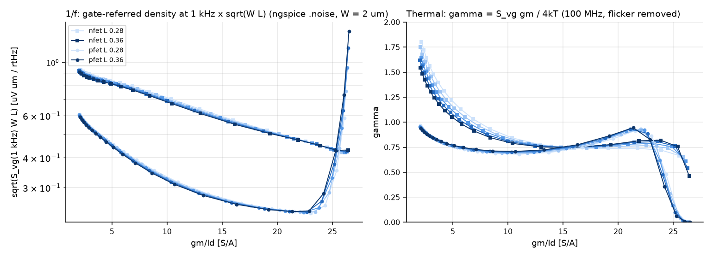

**Search (`size_v3.py`).**

- **Sampling.** 120 000 uniform samples, then 4 local rounds of 30 000.
  The variables are three L (pair, load and buffers, bias), the two finger
  widths, four finger counts, and the bias finger's current.
- **gm/Id follows from (W, L, I).** It is not a free variable.
- **Delay and fall** come from a four-node transient on the tables' I-V
  curves: outa, bst, outb and dout, with the buffers' Miller C_gd.
- **Calibration.** The transient was calibrated on 38 ngspice designs.

| quantity | ngspice / model | p10-p90 | used as |
| --- | ---: | --- | --- |
| delay | 0.975 | 0.68-1.16 | factor |
| fall | 1.25x at L 0.28 to 1.77x at 0.36 um | 0.99-2.62 | fitted in L |
| noise | 1.05 | 0.94-1.16 | not applied (7x margin) |

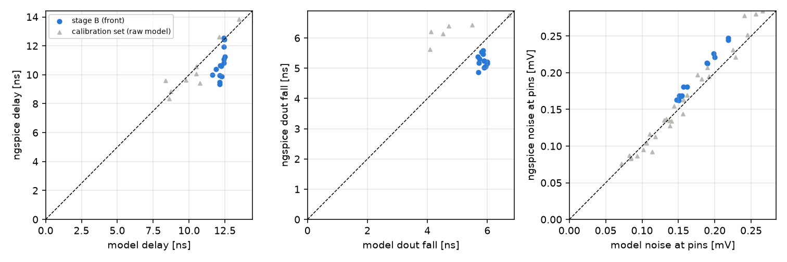

## 4. Pareto fronts and the choice

**What binds.** Noise is never binding: the worst feasible design reads
0.54 mV against 1.2 mV. Delay and fall set the current, and sigma(Vos)
sets the area.

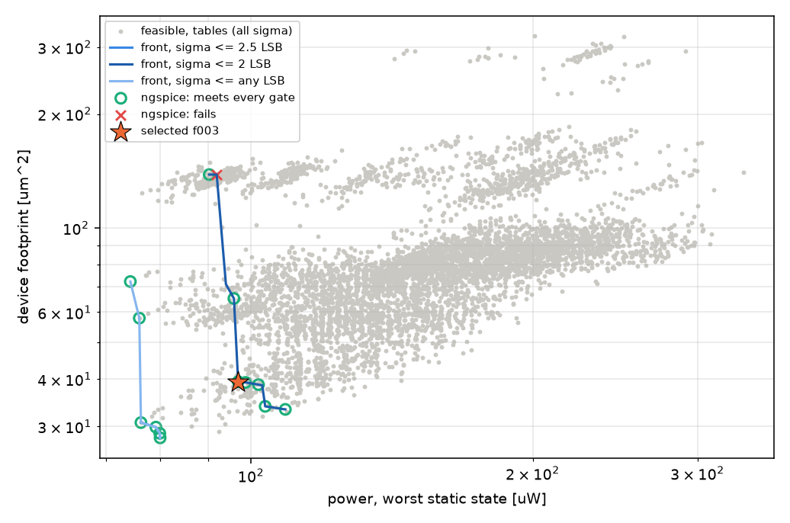

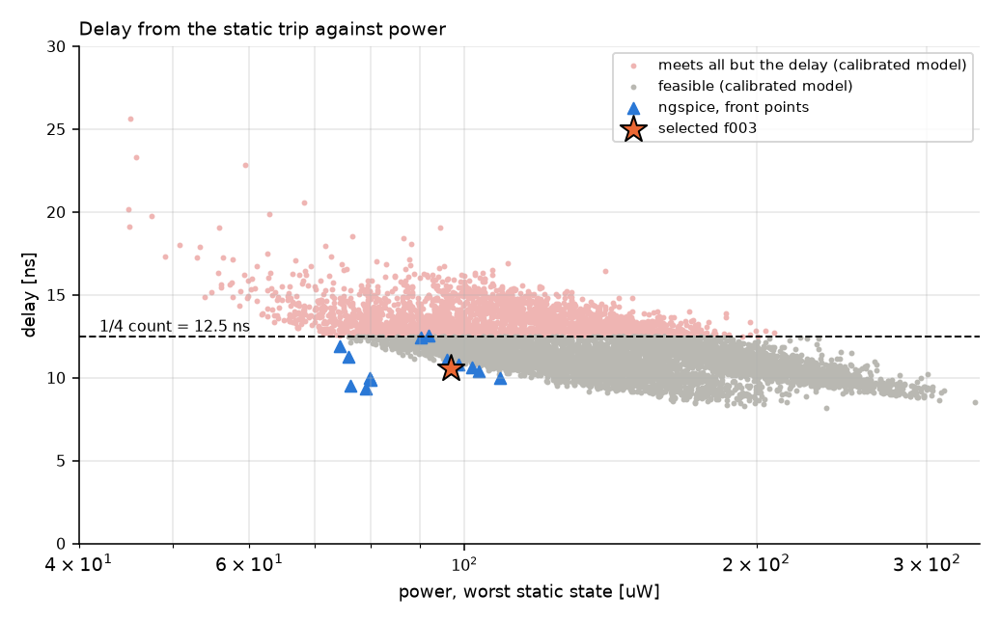

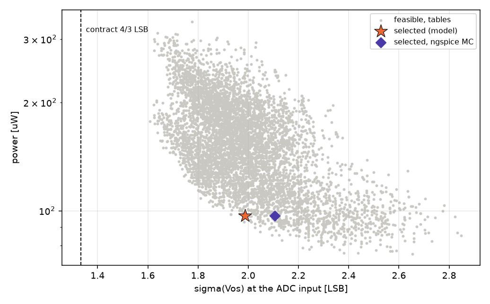

**ngspice on the fronts.** 13 of 14 front points pass every gate. The one
failure misses the delay by 0.03 ns.

| sigma cap at the ADC input | feasible (tables) | ngspice knee | power | footprint | sigma (model) | delay | fall | noise |
| --- | ---: | --- | ---: | ---: | ---: | ---: | ---: | ---: |
| <= 4/3 LSB (contract) | 0 | none | | | | | | |
| <= 1.6 LSB | 0 | none | | | | | | |
| **<= 2.0 LSB** | 14 476 | **f003 (selected)** | 96.9 uW | 39.4 um2 | 1.99 LSB | 10.59 ns | 5.32 ns | 0.168 mV |
| <= 2.5 LSB / any | 24 248 | f008 | 76.3 uW | 30.7 um2 | 2.44 LSB | 9.50 ns | 5.16 ns | 0.221 mV |

**Why f003.** f003 is the knee of the lowest sigma cap that ngspice
passes. It spends 20.6 uW and 8.7 um2 more than f008 for 0.45 LSB less
spread. The in-cell spread is about 2x the bench value (s.9), and pedestal
+ 3 sigma has to fit the 19-count overrun, so the margin is worth that
cost.

## 5. The design (`comparator.spice`)

| Device | Fingers x W_f, L | Current (design) | gm/Id (ngspice) |
| --- | --- | ---: | ---: |
| XINP / XINN (pair) | 12 x 1 um, L 0.32 um | 8.5 uA each | 14.9 S/A |
| XLOADD / XLOADM | 1 x 0.5 um, L 0.36 um | 8.5 uA each | 5.6 S/A |
| XTAIL | 11 x 1 um, L 0.28 um | 17 uA | 12.1 S/A |
| XBST (starve) | 5 x 1 um, L 0.28 um | 9.5 uA | 10.7 S/A |
| XBUF1 / XBUF3 | = XLOADM | | |
| XBUF2 / XBUF4 | 1 x 1 um, L 0.36 um | | |
| reference (bench) | 1 x 1 um, L 0.28 um, I_B = 1.93 uA (J_D 1.93 uA/um) | | |

Currents at I_B = 1.93 uA, typical, at the trip point (`intent.py`, 0.5 uA
steps), checked against the drawn netlist by `intent_op.py` within 5 %
(`make comparator-schematic`); gm/Id from the same ngspice op. The
sizing model's gm/Id-table estimate (`data/sizing.json`: tail 19.73, pair
9.86 uA, gm/Id 10.9 / 14.0 / 5.2 / 10.9) was 15 % high for the tail and the
pair: the circuit settles at a lower tail V_SD than the model took, so the 11
tail fingers copy ~8.8 x I_B. Every ngspice record of this design ran at the
currents in the table. Gain at the trip point: OTA 45 x starved inverter 56 x
output inverter 29 = 6.9e4 V/V (97 dB) inn -> dout.

**Operating figures.**

- alpha = C_S / (C_S + C_top) = 0.761.
- OTA gain 44.5 V/V with its pole at 22.3 MHz.
- Tail headroom margin 0.71 V.
- Static offset -0.39 mV.
- Pedestal (model) 1.67 LSB.

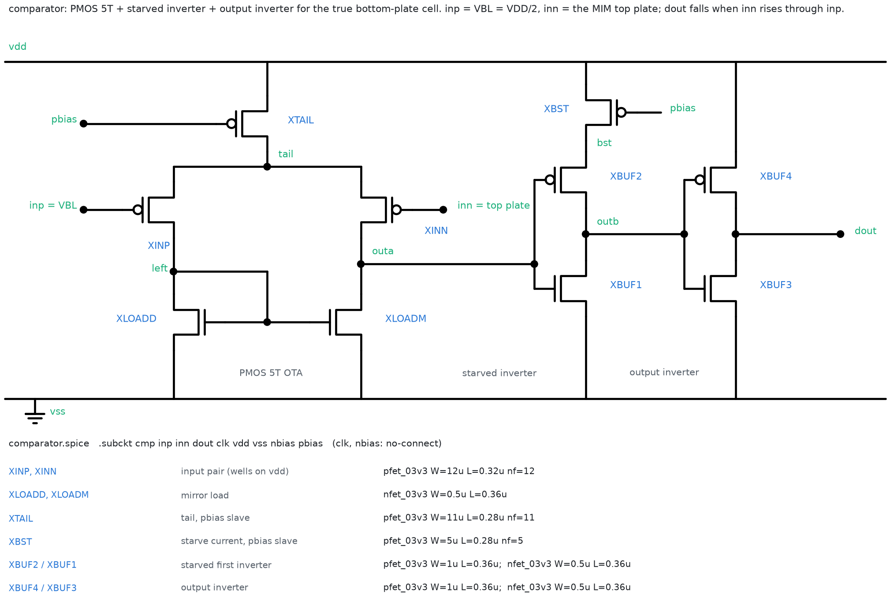

## 6. Typical verification (`./scripts/sim.sh comparator`, `runs/comparator-updt-v3/20261007T001140Z`)

| Check | ngspice | Gate | Verdict |
| --- | ---: | --- | --- |
| delay from the trip at 4.5 / 40.5 / 128.5 / 250.5 LSB | 10.59 / 10.59 / 10.59 / 10.60 ns | <= 12.5 ns | PASS |
| level spread | 0.01 ns | <= 5 ns | PASS |
| dout fall, worst level | 5.33 ns | <= 6 ns | PASS |
| armed at TR | 3.3 V | | PASS |
| noise at the pins | 0.168 mV (1/f below 100 kHz: 0.074 mV) | < 1.2 mV | PASS |
| sigma(Vos), 200 samples | 2.11 LSB (a second run gave 1.93) | 4/3 LSB contract | accepted (s.9) |
| delay from VBL (offset included) | 2.54 ns | reported | |
| delay at 0.69x / 1.77x bias | 12.97 / 7.82 ns | reported | |

**Waveforms (`data/waveform.csv`).** The OTA tracks the attenuated ramp
linearly for the whole approach. outb takes off about 30 ns before the
crossing, and dout falls 2.5 ns after the top plate crosses VBL (10.6 ns
after it crosses the comparator's own trip).

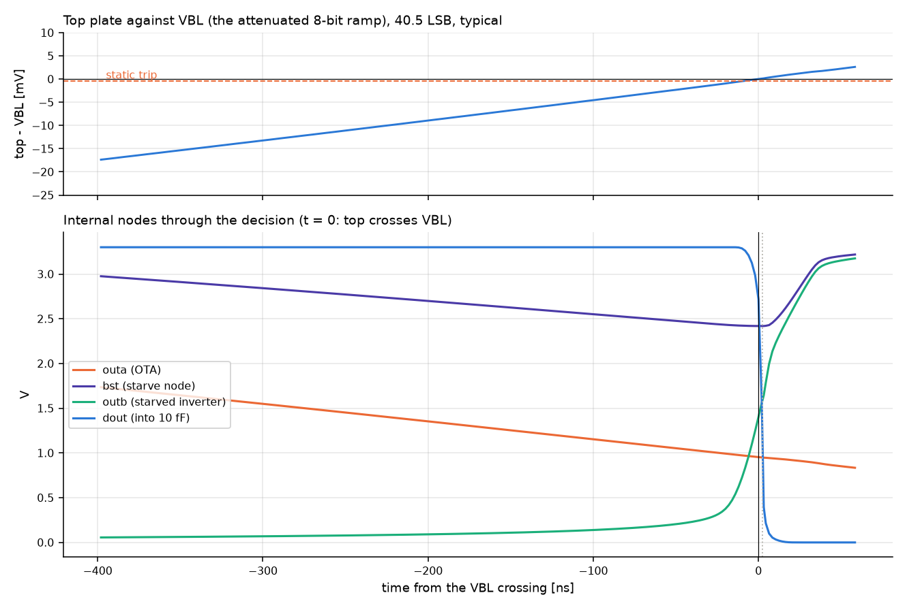

## 7. Schematics and testbenches (`./scripts/sim.sh comparator-schematic`, `runs/comparator-updt-v3-schematic/20261007T232627Z`)

- **`comparator.sch`** is generated from the deck. xschem netlists it back
  device for device (terminals, model, L/W/nf/m), with the ports in order.
- **`comparator.sym`** is the symbol.
- **Four testbenches** place the comparator as that symbol, so xschem
  netlists the drawn schematic into each one.
- **`xtb.py`** simulates every testbench and compares it with the
  hand-written bench. With the S/D geometry that the PDK symbols draw
  stripped out, each reproduces its bench.

| figure | bench | schematic, no S/D geometry | schematic as drawn |
| --- | ---: | ---: | ---: |
| static trip | 1.64961 V | +1 uV | +0 % |
| delay from the trip | 10.589 ns | +21 ps | **+6.7 %** (11.30 ns) |
| delay from VBL | 2.544 ns | 0 | +28 % |
| dout fall | 5.322 ns | 0 | +1.0 % |
| OTA gain | 44.52 V/V | 1e-6 | 0 % |
| noise at the pins | 0.1678 mV | 2e-6 | -2.7 % |
| MC nominal offset | -0.341 mV | 0 | 0 |
| MC sigma | 9.38 mV | -8.4 % (statistical) | +0.3 % |

| tb_delay | tb_trip |
| --- | --- |
| 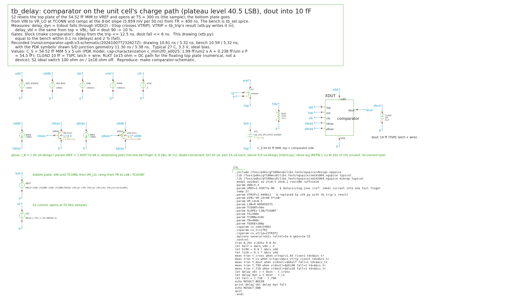 | 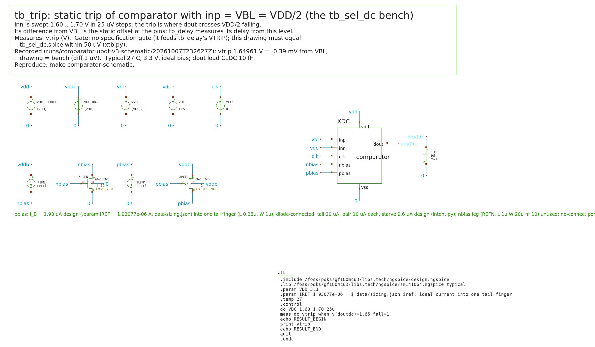 |
| **tb_noise** | **tb_mc** |
| 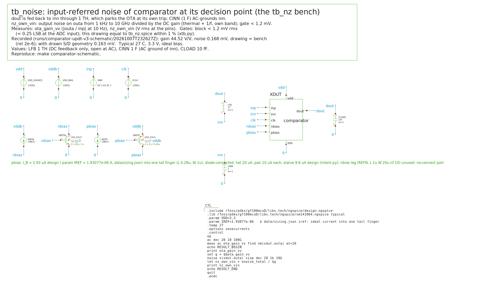 | 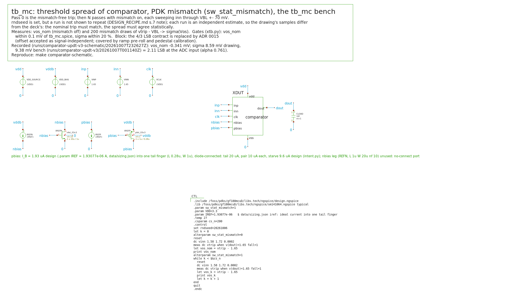 |

## 8. PVT (`./scripts/sim.sh comparator-pvt`, `runs/comparator-updt-v3-pvt/20261007T024232Z`, `-pvt-geom/20261007T024803Z`)

**Grid.** 5 corners x 0 / 27 / 85 C x 3.0 / 3.3 / 3.6 V. The ideal bias is
held constant. The grid was run as the deck and with the S/D geometry the
schematic draws.

| Gate | Controlled deck | Drawn S/D geometry |
| --- | --- | --- |
| delay <= 12.5 ns | 42/45; worst 12.75 ns (ss / 85 / 3.6) | 36/45; every ss cell, worst 13.56 ns |
| dout fall <= 6 ns | 29/45; worst 10.38 ns (ff / 85 / 3.6) | 27/45; worst 10.44 ns |
| noise < 1.2 mV | 45/45; max 0.189 mV | 45/45; max 0.184 mV |
| armed | 45/45 | 45/45 |
| mean power over a conversion | <= 98 uW | |

**Why the fall misses.** The fall is quasi-static. The ramp drives outa at
about 4 mV/ns, and the starved stage's gain drops at ff and high
temperature, so dout's edge slows. The miss is **waived** (ADR 0015).

**Why the delay misses.** The delay misses at ss with the ideal bias. It
goes to the bias generator (s.11).

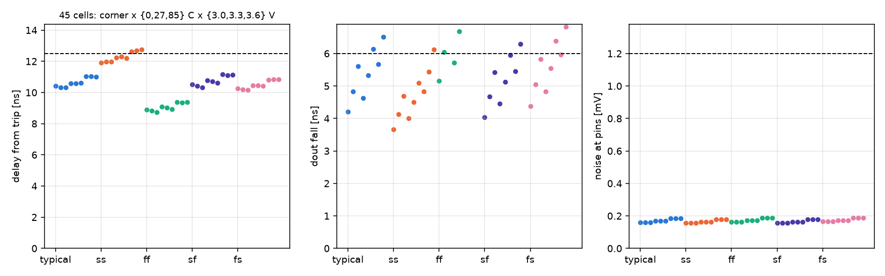

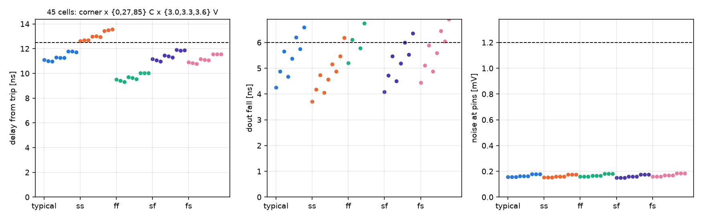

## 9. Mismatch: Monte Carlo and offset signal-independence

**Monte Carlo at 7 corner cells.**

- **ngspice:** 100 samples per cell, independent draws. 1.78-2.19 LSB.
- **VACASK:** 500 samples per cell, seeded. 1.91-2.13 LSB; every sample
  crossed.
- **The two simulators agree** within sampling error. VACASK's converted
  models reproduce ngspice's drain currents to 0.10 %.

Records: `runs/comparator-updt-v3-pvt/20261007T024232Z`,
`runs/comparator-updt-v3-vacask/20261007T024958Z`.

**Where the spread comes from.** The load mirror, at 1 x 0.5 um and
L 0.36 um, gives about 7.5 of the 9.4 mV at the pins.

**In the cell the spread doubles.** It is 3.8-4.2 LSB with a mean of +2
LSB, skewed late. The cause is the pair's C_gd on the floating top plate
as outa swings, as in v2.

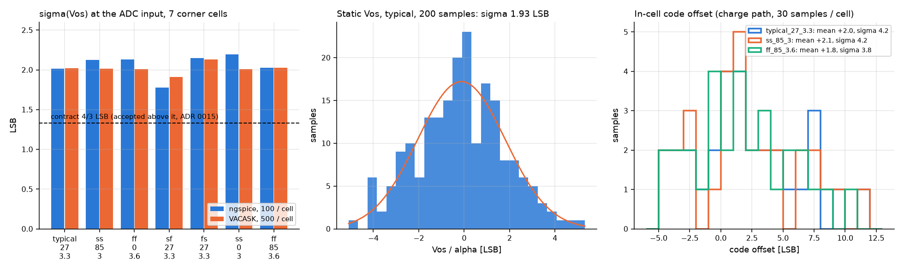

**Offset signal-independence: the condition of ADR 0015**
(`offset_lin.py`, `runs/comparator-updt-v3-lin/20261007T205548Z`, PASS).

- **Method.** 30 mismatch samples per cell. Each sample's draw is identical
  at four levels (`.options seed`), run in the cell's charge path.
- **Result.** No sample's code offset moves by more than 0.0017 LSB, at
  typical, ss / 85 / 3.0 or ff / 85 / 3.6. The pedestal calibration
  therefore removes it completely.
- **What it costs elsewhere.**
  - Range: -4.5 .. +11.5 LSB.
  - A ramp pre-roll of at least about 11 LSB.
  - A calibration span of -11 .. +15 LSB.
  - Mean + 3 sigma is about 15 counts, against the 19-count overrun.

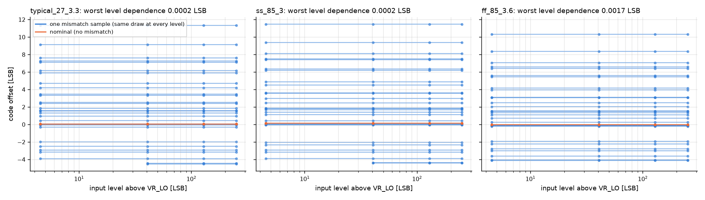

## 10. Noise (`runs/comparator-updt-v3-vacask/20261007T024958Z`)

**Small signal (ngspice `.noise`).** At the pins, 1 kHz to the own band:
0.168 mV typical, at most 0.189 mV over PVT. Of that, 0.074 mV lies below
100 kHz (flicker). Against 1.2 mV that is a 6-7x margin.

**VACASK transient noise under the 8-bit ramp.** Every device noise source
(including the bias reference) injects in the time domain over 800
conversions. The spread of dout's falling instant is the noise the
conversion sees.

| | typical | worst-noise PVT cell fs / 85 / 3.6 |
| --- | ---: | ---: |
| crossing jitter | 1.80 ns rms | 1.90 ns rms |
| at the pins | 160 uV | 169 uV |
| at the ADC input | **0.036 LSB** | **0.038 LSB** |
| gate 1.2 mV at the pins (0.269 LSB) | PASS | PASS |
| NOISE_BUDGET allocation 0.080 LSB | met | met |

**Engine checks.**

- Time-domain PSD against the noise analysis: x1.018 over 100 kHz-20 MHz,
  x1.008 over 1-300 kHz.
- Numerical floor: 2.6e-6 of the noisy sigma.
- noisefmax 1 GHz against 200 MHz: x1.006.
- The transient figure reads x0.95 of the small-signal own-band figure.

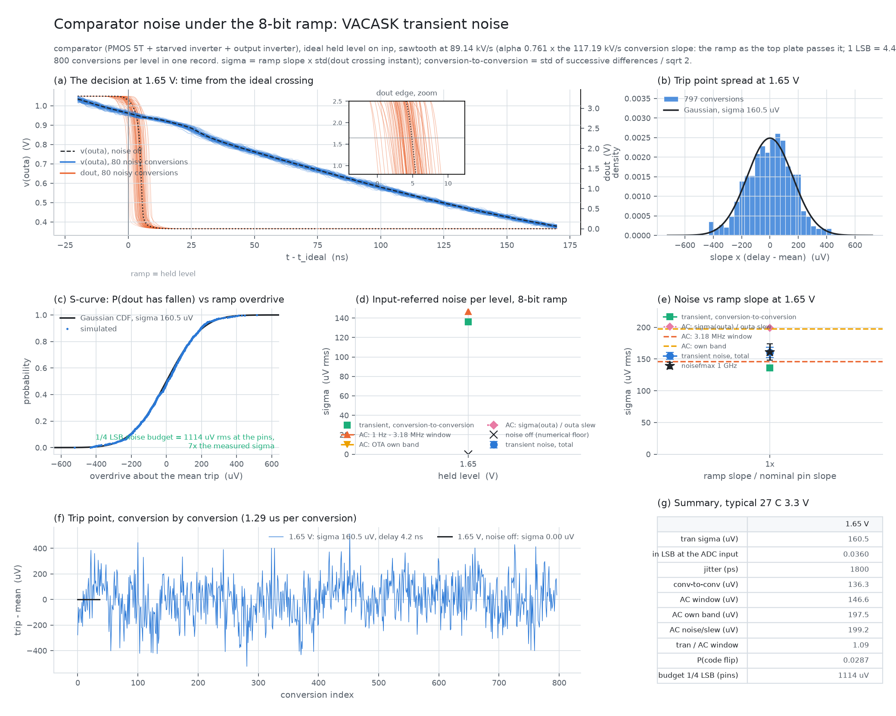

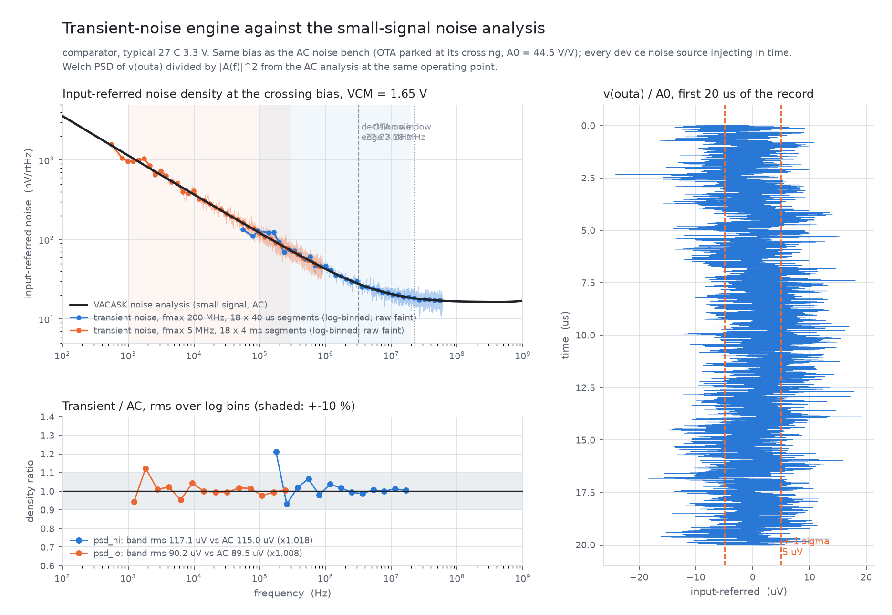


## 11. Bias-generator requirement (`bias_req.py`, `runs/comparator-updt-v3-lin-bias/20261007T205146Z`)

At each of the 45 cells the bias was swept from 0.8x to 1.4x of 1.931 uA
per finger. The requirement is the smallest current that brings the delay
within 12.5 ns.

| | controlled deck | drawn S/D geometry |
| --- | --- | --- |
| ss / 85 C | 1.05x | **1.20x** |
| ss / 27 C | 1.0x | 1.10x |
| ss / 0 C | 1.0x | 1.05x |
| cells already meeting 12.5 ns at 0.8x | 33 / 45 | 18 / 45 |
| lower bound at typical | about 0.9x | |

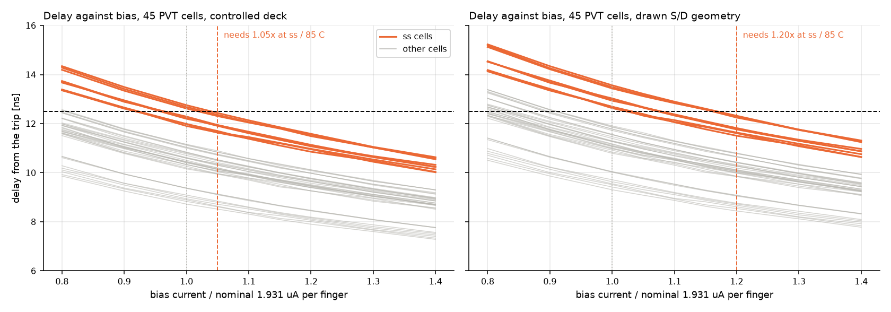

## 12. Decisions (ADR 0015) and open items

**Decisions.**

- **Offset spread accepted**, as a signal-independent per-cell constant.
- **dout fall over PVT waived.**
- **Delay at ss to be met by a dedicated bias generator**, to the s.11
  requirement.

**Open.**

- **The bias generator** has to be designed, and the comparator PVT re-run
  on it.
- **Integration into `../Analog_top_bkp/unit_cell_bps`.** Pre-roll about 11 LSB,
  calibration span -11 .. +15 LSB, and the delay with the real TSPC latch.
- **PEX**, then repeat the delay, the fall, and the offset
  signal-independence.
- **Narrow fingers.** The 0.5 um NMOS finger is below the tables' 2 um
  reference width. ngspice includes narrow-width effects, and the model's
  sigma came out 6 % low.
- **Seeding.** `tb_mc.spice` with `set rndseed` did not repeat between
  runs (9.38 vs 8.60 mV over 200 samples). Each run is an independent
  estimate. Only `.options seed` was shown to fix a draw
  (DESIGN_RECIPE.md s.7 note).

## 13. Reproduction

```sh
./scripts/sim.sh comparator                                   # tables + typical verification
./scripts/sim.sh comparator PHASES='lut size verify'          # also re-run the search (~1 h)
./scripts/sim.sh comparator-schematic                         # xschem views + testbench checks
./scripts/sim.sh comparator-pvt                               # PVT, MC (ngspice + VACASK), transient noise
./scripts/sim.sh comparator-pvt DUT_GEOM=1 PHASES='bench plot'
./scripts/sim.sh comparator-pvt PHASES='lin bias'             # offset signal-independence, bias requirement
./container.sh 'python3 report_data.py && python3 figures_v3.py'      # figures and the report page
```

Copies of every metrics.json cited here are in `results/`.
