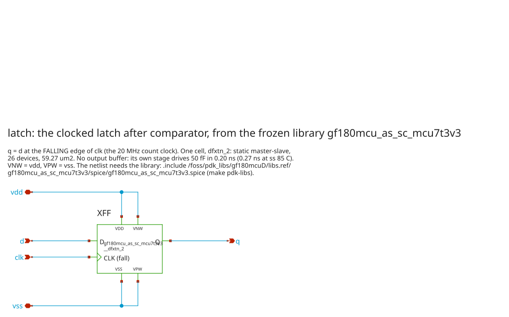

# latch: the clocked latch after comparator, as a standard cell

The PDK's own negative-edge flip-flop from the frozen 3.3 V library,
`gf180mcu_as_sc_mcu7t3v3__dfxtn_2`, in place of the hand-made TSPC
(`../latch_bkp/cmp_tspc`, untouched). It sits between `comparator`'s `dout` and the Gray
capture of `digital/wilkinson_gray_counter`, which stays unchanged.

- It samples `dout` on the **falling** edge of the 20 MHz count clock.
- q is the capture clock and drives 50 fF directly: **no buffer** (0.20 ns
  fall typical, 0.27 ns worst against 2.15 ns).
- q falls **exactly once** for any crossing time, bisected to 1 fs from the
  sampling edge at three corner cells. The master latch regenerates, so the
  TSPC's keeper problem does not arise.
- Power is 6.2 µW per latch at typical, in both d states (the TSPC: 2.5 µW
  before the crossing, 0.01 µW after). In `Analog_top_v3` DVDD is 19.0 µW for
  four latches against 3.2 µW.

Requirements, derivations and results: **[`SPEC.md`](SPEC.md)**. Decision:
`docs/decisions/0019-standard-cell-clocked-latch.md`. Record:
`runs/cmp-scff/20261010T185415Z` (37 PASS, 0 FAIL; copy in `results/`).



```text
.subckt latch d clk q vdd vss          q = d at the falling edge of clk; vdd/vss = digital supply
XFF vdd vdd vss vss clk d q gf180mcu_as_sc_mcu7t3v3__dfxtn_2      (VDD VNW VPW VSS CLK D Q)
.ends latch
```

## The library

`gf180mcu_as_sc_mcu7t3v3` is not in the image's `/foss/pdks`. Install it once:

```sh
./scripts/sim.sh pdk-libs     # ciel enable f6eeac7d --include-libraries all into $HOME/pdks
```

This installs the same pinned commit, outside the repository, and checks that
its ngspice models are byte-identical to the image's. Every deck here includes
`/foss/pdk_libs/gf180mcuD/libs.ref/gf180mcu_as_sc_mcu7t3v3/spice/gf180mcu_as_sc_mcu7t3v3.spice`;
`container.sh` mounts `$PDK_LIBS_ROOT` there read-only. There is no `dffnq`
in this library (that name is the `fd_sc` libraries'); `dfxtn_2` is its only
negative-edge flop.

## Run it

```sh
./scripts/sim.sh latch                                # everything (~15 min)
./scripts/sim.sh latch PHASES='drive aperture check'  # explore drive slew aperture kick schematic check
./container.sh 'python3 bench.py drive'                  # one bench, tables in data/
```

## Benches

| Bench | File | What it shows | Gate (SPEC.md) |
| --- | --- | --- | --- |
| explore | `tb_drive.spice`, `scff_variants.spice` | `dfxtn_2` alone, + `buff_2`, + `buff_4` into 50 fF at four cells | the flop alone meets S4 everywhere: no buffer |
| drive | `tb_drive.spice` | four cells (typical, ss 0 C 3.0 V, ff 85 C 3.6 V, ss 85 C 3.0 V); d moves both ways in both clock phases; power, leakage; `tspc_dff` on the same bench for reference | S2-S5 |
| slew | `tb_drive.spice` | clock edges 0.2-8 ns at four cells | S6 (1 ns); limit reported (8 ns at every cell) |
| aperture | `tb_aperture.spice` | `dout`'s edge swept across the sampling edge, bisected to 1 fs, then 1e-10..1e-15 s either side; slow d at three cells, fast d at typical | S7: one fall, no rise, no runt, stays low |
| kick | `tb_kick.spice` | `comparator` (on its XREFP diode, 1.681 x 1.931 uA) + latch on the cell's charge path, codes 4/64/128/250 x 8 phases, clock on/off; `tspc_dff` and 10 fF as references | S10, S12 |
| schematic | `latch.sch`, `schematic.sh` | xschem netlists `latch.sch` back to `latch.spice`; render | instance and port order equal |

## Files

| File | What it is |
| --- | --- |
| `latch.spice` | the subcircuit (one library cell) |
| `latch.sch`, `latch.sym` | xschem schematic and symbol (the TSPC's pin order) |
| `gf180mcu_as_sc_mcu7t3v3__dfxtn_2.sym` | xschem primitive symbol of the library cell (the PDK ships none for this library) |
| `scff_variants.spice` | the buffer candidates for `explore` |
| `SPEC.md` | requirements, buffer decision, results, what is not covered |
| `bench.py` | renders the bench templates, runs ngspice in parallel, reduces each run to a CSV row |
| `tb_*.spice` | bench templates |
| `check-*.awk` | PASS / FAIL / REPORT on the tables |
| `run.sh`, `container.sh`, `schematic.sh` | the flow; `scripts/run-latch.sh` and `make latch` call `run.sh` |
| `data/` | `explore.csv`, `drive.csv`, `drive_tspc.csv`, `slew.csv`, `aperture.csv`, `kick.csv`, `kick_runs.csv` |
| `results/` | copy of the cited `metrics.json` |

Reads outside this folder, read-only and by path: the PDK models, the
library's SPICE view (`/foss/pdk_libs`), `../comparator/comparator.spice`
and `../latch_bkp/cmp_tspc/tspc_dff.spice` (references in the drive and kick benches).
