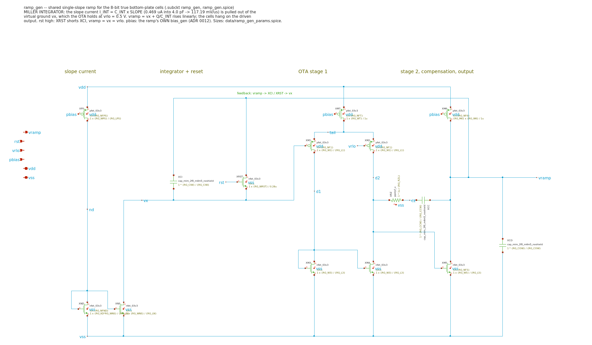
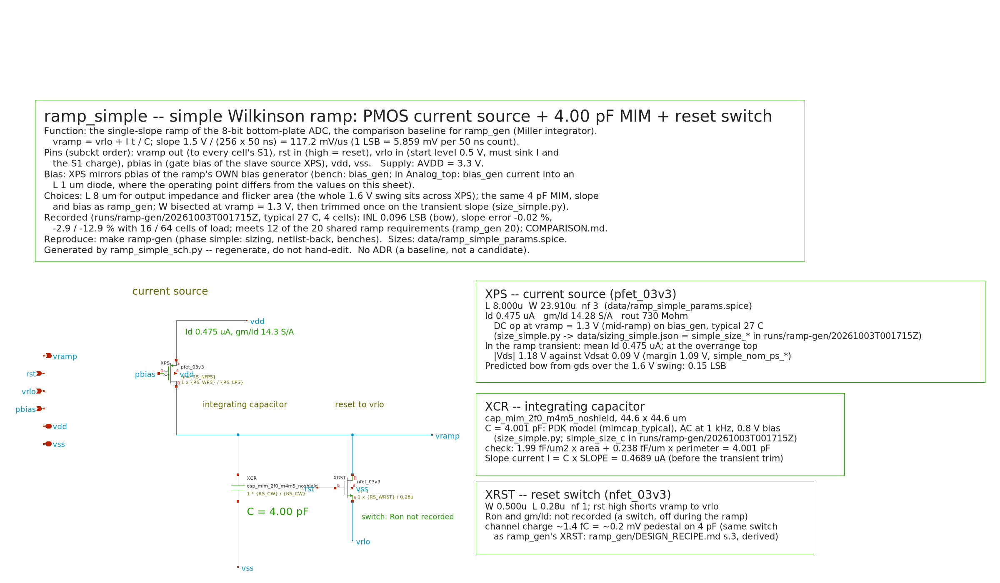
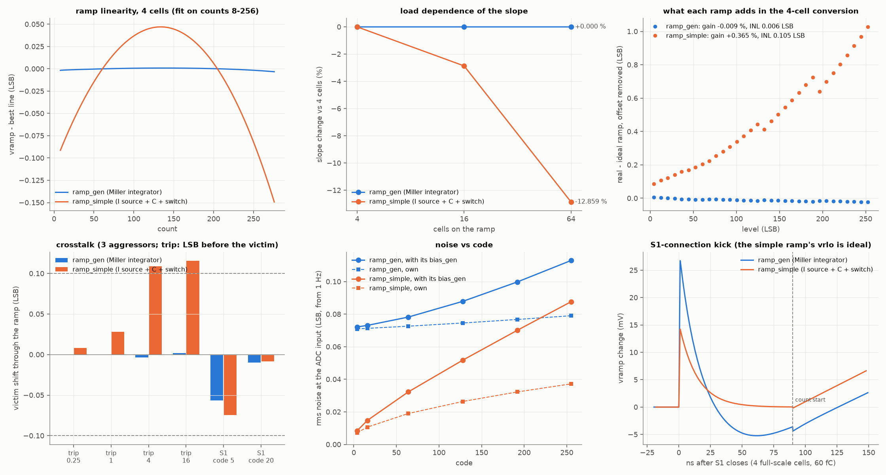

# Ramp generator: Miller integrator vs. a simple current-source ramp

Date: 2026-10-03. Scope: the shared ramp of the 8-bit true bottom-plate
single-slope ADC (`../ramp_gen/ref/unit_cell_bps`, ADR 0011), 0.5 -> 2.117 V at
117.19 mV/us. Typical corner, 27 C, 3.3 V, pre-layout.

Every number below comes from one run:
`./scripts/sim.sh ramp-gen` -> `runs/ramp-gen/20261003T001715Z/metrics.json`,
`"pass": true` (86 PASS, 0 FAIL). The side-by-side table is
`data/ramp_compare.csv`, written by `compare_ramps.py`.

## 1. Verdict

| | ramp_gen (Miller integrator) | ramp_simple (current source + C + switch) |
| --- | --- | --- |
| Requirements met (of 20 shared) | **20** | **12** |
| Ramp INL | **0.002 LSB** | 0.096 LSB (a 0.15 LSB bow end to end) |
| Slope with 16 / 64 cells vs 4 | **0.000 / 0.000 %** | -2.9 / -12.9 % |
| Error spread, 4 cells on the real ramp, 32 levels | **0.064 LSB** | 1.02 LSB |
| The ramp's crosstalk share (aggressors 4 / 16 LSB before the victim) | **-0.004 / +0.002 LSB** | +0.109 / +0.116 LSB |
| Noise at code 255, with its bias (from 1 Hz) | 0.113 LSB | **0.088 LSB** |
| Noise at code 4 | 0.072 LSB | **0.008 LSB** |
| Power, incl. its own bias_gen | 82 uW | **23 uW** |
| Area: MIM / MOS gate | 3225 / 593 um2 | **1989 / 191 um2** |
| Recovery after the reset | 578 ns | **119 ns** |
| Needs a stiff VR_LO reference | no (vrlo is a gate) | **yes** (sinks the source current and the S1 charge; ideal in these benches) |

**The integrator is the right ramp for this ADC, and it gets more right as
the array grows.** Its accuracy rests on things that do not change with the
load: the ratio I/C and an amplifier holding one node still. The simple
ramp's accuracy rests on things that do: the source's output impedance, the
junctions on the capacitor node, the capacitance the cells add, and every
charge they dump on it.

**The simple ramp is better on everything that has no feedback in it:**
- noise, by 10x at low codes and 1.3x at full scale
- power (3.5x)
- area (1.6x MIM, 3x MOS)
- recovery
- simplicity

If the array stayed at four cells, the cells were calibrated in gain, and a
stiff VR_LO reference existed, the simple ramp would be a defensible
choice. With the array going to more cells it is not: its slope moves 0.24 %
per cell connected, and the kicks it integrates grow with the number of
cells that convert before a given one.

## 2. The two architectures



**ramp_gen, Miller integrator.** The 4 pF MIM (XCI) sits in the feedback
path of a two-stage OTA, between the output vramp and the inverting input vx.
The OTA holds vx at vrlo = 0.5 V. A long NMOS sink (XNS, mirrored from the
ramp's own bias generator through XND and XPS) pulls the slope current
I = C x SLOPE = 0.469 uA out of vx. That current can only come through XCI,
so `vramp - vx = I t / C` and vramp rises at 117.19 mV/us.

- **Reset:** XRST shorts XCI, which turns the OTA into a follower and holds
  vramp = vx = vrlo.
- **The sink never sees the swing:** its drain is vx, which does not move.
- **The loads sit on a driven node:** the cells' bottom plates hang on the
  OTA output, not on the integrating capacitor.
- **Kicks are corrected, not stored:** a kick on vramp is undone by the
  loop.

15 devices: 11 MOS, 3 MIM (XCI 4 pF, XCC 0.5 pF Miller, XCO 2 pF output),
1 poly resistor (XRZ, the compensation zero).



**ramp_simple, the textbook Wilkinson ramp.** A PMOS current source (XPS,
L = 8 um, a slave of the same kind of bias line) pours 0.469 uA into the same
4 pF MIM (XCR) to ground, so vramp = vrlo + I t / C directly. XRST shorts
vramp to vrlo during reset. Three devices.

What it relies on, and what the measurements below show:
- **The swing sits across the source.** It sees V_SD from 2.8 V down to
  1.2 V, so its output conductance (rout = 730 Mohm at mid-ramp) bends the
  ramp.
- **The capacitor node carries everything.** The source and switch drain
  junctions (voltage-dependent), every cell's bottom plate, and every kick a
  cell sends all add to C.
- **vrlo must be stiff.** It must sink the source current during reset and
  absorb the S1 connection charge.

Both are sized by the same rules:
- the same capacitor;
- the slope current from a dedicated bias_gen instance;
- the current set by an operating-point bisection, then trimmed once on a
  transient of the ramp-alone bench, so both start within 0.03 % of the
  slope.

They have the same ports and pin-compatible symbols, so the same benches and
the same xschem four-cell testbench take either.

## 3. How they were compared

| Bench | What | Both? |
| --- | --- | --- |
| `tb_ramp.spice` / `tb_ramp_simple.spice` | the ramp alone, its own bias_gen, 4 x 10 fF of cell load and the S1 charge of 4 full-scale cells (60 fC); cases: nominal, no charge, VDD +-2 %, 16 and 64 cells, 300 ns pre-roll | yes |
| `noise_bench.py` / `noise_simple.py` | per-device noise spectra (ngspice) through the exact integration kernel, from 1 Hz | yes (method identical; the simple ramp's source is evaluated at mid-ramp, s.7) |
| `tb_ramp_adc4.sch` / `tb_ramp_simple_adc4.sch` (xschem) | four real unit cells (switches, MIM, cmp_bps) on the real ramp and on an ideal ramp, 48 runs: showcase, 32-level transfer, fine staircase, lowest codes, trip-kick crosstalk at 0.25 / 1 / 4 / 16 LSB (real and ideal), S1-kick crosstalk, pre-roll | yes |
| `tb_loop.spice`, VACASK `trannoise/` | loop gain; transient-noise cross-check | ramp_gen only (the simple ramp has no loop; its noise has no OTA term to cross-check) |

The ramp's own contribution to the conversion is always **real ramp minus
ideal ramp**, with the same cells, the same references and the same timeline.



## 4. Results, topic by topic

### 4.1 Linearity of the ramp itself

| | ramp_gen | ramp_simple |
| --- | --- | --- |
| INL, best line, codes 8-256 | **0.0020 LSB** | 0.096 LSB |
| INL, end-point line | 0.0027 LSB | 0.141 LSB |
| INL over the 20-count overrun | 0.0033 LSB | 0.149 LSB |
| INL with 64 cells | 0.0053 LSB | 0.070 LSB |

The simple ramp's error is a clean parabola (top-left panel). The source's
current falls as its V_SD shrinks: gds x 1.6 V / I = 4.6 % over the ramp. The
sizer predicted 0.148 LSB end to end from gds alone, and 0.141 was measured.
The integrator's 0.002 LSB is the OTA's finite gain and the sink's tiny V_DS
change (6 uV over the ramp). Cascoding the simple source would remove most of
the bow (the earlier `simulations/gf180_ramp_topology` study: 0.026 LSB at
L = 2 um, unmeasured here), at the cost of 0.3-0.5 V of top-end headroom and
a cascode bias. It would not touch anything in 4.2-4.4.

### 4.2 Load dependence: the decisive difference

| | ramp_gen | ramp_simple |
| --- | --- | --- |
| slope change, 16 cells vs 4 | **0.000 %** | -2.87 % |
| slope change, 64 cells vs 4 | **0.000 %** | -12.86 % |
| trim the transient needed beyond I/C | -0.09 % (bias settling) | -1.31 % (the load) |

In the simple ramp every cell's bottom plate (~10 fF here) adds to the 4 pF,
so the slope falls by 0.24 % per connected cell. At 8 bits 0.24 % is 0.6 LSB
at full scale. The slope therefore depends on how many cells are connected.
Through the comparators' input capacitance it also depends on how many have
already tripped.

The four-cell conversion makes it concrete. The simple ramp was trimmed on
the bench's 4 x 10 fF of ideal load. On the real cells it comes out +0.37 %
slow in gain, and the 32-level error spread is **1.02 LSB**, four times the
0.25 LSB budget. The trim was right for one load and wrong for the real one.
The integrator, trimmed the same way, lands at -0.009 % and 0.064 LSB.

### 4.3 Crosstalk through the ramp

Three aggressor cells convert d LSB before a victim cell. The ramp's share is
the victim's shift on the real ramp minus the same shift on an ideal ramp.

| d (LSB) | ramp_gen | ramp_simple |
| --- | --- | --- |
| 0.25 | -0.001 | +0.008 |
| 1 | -0.000 | +0.028 |
| 4 | -0.004 | **+0.109** |
| 16 | +0.002 | **+0.116** |
| S1 kick, victim at code 20 | -0.010 | -0.008 |

A comparator decision pushes ~1 fC through its input device's C_GD and the
cell's C_S into the ramp node.
- **Simple ramp:** that charge stays on the 4 pF as a step, about 0.037 LSB
  per aggressor (0.11 / 3). It does not decay: it is the same at 4 and 16
  LSB of distance, and it hits every cell that converts later. At 1 LSB of
  distance most of the kick has not arrived when the victim decides. In an
  array of N cells the last cell can carry up to N x 0.037 LSB.
- **Integrator:** the loop removes the charge. The share is zero at every
  distance, once the ramp has its own bias (RESULTS s.4). On the
  comparators' shared bias line the integrator took a different path, the
  slope current, and was +0.24 LSB.

The S1 charge (up to 15 fC per cell, 90 ns before the count) is absorbed by
the reset in both designs. In the simple ramp the ideal vrlo source does it.
A real reference would have to take the 60 fC of four full-scale cells and
settle back to < 0.3 mV (0.05 LSB) within the 90 ns before the count starts.
That needs a buffer with ~10 MHz of bandwidth into 4 pF, which is a second
amplifier.

### 4.4 The start of the ramp and the pre-roll

| | ramp_gen | ramp_simple |
| --- | --- | --- |
| S1 kick of 4 full-scale cells, peak | 26.7 mV (on 2 pF, loop-settled) | 14.2 mV (on 4 pF, ideal vrlo) |
| start deviation, code 0 | +0.14 LSB, settled by code 1 | -0.07 LSB (inside the bow) |
| the ramp's INL in the conversion with a 300 ns pre-roll | 0.003 LSB | **0.40 LSB** |

The pre-roll test exposes the simple ramp's weakness in one number. If the
ramp is released before S1 connects, the S1 charge lands on a free-running
capacitor and stays. That is a level-dependent offset of -2 LSB with 0.4 LSB
of INL across the transfer. The integrator absorbs the same charge through
its loop. The simple ramp can only work with S1 connected while the reset
holds the node, which fixes the timeline.

### 4.5 Noise

LSB rms at the ADC input, from 1 Hz, exact integration kernel:

| code | ramp_gen own | ramp_gen + bias | ramp_simple own | ramp_simple + bias |
| --- | --- | --- | --- | --- |
| 4 | 0.071 | 0.072 | **0.007** | **0.008** |
| 128 | 0.075 | 0.088 | **0.026** | **0.052** |
| 255 | 0.079 | 0.113 | **0.037** | **0.088** |

The simple ramp is quieter, and the reason is structural. The integrator
adds an amplifier whose input noise appears directly on vramp. Its 1/f noise
(input pair and mirror) is a flat 0.071 LSB at every code: a slowly
wandering ramp offset. The simple ramp has no amplifier. Its own noise is
one current source integrated on C, which grows from zero at code 0 (0.036
LSB of thermal noise at code 255). Its reset kT/C (0.005 LSB) is the same as
the integrator's.

Both carry the same bias generator 1/f term at high codes (0.079-0.081 LSB
at code 255). Above a few counts it is the largest single term in both.

Against the 0.25 LSB channel budget (with kT/C 0.051 and the comparator
0.024) both are comfortable: 0.126 LSB (ramp_gen) and 0.105 LSB
(ramp_simple) at code 255. Almost all of ramp_gen's extra noise is below
1 kHz, because it is 1/f. A per-frame pedestal, or auto-zeroing the OTA
(not designed), would remove it.

### 4.6 Supply, power, area, recovery

| | ramp_gen | ramp_simple |
| --- | --- | --- |
| slope vs VDD | 0.165 %/% | 0.159 %/% |
| power (incl. ~20 uW own bias_gen) | 82 uW | 23 uW |
| MIM area | 3225 um2 (4 + 0.5 + 2 pF) | 1989 um2 (4 pF) |
| MOS gate area | 593 um2 | 191 um2 |
| recovery after the end-of-ramp reset | 578 ns (Miller slew 5 V/us) | 119 ns (ideal vrlo) |

The supply sensitivity is the bias generator's in both (0.158 %/% of its
reference current). Power, area and recovery all go to the simple ramp. Its
recovery is helped by the ideal vrlo source; with a real reference it would
be that reference's slew.

## 5. What it would take to make the simple ramp pass (not measured)

| Problem | Fix | Cost |
| --- | --- | --- |
| 0.10-0.15 LSB bow | cascode the source | 0.3-0.5 V of headroom at the top (2.117 V + cascode stack under 3.3 V is tight at L = 8 um) and a cascode bias |
| 0.24 % slope per cell | a larger C: 0.05 % per cell needs C ~ 20 pF; for a 128-cell array the variation of the load is what matters (cells tripping), so tens of pF | 5-10x MIM area and current, and the noise advantage shrinks only slowly (thermal ~ 1/sqrt(C)) |
| 0.037 LSB per aggressor, integrated | the same larger C (charge / C) | as above |
| vrlo must sink the current and the S1 charge | a VR_LO buffer with ~10 MHz into the ramp node | a second amplifier, its own noise and power, i.e. most of what the integrator costs |

Each fix moves the simple ramp toward the integrator's cost without its
load independence. A buffer between a simple ramp and the cells fixes load
and kicks but adds an amplifier at the output with a 0.5-2.1 V common mode,
and its gain error then becomes INL. The integrator keeps its amplifier at a
fixed 0.5 V input.

## 6. Recommendation

1. **Keep ramp_gen (Miller integrator, on its own bias_gen)** as the
   channel ramp. It is the only one of the two that meets every requirement,
   and its accuracy does not degrade as cells are added.
2. **Reduce its noise floor**, the one figure on which the simple ramp is
   clearly better, by attacking the OTA's 1/f term (0.071 LSB flat). The
   options are a larger input pair and mirror area at lower bandwidth, or
   auto-zero of the OTA offset onto a capacitor during reset. Neither is
   designed yet.
3. **Keep ramp_simple in the repository as the measured baseline.** It
   documents why the integrator's cost is paid, and it is the fallback for a
   4-cell-only, gain-calibrated test chip with a stiff off-chip VR_LO.

## 7. Caveats

- Typical corner only; no PVT, Monte Carlo, layout or extraction for either.
- vrlo is an ideal source in every bench. This flatters the simple ramp
  (S1 charge, reset current, recovery) far more than the integrator, whose
  vrlo is a gate.
- The simple ramp's noise uses the source's mid-ramp operating point; its
  real operating point moves with the ramp (V_SD 2.8 -> 1.2 V). Inside
  saturation the noise changes little over that range, but it is an
  approximation the integrator's analysis does not need.
- The simple ramp's INL with 64 cells (0.070 LSB) is lower than with 4
  (0.096 LSB) for the wrong reason. The 64 cells' capacitance slows the
  ramp by 12.9 %, so over the same 276 counts it swings 12.9 % less voltage.
  Its source then sees a smaller V_SD change, and the bow shrinks with it.
- The VACASK transient-noise cross-check (`trannoise/`) covers ramp_gen
  only.

## Reproduce

```sh
./scripts/sim.sh ramp-gen                                  # both designs, every phase
./scripts/sim.sh ramp-gen PHASES='simple compare plot'     # the baseline and the comparison only
```

Files of the baseline: `ramp_simple.spice`, `ramp_simple.sch`,
`ramp_simple.sym`, `data/ramp_simple_params.spice` (`size_simple.py`),
`tb_ramp_simple.spice`, `noise_simple.py`, `tb_ramp_simple_adc4.sch`
(`tb_ramp_adc4_sch.py simple`). Comparison: `compare_ramps.py` ->
`data/ramp_compare.csv`, `assets/ramp_compare.png`.
