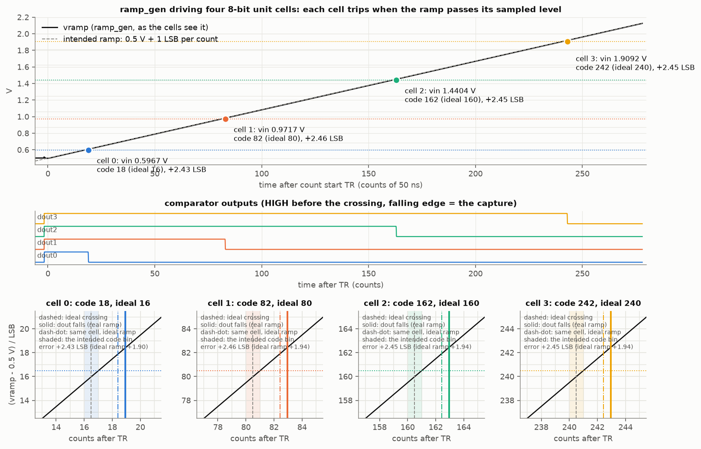

# ramp_gen -- the shared ramp of the 8-bit bottom-plate single-slope ADC

One ramp generator drives the bottom plates of every unit cell
(`../ramp_gen/ref/unit_cell_bps`): 0.5 V -> 2.117 V at 117.19 mV/us (1 LSB = 5.859 mV per
50 ns count, 256 codes plus a 20-count overrun). It is a **Miller integrator**:
the slope current I_INT = C_INT x SLOPE (0.469 uA into a 4 pF MIM) is drawn
out of a virtual ground that never moves, so the slope is independent of how
many cells hang on the output and of what they do (S1-connection charge,
comparator trip kicks, input capacitance changing at the trip). Every current
is a mirror of the `pbias` line of a **dedicated** `../ramp_gen/ref/bias_gen` instance:
never the comparators' line, because a comparator decision glitches that line
by ~0.5 mV and the integrator would keep the glitch as a ramp shift for every
cell that converts later (RESULTS s.4).



Results and verdict: [`RESULTS.md`](RESULTS.md). How the ADC's numbers set
every W and L: [`DESIGN_RECIPE.md`](DESIGN_RECIPE.md).

## Run it

```sh
./scripts/sim.sh ramp-gen                       # from the repo root: every phase
./scripts/sim.sh ramp-gen PHASES='ramp check'   # a subset
```

The record is `runs/ramp-gen/latest/metrics.json`. `./run.sh` in this
directory runs the block standalone with its own record. The phases
(`phases.sh`, inside the pinned container):

| Phase | What it does |
| --- | --- |
| `size` | `size_ramp.py` re-derives every size into `work/size/` and must reproduce `data/ramp_gen_params.spice` |
| `schematic` | xschem netlists `ramp_gen.sch`; `check-schematic.awk` compares it with `ramp_gen.spice` device by device; netlists the testbench `tb_ramp_adc4.sch`; renders both |
| `ramp` | `tb_ramp.spice`: the ramp alone on the real bias generator, cases nominal (4 full-scale cells of load and S1 kick), no kick, VDD +-2 %, 16 and 64 cells, a 300 ns pre-roll; `reduce_ramp.py`: slope, INL, start transient, virtual-ground excursion, kick, recovery |
| `loop` | `tb_loop.spice`: loop gain by Middlebrook double injection at the OTA input, in reset and at three ramp levels, and with 64 cells of load |
| `noise` | `noise_bench.py`: per-device noise spectra (ngspice), pushed through the exact integration kernel into LSB rms at each code |
| `trannoise` | `trannoise/run.sh`: VACASK transient noise of the four-cell system, group by group, against the kernel (~8-16 min) |
| `adc4` | the xschem testbench netlist: four unit cells on the real ramp and on an ideal ramp, 48 runs (showcase, 32-level transfer, fine staircase, lowest codes, trip-kick crosstalk on the real and the ideal ramp, S1-kick crosstalk, pre-roll); `reduce_adc4.py` |
| `simple` | the comparison baseline `ramp_simple` (current source + capacitor + switch) through the same benches: sizing, schematic netlist-back, ramp alone, noise, the same 48 four-cell runs |
| `compare` | `compare_ramps.py`: both designs against the same requirements -> `data/ramp_compare.csv`, `assets/ramp_compare.png`; the report is [`COMPARISON.md`](COMPARISON.md) |
| `plot` | `plot_ramp.py`: the figures under `assets/` |
| `check` | `check-ramp.awk`: the acceptance gates of DESIGN_RECIPE.md s.1 |

The transient-noise cross-check (VACASK, every device noise source in the
time domain, group by group) lives in `trannoise/` with its own entry.

## The architecture in one paragraph

A Wilkinson ramp is `V = I t / C`. The simple way builds it literally: a
current source pours I into a grounded capacitor, and the capacitor's voltage
*is* the ramp (`ramp_simple`). Everything on that node then shapes the ramp: the
source sees a 1.6 V swing (its output conductance bends the slope), the cells'
bottom plates add to C, and every kick stays in C as a permanent offset. The
Miller integrator (`ramp_gen`) puts the same capacitor in the feedback path
of an amplifier. The amplifier holds the capacitor's lower plate (vx) at a
fixed 0.5 V, the current is pulled out of that fixed node, and the ramp
appears on the amplifier's output: `vramp = vx + I t / C`. The current source
never sees the swing, the cells hang on a driven output, and a kick is
corrected by the loop instead of being stored.

## The circuit


```text
                 XRST (rst high = reset)
              +-----/ -----+
              |   XCI 4 pF |
     vx ------+----||------+------ vramp ---> S1 of every cell
     |                     |          |
     |    +-------+        |        XCO 2 pF (kick absorber)
     +--(-|  OTA  |>-------+          |
  vrlo --(+|      |                  vss
     |    +-------+
   XNS sink (I_INT, L = 20 um) <- XND diode (4 x) <- XPS pbias slave (L = 4 um)
OTA: XM1/XM2 PMOS pair (L 4 um), XM3/XM4 NMOS mirror, XM5 common source,
     XM6 pbias-slave load, XCC 0.5 pF + XRZ Miller compensation; XM7 tail
```

Ports `vramp rst vrlo pbias vdd vss`. `pbias` comes from the ramp's own
`bias_gen` instance (`XBIASR` in the testbench). `rst` is 0 / VDD, HIGH = reset
(vramp = vx = vrlo); the ramp starts when rst falls. `vrlo` is the start level
(0.5 V), a gate only.

## Files

| File | What it is |
| --- | --- |
| `ramp_gen.spice` | the subcircuit, topology only; sizes are `{RG_*}` parameters |
| `data/ramp_gen_params.spice`, `data/sizing.json` | the sizes and the sizer's predictions (`size_ramp.py`) |
| `ramp_gen.sch`, `ramp_gen.sym` | the routed xschem drawing and symbol (generated by `ramp_gen_sch.py` with `sch_lib.py`; the drawing netlists back to the deck) |
| `ramp_simple.spice`, `ramp_simple.sch`, `ramp_simple.sym`, `data/ramp_simple_params.spice` | the comparison baseline: current source + capacitor + switch, pin-compatible (`size_simple.py`, `ramp_simple_sch.py`) |
| `tb_ramp_simple.spice`, `noise_simple.py`, `tb_ramp_simple_adc4.sch` | its ramp-alone bench, noise breakdown and four-cell testbench (`tb_ramp_adc4_sch.py simple`) |
| `compare_ramps.py`, `COMPARISON.md` | the comparison and its report |
| `tb_ramp_adc4.sch`, `tb_ramp_adc4_ctl.inc` | the xschem testbench (generated by `tb_ramp_adc4_sch.py`) and its timeline / measures |
| `tb_ramp.spice`, `tb_loop.spice` | the ramp-alone and loop-gain benches |
| `noise_bench.py` | the frequency-domain noise breakdown (benches generated into `work/noise/`) |
| `reduce_ramp.py`, `reduce_loop.py`, `reduce_adc4.py` | reducers to `name = value` lines and `data/*.csv` |
| `check-ramp.awk`, `check-schematic.awk` | acceptance |
| `xschemrc` | the PDK rc plus `../ramp_gen/ref/unit_cell_bps` on the symbol path (`cell_bps.sch` names `sw_blk.sym` / `cmp_blk.sym` bare); xschem reads it when started here |
| `trannoise/` | the VACASK transient-noise cross-check (phase `trannoise`) |
| `explore/` | the exploration scripts behind the sizing decisions (damping, gate area, C_OUT, the shared-pbias crosstalk), kept for reproduction |
