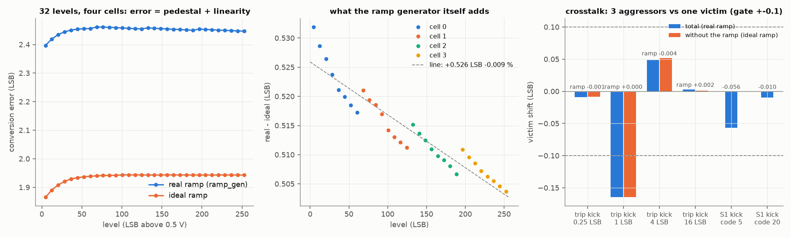
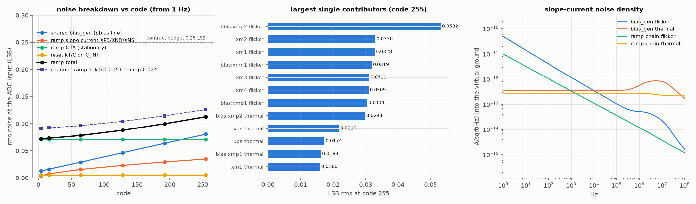
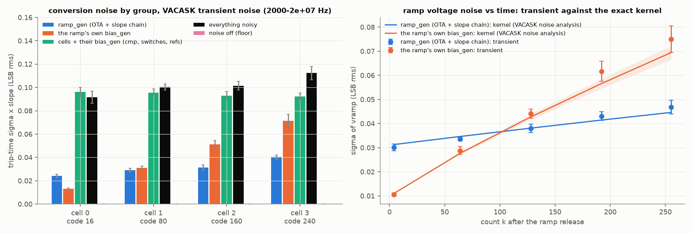
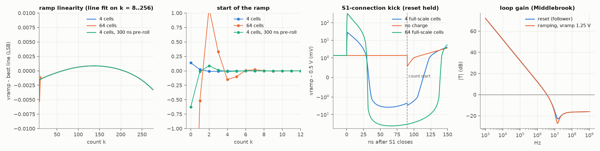

# ramp_gen -- results

The comparison with a simple current-source ramp, run through the same
benches: [`COMPARISON.md`](COMPARISON.md) (`runs/ramp-gen/20261003T001715Z`).

Run: `./scripts/sim.sh ramp-gen` -> `runs/ramp-gen/20261002T232629Z/metrics.json`,
**`"pass": true`**, 77 PASS lines, 0 FAIL. Typical corner, 27 C, 3.3 V,
pre-layout. Every phase ran: size, schematic, ramp, loop, noise, trannoise
(VACASK), adc4 (48 four-cell runs), plot, check. The figures under `assets/`
were re-rendered from the same run's outputs afterwards with axis limits and
legend placement changed (no data changed).

## 1. The answer

| Requirement (DESIGN_RECIPE s.1) | Limit | Measured | |
| --- | --- | --- | --- |
| R2 slope at typical | within 0.5 % | **+0.008 %** (117.20 mV/us) | PASS |
| R3 ramp INL, best line, codes 8-256 | <= 0.05 LSB | **0.0020 LSB** (overrun 0.0033) | PASS |
| R3 the ramp's INL inside the conversion (real - ideal ramp, 32 levels, 4 cells) | <= 0.1 LSB | **0.0064 LSB** | PASS |
| R4 slope with 16 / 64 cells of load vs 4 | <= 0.05 % | **+0.0000 / +0.0000 %** | PASS |
| R4 INL with 64 cells | <= 0.05 LSB | 0.0053 LSB | PASS |
| R5 start transient over by | code 4 | code 1 (4 cells; code 6 with 64) | PASS |
| R6 S1 kick, 4 full-scale cells | <= 35 mV | 26.7 mV (3.6 mV left at count start) | PASS |
| R7 trip-kick crosstalk, the ramp's share (3 aggressors 0.25 / 1 / 4 / 16 LSB before the victim) | <= 0.1 LSB | **-0.0007 / -0.0000 / -0.0035 / +0.0019** | PASS |
| R7 S1-connection crosstalk at code 20 | <= 0.1 LSB | -0.0098 LSB (code 5: -0.056) | PASS |
| R8 the ramp's own noise at code 255, from 1 Hz | <= 0.10 LSB rms | **0.079 LSB** | PASS |
| R8 with its bias generator | <= 0.15 LSB rms | **0.113 LSB** | PASS |
| R8 channel at code 255 (ramp + kT/C 0.051 + comparator 0.024) | <= 0.25 LSB rms | 0.126 LSB | PASS |
| R9 recovery after the end-of-ramp reset | <= 1 us | 578 ns | PASS |
| R10 slope vs VDD | <= 0.2 %/% | 0.165 %/% (96 % of it is bias_gen's, s.5) | PASS |
| loop phase / gain margin, reset and ramping | >= 55 deg / 10 dB | 58.8-60.8 deg / 15.7-18.9 dB, crossover 3.5 MHz | PASS |
| R12 power | <= 100 uW | **81.9 uW** (ramp 60 uW + its own bias_gen) | PASS |
| four cells on the real ramp: 32-level error spread | <= 0.25 LSB | **0.064 LSB** (ideal ramp: 0.078) | PASS |

## 2. Four cells converting on the ramp, against the 8-bit grid

The xschem testbench `tb_ramp_adc4.sch` (netlisted by the flow, so the drawn
`ramp_gen.sch` and the drawn `cell_bps.sch` are what is simulated) samples
four DC levels at the middle of codes 16, 80, 160 and 240 and converts them on
the real ramp:

| cell | vin | code (ideal) | error, real ramp | error, ideal ramp | the ramp's part |
| --- | --- | --- | --- | --- | --- |
| 0 | 0.5967 V | 18 (16) | +2.427 LSB | +1.901 LSB | +0.526 |
| 1 | 0.9717 V | 82 (80) | +2.460 | +1.942 | +0.518 |
| 2 | 1.4404 V | 162 (160) | +2.454 | +1.943 | +0.511 |
| 3 | 1.9092 V | 242 (240) | +2.450 | +1.943 | +0.507 |

Every cell lands **two codes above** its ideal code. That pedestal is
common, static and calibratable. The cell itself contributes +1.94 LSB on an
ideal ramp: the comparator delay plus the charge terms, as in
`../ramp_gen/ref/unit_cell_bps`. The ramp adds a constant **+0.53 LSB**. That is its
offset: the OTA's velocity error (Cc x SLOPE / gm1 = 4.6 mV) less the reset
level. Over 32 levels the ramp's part is a line of +0.526 LSB and -0.009 %
of gain with **0.006 LSB** of residue.

## 3. Noise, and where it comes from

**Frequency domain, exact** (`noise_bench.py`, ngspice). Every device that
sets the slope sits at a fixed operating point (vx never moves), so its
noise is stationary. Its contribution at code k is the exact integral of its
PSD through the integration kernel, flicker included, from F_LO = 1 Hz. The
OTA's noise is a stationary voltage on vramp. LSB rms at the ADC input:

| code | the ramp's bias_gen | slope chain XPS/XND/XNS | OTA | reset kT/C | **ramp own** | **ramp total** |
| --- | --- | --- | --- | --- | --- | --- |
| 4 | 0.013 | 0.004 | 0.071 | 0.005 | 0.071 | **0.072** |
| 64 | 0.029 | 0.016 | 0.071 | 0.005 | 0.073 | **0.078** |
| 128 | 0.046 | 0.023 | 0.071 | 0.005 | 0.075 | **0.088** |
| 192 | 0.064 | 0.029 | 0.071 | 0.005 | 0.077 | **0.100** |
| 255 | 0.081 | 0.035 | 0.071 | 0.005 | 0.079 | **0.113** |

- Low codes are set by the **OTA's own 1/f noise**: the input pair at
  0.033 LSB per device and the mirror at 0.031 per device. It is a slowly
  wandering ramp offset.
- High codes are set by the **bias generator's 1/f noise integrated into
  the slope**. XMP2's flicker alone is 0.053 LSB at code 255.
- The slope chain designed here (L = 20 um sink, 4:1 diode, L = 4 um slave)
  adds only 0.035 LSB.
- Almost all of it is slow. From 100 Hz the code-255 total is 0.076 LSB; from
  10 kHz it is 0.057 LSB. A per-frame pedestal or gain reference removes the
  part below its own rate.

**Time domain, independent check** (`trannoise/`, VACASK transient noise):
every device noise source injects in the time domain, groups are silenced
with quiet model copies, and 9-12 seeds x 24 conversions are kept per
group. The generated band is 2 kHz-20 MHz, so these numbers are lower than
the 1 Hz figures above; they validate the kernel, not the 1 Hz total.

| trip-time sigma (LSB rms) | cell 0, code 16 | cell 1, code 80 | cell 2, code 160 | cell 3, code 240 |
| --- | --- | --- | --- | --- |
| ramp_gen (OTA + slope chain) | 0.024 | 0.029 | 0.031 | 0.040 |
| the ramp's own bias_gen | 0.013 | 0.031 | 0.051 | 0.072 |
| cells + their bias_gen (comparator, switches, FVF refs) | 0.096 | 0.095 | 0.093 | 0.092 |
| everything | 0.092 | 0.100 | 0.102 | 0.112 |

- The transient sigma of vramp matches the kernel within its error bars at
  every count, for the ramp group (0.030-0.047 LSB measured, 0.031-0.045
  predicted) and for the bias group (0.011-0.075, predicted 0.011-0.069).
- The three groups add in quadrature to the all-noise case within 3 SE.
- The noise-off floor is 0.000.
- **Caveats:**
  - VACASK's BSIM4 flicker is 2.3x ngspice's on these devices (the
    comparator block found the same). The gate therefore compares the
    transient with VACASK's own noise analysis.
  - The cross-check exposed a path the first `noise_bench.py` missed: the
    ramp's bias line also biases the OTA's tail and load, so bias noise
    reaches vramp directly. Bench V2 now carries it: 0.013 LSB at code 4,
    against 0.009 for the slope path alone.

The ramp adds about 0.03-0.04 LSB of trip noise in that band, on top of a
cell-side 0.09 LSB.

## 4. Crosstalk: why the ramp has its own bias generator

The first complete design put the ramp's pbias slave on the comparators'
shared pbias line, as the contract's single bias line suggested. The
four-cell crosstalk test failed. Three aggressors tripping 1 LSB before the
victim moved it by +0.237 LSB through the ramp, and the effect rang to
-0.119 LSB at 4 LSB.

- **Not the kick charge:** doubling and tripling C_OUT (with stage 2
  re-sized to keep the phase margin) left the 1 LSB figure at +0.16
  (`explore/xt_sweep.sh`).
- **The shared line:** every comparator decision glitches pbias by
  ~0.5 mV. Through XPS (29 uS) that is a ~0.8 % slope-current step for
  ~200 ns, and **the integrator keeps it as a ramp shift for every cell
  that converts later**.
- **The test:** putting the ramp on its own bias_gen instance took its
  share to 0.000 LSB at 1 LSB and -0.004 at 4 LSB, with the 2 pF C_OUT
  unchanged (`explore/xt_pbias.sh`, `explore/xt_pbias2.sh`).

The rule for integration is therefore: **the ramp's pbias is never the
comparators' pbias.** It costs one bias_gen instance (~20 uW).

The same test measures a crosstalk **the ramp does not cause**. On an ideal
ramp, three aggressors 1 LSB before a victim move it by -0.165 LSB. That
coupling runs through the comparators' own shared pbias and VBL lines. It
is above SPEC_BPS item 20's 0.1 LSB and belongs to the bias / comparator /
midrail blocks (s.6).

## 5. The ramp alone

- **Linearity:** a 0.003 LSB bow, flat for 4 and 64 cells and with the
  pre-roll. Every junction on the integrating node sits on vx (fixed) or
  vramp (driven), so the reset-switch mechanism that limited the
  grounded-capacitor ramps (`simulations/gf180_ramp_topology`) is gone.
- **Slope trim:** the sizer trims the slope current in a transient of this
  bench. The bias generator's settled transient state carries 0.095 % less
  slave current than its DC operating point, about 70 uV of pbias. Without
  the trim the slope came out 0.09 % slow.
- **Start:** the first counts carry the velocity error coming in, plus the
  S1-kick residue. With 4 cells code 0 is off by +0.14 LSB and settled by
  code 1. The residue depends on the other cells' levels (+0.77 LSB at code 0
  with no charge at all; -1.4 with 16 cells; -5.7 with 64 cells, settled by
  code 6). A **300 ns pre-roll** (rst falls 300 ns before TR, vrlo lowered by
  SLOPE x 300 ns) does **not** clear the start as timed. S1 still connects
  at TR - 90 ns, so the kick now lands on the moving ramp: code 0 is off by
  -0.63 LSB and settles by code 3. Its INL from code 8 is 0.002 LSB. A useful
  pre-roll needs S1 to connect before the release (a controller timeline
  change, not made here).
- **Load scaling:** slope and INL are unchanged up to 64 cells, which is
  what the integrator was chosen for. C_OUT is sized for 4 cells: 64
  full-scale cells kick 336 mV and settle by code 6. A larger array needs
  C_OUT scaled with N, a pre-roll, or a separate VR_LO pre-charge bus for
  the S1 connection.
- **Supply:** 0.165 %/% of slope per % of VDD. bias_gen's own reference
  current moves 0.158 %/% at the same supply step, so the ramp adds
  0.007 %/% of its own (operating-point split, `explore/psr.sh`). 1 % of
  VDD is 0.42 LSB at full scale. The fix belongs in bias_gen.
- **Recovery:** 578 ns to within 1 mV after the end-of-ramp reset. That
  limit is the Miller slew I_TAIL / Cc = 5 V/us.

## 6. Findings for other blocks (reported, not acted on)

| Finding | Owner | Number |
| --- | --- | --- |
| The cells' crosstalk through the shared comparator pbias / VBL | bias_gen, comparator_lp, midrail_ref | -0.165 LSB, 3 aggressors 1 LSB away (ideal ramp) |
| Cell-side trip noise about twice kT/C + comparator; includes the FVF references, not broken down | midrail_ref / unit_cell_bps | 0.09-0.10 LSB (2 kHz-20 MHz) |
| bias_gen supply sensitivity sets the ramp's | bias_gen | 0.158 %/% |
| bias_gen 1/f noise is the largest ramp term at high codes | bias_gen | 0.081 LSB at code 255 from 1 Hz |
| `cell_bps.sch` names its symbols bare, so xschem started elsewhere silently drops XS0/XS1/XS2/XCMP | unit_cell_bps | worked around by `xschemrc` here |

## 7. Not done

- No PVT, no Monte Carlo, no layout, no extraction. The slope's process spread
  (bias current 0.69x-1.77x over PVT per bias_gen, MIM tolerance) needs a
  trim DAC or a calibration; none is designed.
- VR_LO (the `vrlo` pin) is an ideal 0.5 V source; its noise and its source
  are not designed.
- The VACASK cross-check does not cover below 2 kHz, the independence of its
  20 MHz upper band edge, or PVT.
- The pre-roll changes the controller's timeline (rst before TR); it is
  measured here, not adopted in the contract.
