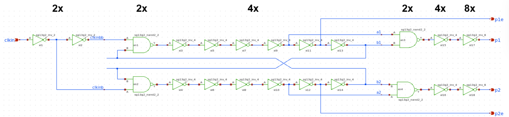
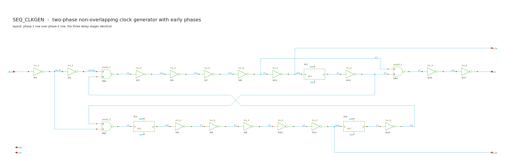
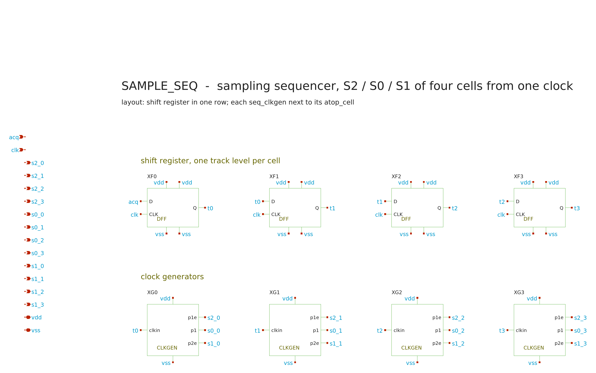
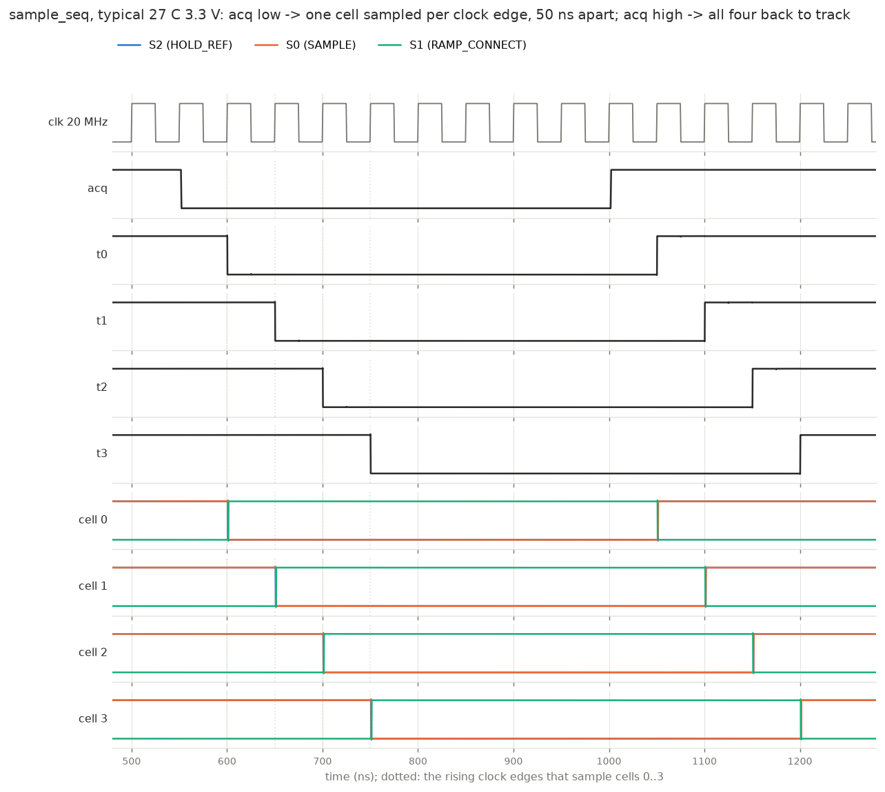
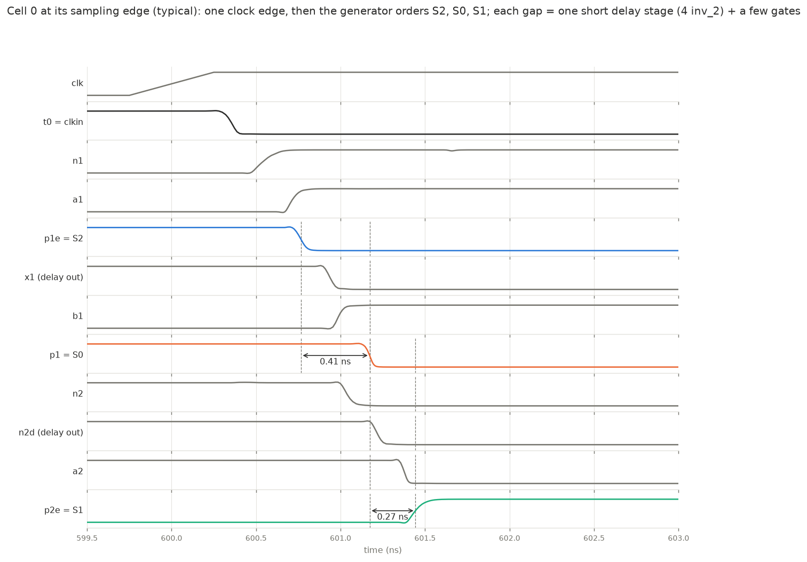
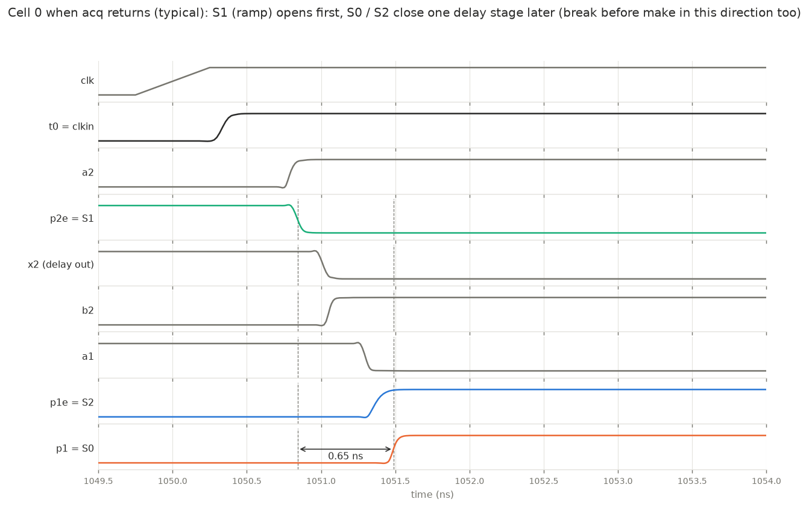
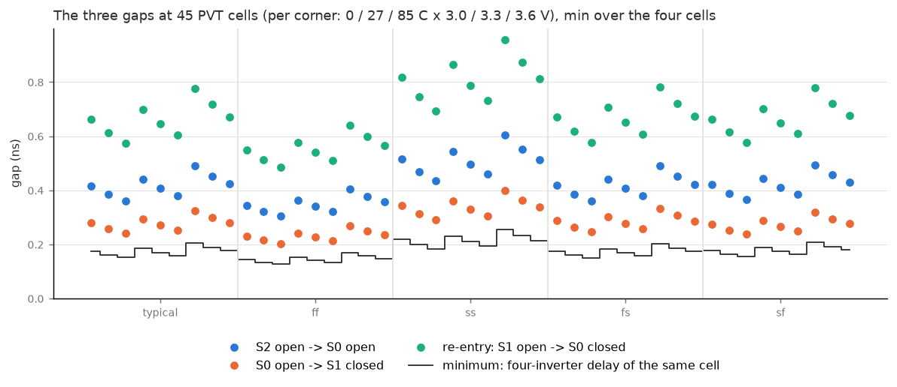

# sample_seq: how one 20 MHz clock makes S2 / S0 / S1 at least 5 ns apart

Date: 2026-11-06. Decision record ADR 0029 (structure), ADR 0027
(requirements). Results `README.md`, requirements `SPEC.md`. Figures from
`PHASES=wave ./scripts/sim.sh sample-seq` (typical, 27 C, 3.3 V;
`runs/sample-seq/20261107T014517Z`) and the PVT record
`runs/sample-seq/20261106T183443Z` (39/39).

**Since 2026-11-15 (ADR 0031) the delay stages are 4 x `inv_2`, not
22 x `dlybuff_2`, and the gaps are a few hundred ps (>= the generator's own
four-inverter delay, no 10 / 90 overlap), not >= 5 ns.** The structure, the
signal paths and the edge order below are unchanged; the times quoted
(5 ns, 7.2 ns, 14.85 ns, ...) are the 5 ns version's. The current numbers
and figures (`assets/wave_*.png`, `gaps_pvt.png`, regenerated by
`runs/sample-seq/20261115T105738Z`) are in `README.md`.

## 1. The job

Each of the four bottom-plate cells has three switches, HIGH = closed:

| Switch | Net | Track | Hold |
| --- | --- | --- | --- |
| S2, bottom plate to VREF (HOLD_REF) | `s2_k` | closed | open |
| S0, input gate (SAMPLE) | `s0_k` | closed | open |
| S1, top plate to the ramp (RAMP_CONNECT) | `s1_k` | open | closed |

When the controller drops `acq`, cell k must sample at the k-th rising clock
edge (cells 50 ns apart) with the order **S2 opens, then S0 opens, then S1
closes**, each step at least 5 ns after the previous one. When `acq` returns,
the order must reverse: **S1 opens before S0 closes** (otherwise VIN and the
ramp are shorted through the top plate), again at least 5 ns apart.

## 2. The source circuit

B. Murmann, EE628, `5_Design/3_Real_circuits/template_clkgen.sch` (lecture 12):
a two-phase non-overlapping clock generator.

The clock is split into `clkinbb` (phase 1) and `clkinb` (phase 2). Each phase is a
NAND (`xn1` / `xn2`) followed by four inverters to `a1` / `a2`. One more
inverter gives the **early phase** `p1e` / `p2e`, and one after that gives the
**feedback** `b1` / `b2`. The feedback crosses over to the other phase's NAND.
The main phase is `p1 = NAND(a1, b1)` buffered 4x / 8x (`p2` likewise). The
cross-coupling makes it break-before-make: phase 2 cannot start until phase 1's
feedback `b1` has moved, and the same holds the other way round. Inside a
phase, the early output moves before the main one.

## 3. What was built

**One copy of the template per cell (`seq_clkgen`)**, same gates and same
connections, mapped onto the three switches:

| Template node | Here | Why |
| --- | --- | --- |
| `p1e` (early phase 1) | **S2** | moves first when phase 1 turns off |
| `p1` (phase 1) | **S0** | moves after `b1`, i.e. after S2 |
| `p2e` (early phase 2) | **S1** | phase 2 starts only after `b1`; on the return it stops first |
| `p2` (`xn4`, `xi16`, `xi18`) | not built | nothing uses it |

**Three delay stages added** (`seq_dly` = 22 `dlybuff_2`, identical). The
template's inverter-only delays are ~0.1 ns, but each gap must be 5 ns:

| Inserted | Template path | Sets |
| --- | --- | --- |
| `XL1` between `p1e` and `xi13` | `a1 -> p1e -> b1` | S2 open -> S0 open |
| `XL2` between `xn2` and `xi4` | `b1 -> xn2 -> a2 -> p2e` | S0 open -> S1 closed |
| `XL3` between `p2e` and `xi14` | `p2e -> b2 -> xn1 -> a1` | on the return: S1 open -> S0 / S2 closed |

N = 22 is the smallest count that keeps every gap at or above 5.25 ns
(5 ns [U] + 0.25 ns layout allowance [A]). It is set by the fastest corner
(ff, 0 C, 3.6 V), where `dlybuff_2` is 0.235 ns per cell.

**What drives `clkin`.** The template's input is not the free-running
20 MHz clock. It is a per-cell level `t_k` from a four-flop shift register on the
clock: `t0` = `acq` one edge later, `t1` = `t0` one edge later, and so on.

## 4. How the 20 MHz clock turns into edges 5 ns apart

The clock decides **when** a cell samples (which edge). The 5 ns spacing is
**not** derived from the clock period: it is the propagation delay of the
inserted stages, so it is an absolute delay that varies over PVT
(5.26-10.80 ns). Step by step for cell 0 at typical (times after the
rising clock edge, measured by `wave.py`):

1. 0.35 ns: the flop takes `acq` = 0, `t0` falls. Through `xi1` / `xi2` and
   `xn1`, `n1` rises; four inverters later `a1` rises.
2. **0.76 ns: `p1e` falls, S2 opens.** This is the template's short path,
   so the sampling instant is the clock edge plus a fixed 0.76 ns.
3. `p1e` runs through `XL1` (22 cells): `x1` falls at 7.76 ns, `b1` rises.
4. **8.00 ns: `p1 = NAND(a1, b1)` falls, S0 opens**, 7.24 ns after S2.
5. `b1` high releases phase 2: `n2 = NAND(clkinb, b1)` falls, runs through
   `XL2` (`n2d` 14.85 ns), four inverters, `a2` falls.
6. **15.08 ns: `p2e` rises, S1 closes**, 7.08 ns after S0.

Cells 1, 2, 3 do the same at the next three edges, because their `t_k` falls
one period later each. When `acq` returns, `t0` rises at the next edge and the
template runs the other way:
- phase 2 stops first: **S1 opens at 7.88 ns**;
- `p2e` goes through `XL3`, so `b2` rises and `xn1` releases phase 1;
- **S2 closes at 15.24 ns and S0 at 15.37 ns**, 7.48 ns after S1 opens.

## 5. Waveforms

All four cells. Each cell moves once at its own edge and then holds until `acq`
returns. The four flops see every clock edge; the generators see only their
own `t_k`.

Cell 0 at its sampling edge, through the generator's nodes:

Cell 0 when `acq` returns. The ramp switch breaks before the input gate makes:

The three gaps at all 45 PVT cells. Every point is the minimum over the four
cells; none is below 5 ns. The smallest values are at ff / 0 C / 3.6 V and
the largest at ss / 85 C / 3.0 V:

## 6. Compared with the suggested three-tap delay line

The suggestion (a designer's note, 2026-11-06): in the template's top branch,
replace the `a1 -> b1` segment with two 5 ns stages. Tap 1 is after `a1` through an
inverter, tap 2 is after stage 1, and tap 3 is at `b1`, which feeds `xn3` and the
cross-over to `xn2`. The template keeps running on the free-running 20 MHz
clock. Alternative: three copies of `p1` shifted by 5 ns delay cells.

| | Suggested | Built here |
| --- | --- | --- |
| First edge: tap after `a1` through an inverter | yes | **same** (`xi11` -> `p1e` = S2) |
| 5 ns stage in the `a1 -> b1` segment, `b1` into `xn3` and `xn2` | two stages, three taps on phase 1 | **one stage** (`XL1`); `b1 -> xn3` gives S0, `b1 -> xn2` releases phase 2 |
| Third edge | tap 3 on phase 1 | **phase 2's early output `p2e`**, behind its own stage `XL2` |
| Order on the return to track | a delay line keeps its order in both directions: S2, S0, then S1. S0 closes while S1 is still closed (VIN shorted to the ramp for ~5 ns) | reversed by the cross-coupling: S1 opens first, S0 / S2 close 7.48 ns later (`XL3` sets that gap) |
| What drives `clkin` | the 20 MHz clock: phases repeat every 50 ns, every cell would sample every cycle | a per-cell level `t_k`: each cell samples once at its own edge and holds through the 12.8 us conversion |
| Fit inside the clock's high time | 10 ns stagger in 25 ns, "15 ns clean" | not needed. At ss / 85 C / 3.0 V the S2 -> S1 span is 21.35 ns, and 30 % / 70 % duty were simulated with identical gaps |
| Delay element | "5 ns delay cell" | 22 `dlybuff_2` (GF180 3.3 V cells, 0.235-0.472 ns each). The note's 35-60 ps inverters are IHP sg13g2 figures and do not apply here |

So: the first two edges follow the suggestion (tap after `a1`, a 5 ns stage
toward `b1`, `b1` into `xn3` and across to `xn2`). The third edge comes from
the template's other phase instead of a third tap, because only the
cross-coupling reverses the order when `acq` returns. The input is a per-cell
track level instead of the free-running clock.

## 7. The drawing

`seq_clkgen.sch` holds exactly the template's gates and nets: it netlists back
to the deck, checked by `check_sch.py`. It does not look like the source,
though: the gates are boxes on a grid joined by net labels, not gate symbols
joined by wires. The cross-over between the phases and the `p1e` / `p2e` taps
are visible only by name. Redrawing it in the source's arrangement is open.

## 8. Not covered

The spacing is not locked to the clock; a DLL would be needed for that (spec
§10 non-goal). Also not covered: standard-cell mismatch, layout / route skew,
PEX, and the substrate coupling of the flops' clock edges. The macro
(`Analog_top`) has not been re-run with this structure.
