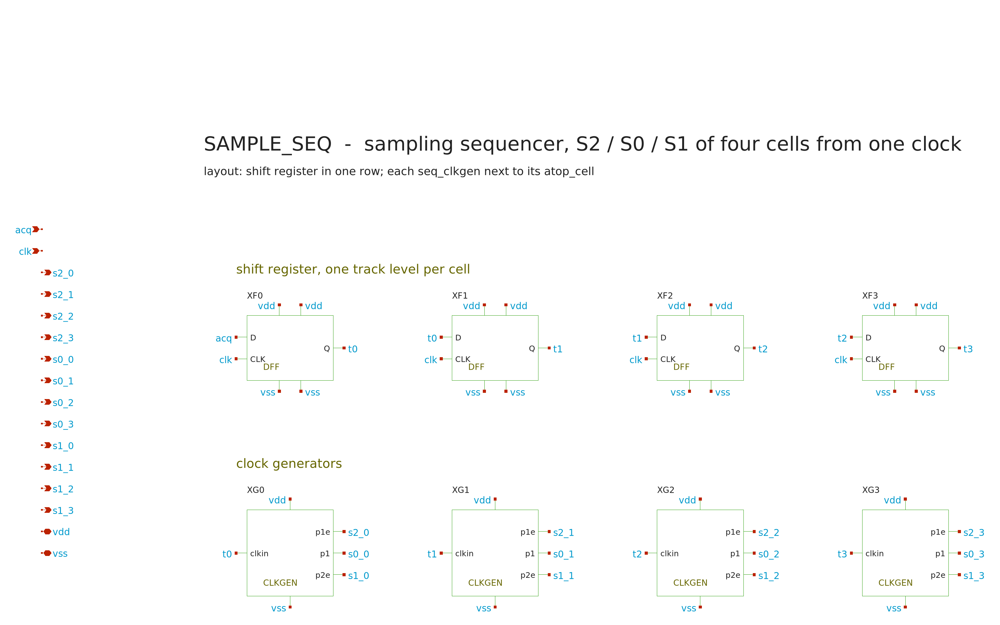
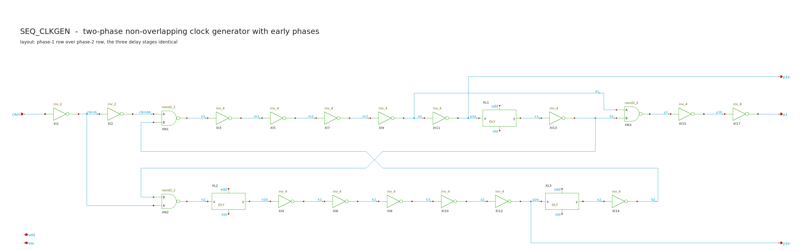

# sample_seq: the on-chip sampling sequencer

Date: 2026-11-15. ADR 0031 (gaps of a four-inverter delay, short `inv_2`
stages; supersedes the 5 ns of ADR 0027), ADR 0029 (structure; supersedes
ADR 0027's flop pipeline), ADR 0027 (requirements). Requirements `SPEC.md`
(Q1-Q8, Q2b). Target `./scripts/sim.sh
sample-seq` (phases `size schematic typ pvt duty wave check`; ~2 h at
`JOBS=16`). The 5 ns version (ADR 0029, 22 x `dlybuff_2` per stage) is in
`../sample_seq_bkp/sample_seq_v2/`, the ADR 0027 design in
`../sample_seq_bkp/sample_seq_v1/` (local). How the structure works and the
comparison to the EE628 source: `DESIGN.md` (written for the 5 ns stages;
the structure and the edge order are unchanged, the numbers are the v2
ones).

From the one 20 MHz clock (`clk`, the count clock) and the digital
controller's `acquire` level (`acq`), it makes the twelve switch controls of
the four bottom-plate cells: cell k's S2 (bottom plate to VREF) opens at the
k-th clock edge after `acq` falls, S0 (input gate) opens after it and S1
(ramp connection) closes after that. When `acq` returns high, S1 opens
first and S0 / S2 close after it. Every gap >= the generator's own
four-inverter delay (a few hundred ps) and no 10 / 90 overlap at every PVT
cell (the user's rule, 2026-11-15).

## Circuit (frozen standard cells `gf180mcu_as_sc_mcu7t3v3`, DVDD)

- **Shift register**: four `dfxtp_2` on `clk`, `acq` -> `t0` -> `t1` ->
  `t2` -> `t3`, one track level per cell, one period apart.
- **One clock generator per cell** (`seq_clkgen`, next to its `atop_cell`):
  B. Murmann's EE628 `template_clkgen.sch` gate for gate, driven by `t_k`.
  Mapping: early phase 1 `p1e` = S2, phase 1 `p1` = S0, early phase 2
  `p2e` = S1. The cross-coupled NAND pair lets one phase start only after
  the other phase's feedback (`b1` / `b2`) has moved.

- **Delay stages** (`seq_dly`, 4 x `inv_2`, identical): added in three
  paths of the template so each gap reaches a four-inverter delay with
  margin: before `xi13` (S2 -> S0),
  after `xn2` (S0 -> S1), before `xi14` (re-entry S1 open -> S0 closed). The
  template's late `p2` path drives nothing here and is not built.

Why not the template on the free-running clock: it re-arms every half
period, so both delays would have to fit in 25 ns and every cell would
sample every cycle. Driven by `t_k`, a generator moves only at its own
record edge, and the clock duty does not matter.

128 standard cells: 56 `inv_2` (48 of them in the delay stages), 52
`inv_4`, 12 `nand2_2`, 4 `inv_8`, 4 `dfxtp_2` (v2: 344, 264 of them
`dlybuff_2`). Area not recomputed.

## Sizing (`size` phase)

Each of the 45 PVT cells (5 corners x 0/27/85 C x 3.0/3.3/3.6 V) run at N = 2
and 6 inverters per stage; each gap fitted to a + b N; the smallest even N
with every gap >= 1.15 x that run's four-inverter delay (`n1` -> `a1`; 15 %
for layout skew and mismatch [A]). `inv_2` in a stage measures 0.029 ns
(ff/0/3.6) to 0.058 ns per inverter, the four-inverter delay 0.127-0.255 ns
over PVT [M]. Binding: S0 -> S1 at ff/0/3.6 (a 0.087 ns + 0.0290 ns per
inverter against 1.15 x 0.127 ns): **N = 4**.

## Record

`runs/sample-seq/20261115T105738Z/metrics.json`: 39 PASS, 0 FAIL (bench max
step 20 ps).

| Quantity | typical | 45 PVT cells | duty 30 / 70 % (typ, ff/0/3.6, ss/85/3.0) |
| --- | --- | --- | --- |
| Q2 S2 -> S0 open | 0.407 ns | 0.305 (ff/0/3.6) .. 0.604 ns (ss/85/3.0) | 0.305 .. 0.604 ns |
| Q2 S0 open -> S1 closed | 0.271 ns | 0.203 .. 0.399 ns | 0.203 .. 0.399 ns |
| Q2 re-entry S1 open -> S0 closed | 0.646 ns | 0.485 .. 0.958 ns | 0.485 .. 0.958 ns |
| four-inverter delay (`n1` -> `a1`) | 0.170 ns | 0.127 .. 0.255 ns | 0.127 .. 0.255 ns |
| Q2 min gap / four-inverter delay (>= 1.0) | 1.59 | >= 1.528 (sf/85/3.0) | >= 1.565 |
| Q2b 10 / 90 clearance S2 -> S0 / S0 -> S1 / re-entry (> 0) | 0.339 / 0.179 / 0.562 ns | >= 0.250 / 0.133 / 0.420 ns (ff/0/3.6) | same |
| Q3 S0 open after the clock edge (<= 15 ns) | 1.17 ns | <= 1.73 ns | <= 1.73 ns |
| Q3 S2 open -> S1 closed (<= 25 ns) | 0.68 ns | <= 1.00 ns | <= 1.00 ns |
| Q4 cell spacing error (<= 0.05 ns) | 0.009 ns | <= 0.012 ns | <= 0.012 ns |
| Q5 S2 opens after the clock edge (<= 2 ns) | 0.76 ns | 0.57-1.13 ns | 0.57-1.13 ns |
| Q1 / Q6 / Q7 order, tracking start, one edge each, generators static | pass | pass | pass |
| delay-stage output edges per record entry | 8 | 8 | 8 |
| Q8 DVDD tracking / holding | 27.5 / 23.1 uW | <= 40.4 / 34.1 uW | <= 31.1 / 34.0 uW |
| Q8 energy per entry / re-entry | 23.7 / 24.6 pJ | <= 31.4 / 32.5 pJ | <= 30.6 / 31.7 pJ |

The DVDD power while settled is the four flops' clock pins (ADR 0027's
gated line held 4.9 uW). The clock duty does not change any gap. The v2
record (5 ns stages) was `runs/sample-seq/20261106T183443Z` / `20261108T223753Z`.

Bench: the record starts at R0 = 600 ns. The shift register fills four
edges after the 100 ns supply ramp and the last generator settles by
~330 ns; the tracking window is R0 - 180 .. R0 - 70 ns.

## Not done

Mismatch Monte Carlo of the standard cells (with gaps of a few hundred ps
it matters more than at 5 ns; the 0.133 ns S0 -> S1 clearance at ff/0/3.6
is the number to watch), layout / route skew of the controls to the cells,
PEX, the substrate coupling of the flops' DVDD clock edges into the cells.
