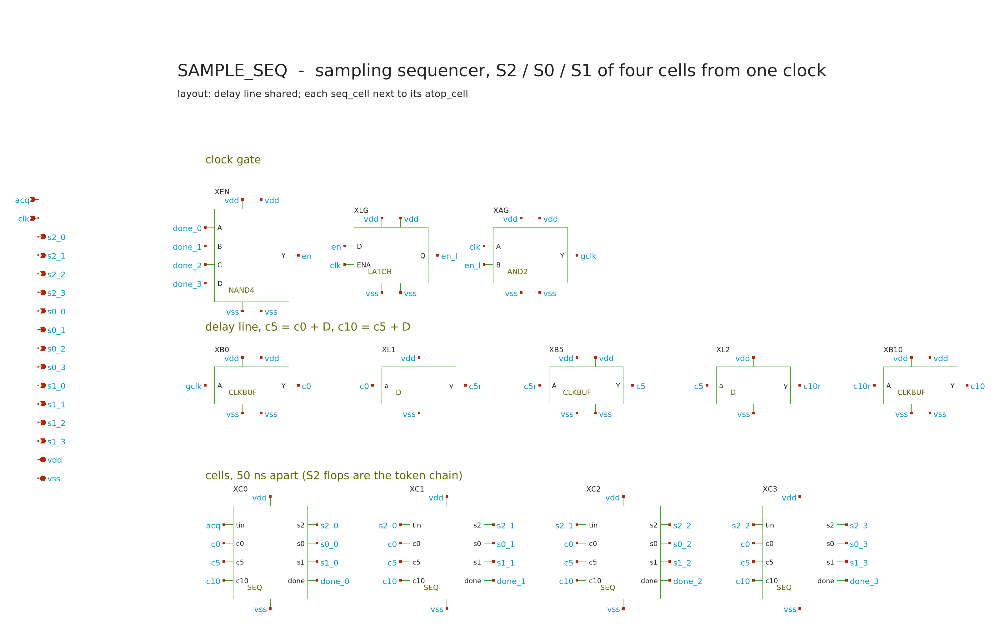

# sample_seq: the on-chip sampling sequencer

Date: 2026-11-01. ADR 0027. Requirements `SPEC.md` (Q1-Q8), working rules
`CLAUDE.md`. Target `./scripts/sim.sh sample-seq` (phases `size schematic
typ pvt duty check`; ~1.5 h at `JOBS=6`).

From the one 20 MHz clock (`clk`, the count clock) and the digital
controller's `acquire` level (`acq`), it makes the twelve switch controls of
the four bottom-plate cells: cell k's S2 (bottom plate to VREF) opens at the
k-th clock edge after `acq` falls, S0 (input gate) one stage delay D later,
S1 (ramp connection) closes D after that. When `acq` returns high, S1 opens
first and S0 / S2 close D later. D >= 5 ns at every PVT cell (the user's
rule).

## Circuit (frozen standard cells `gf180mcu_as_sc_mcu7t3v3`, DVDD)

- **Delay line**, shared: the gated clock buffered to c0, then
  `seq_dly` (22 x `dlybuff_2`) + `clkbuff_4` to c5, and again to c10.
- **Per cell** (`seq_cell`, next to its `atop_cell`): three rising-edge flops
  in a pipeline, `s2 <- tin @ c0`, `s0 <- s2 @ c5`, `qc <- s0 @ c10`,
  `s1 = NOR(qc, s2)`. Each phase samples the previous phase's state, so a
  phase moves only after the one before it has moved. That is the lock-out
  of the cross-coupled NAND non-overlap generator (EE628
  `template_clkgen.sch`) without its re-arming on the clock's falling edge.
  The S2 flops are the token chain (`tin` of cell k+1 = `s2` of cell k).
- **Clock gate**: `done_k` = the cell's three flops agree with its input
  (3 x `xor2_2` + `nor3_2`); `en = NAND4(done)` latched while clk is low
  (`dlxtn_2`) and ANDed with clk. The line runs only while a cell has
  something to move, and the same logic makes the sequencer
  self-initialising.

82 standard cells: 44 `dlybuff_2`, 12 `dfxtp_2`, 12 `xor2_2`, 4 `nor3_2`,
4 `nor2_2`, 3 `clkbuff_4`, `nand4_2`, `dlxtn_2`, `and2_2`. Cell area from the
LEF ~2.45k um2 [D] (44 x 24.1 + 12 x 59.3 + 12 x 30.7 + 4 x 24.1 + 4 x 15.4 +
3 x 19.8 + 30.7 + 41.7 + 15.4), before routing; the delay line is 43 % of it.

## Sizing (`size` phase)

Each of the 45 PVT cells (5 corners x 0/27/85 C x 3.0/3.3/3.6 V) run at N = 8
and 24 delay cells per stage; each gap fitted to a + b N; the smallest N with
every gap >= 5.25 ns (5 ns [U] + 0.25 ns for layout skew [A]).
`dlybuff_2` measures 0.244 ns (ff/0/3.6) to 0.485 ns (ss/85/3.0) per cell
[M]. Binding: S2 -> S0 at ff/0/3.6 (a 0.092 ns + 0.2441 ns/cell): **N = 22**.

## Record

`runs/sample-seq/20261031T231843Z/metrics.json`: 40 PASS, 0 FAIL. Sheet
text moved off the instances afterwards (text only, `sample_seq.spice` sha256
unchanged): `PHASES='schematic check'` `runs/sample-seq/20261101T024118Z`,
39 PASS (every line of the full record except the size REPORT).

| Quantity | typical | 45 PVT cells | duty 30 / 70 % (typ, ff/0/3.6, ss/85/3.0) |
| --- | --- | --- | --- |
| Q2 S2 -> S0 open (>= 5 ns) | 7.31 ns | 5.46 (ff/0/3.6) .. 10.89 ns (ss/85/3.0) | 5.46 .. 10.89 ns |
| Q2 S0 open -> S1 closed (>= 5 ns) | 7.44 ns | 5.56 .. 11.08 ns | 5.56 .. 11.08 ns |
| Q2 re-entry S1 open -> S0 closed (>= 5 ns) | 7.18 ns | >= 5.37 ns | >= 5.37 ns |
| Q3 S0 open after the clock edge (<= 15 ns) | 8.02 ns | <= 11.91 ns | <= 11.91 ns |
| Q3 S2 open -> S1 closed (<= 25 ns) | 14.77 ns | <= 21.96 ns | <= 21.96 ns |
| Q4 cell spacing error (<= 0.05 ns) | 0.015 ns | <= 0.021 ns | <= 0.021 ns |
| Q5 S2 opens after the clock edge (<= 2 ns) | 0.69-0.70 ns | 0.53-1.02 ns | 0.53-1.02 ns |
| Q1 / Q6 / Q7 order, tracking start, one edge each, line gated | pass | pass | pass |
| gated clock edges per record entry | 4 | 4 | 4 |
| Q8 DVDD holding (the gate's own clock pins) | 4.9 uW | <= 7.8 uW | <= 7.5 uW |
| Q8 energy per entry / re-entry | 92 / 93 pJ | <= 123 / 124 pJ | |

The clock duty does not change any gap (the pipeline depends only on rising
edges).

**Open, reported:** the bench's "tracking" window (220-330 ns, after the
timeline was shortened) reads 99 uW at typical against 4.9 uW holding, and
4.9 uW in the earlier long-timeline bench (400-900 ns, not recorded). No
gated-clock edge falls in that window (Q7 passes), so the reading is most
likely power-up settling inside the cells; the window is to be moved later
and the number re-measured before it is quoted.

Free-running (no clock gate), the delay line drew 351 uW of DVDD at
typical (smoke run, not recorded); that is why the gate exists.

## Not done

Mismatch Monte Carlo of the standard cells, layout / route skew, PEX, the
substrate coupling of the record-edge DVDD activity into the cells.
